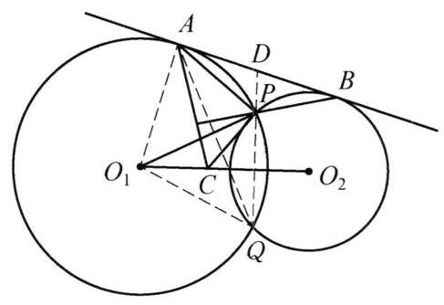

::: {.problem-meta-bar}
第 2 讲 相似三角形
竞赛难度
相似三角形 中点 相似
:::

## 题目

已知圆 ${O}_1$ 和圆 ${O}_2$ 交于 $P, Q$ 两点,两圆的外公切线分别切圆 ${O}_1$ 和圆 ${O}_2$ 于点 $A, B$ . 点 $A, B$ 与 $Q$ 在点 $P$ 两侧. 过点 $A$ 作 ${AC} \perp  {BP}$ 交 ${O}_1{O}_2$ 于点 $C$ . 证明: $\angle {APC} = {90}^{ \circ  }$ .

图 2-1

## 参考解答

::: {.callout-important title="标准解答" collapse="false"}
如图 2-1,连接 ${QP}$ 并延长交 ${AB}$ 于点 $D$ ,连接 ${O}_{1}Q,{AQ}$ ,则 $D{A}^2 = {DP} \cdot  {DQ} = \; D{B}^2$ ,即 $D$ 为线段 ${AB}$ 的中点.

连接 ${O}_{1}A$ ,则由 ${O}_{1}C \perp  {DP},{O}_{1}A \perp  {DB}$ , ${AC} \perp  {BP}$ ,知 $\triangle {DBP} \backsim  \triangle {O}_1{AC}$ ,故 $\frac{DP}{DB} = \frac{{O}_{1}C}{{O}_{1}A}$ . 所以

$$
\frac{{O}_{1}C}{{O}_{1}P} = \frac{{O}_{1}C}{{O}_{1}A} = \frac{DP}{DB} = \frac{DP}{DA} = \frac{AP}{AQ},
$$

结合 $\angle {PAQ} = \frac{1}{2}\angle P{O}_{1}Q = \angle P{O}_{1}C$ ,知 $\triangle P{O}_{1}C \backsim  \triangle {QAP}$ ,所以 $\angle {O}_1{PC} = \; \angle {AQP}$ ,故

$$
\angle {APC} = \angle {AP}{O}_1 + \angle {O}_1{PC} = \angle {O}_1{AP} + \angle {AQP}
$$

$$
= \angle {O}_1{AP} + \angle {PAD} = \angle {O}_1{AD} = {90}^{ \circ  }.
$$

所以，原问题得证.

注:利用相似联系线段长度和角度，是几何证明的常见手法.
:::

## 解题思路与分析

::: {.callout-note title="思路还原与分析" collapse="false"}
这段证明之所以让人觉得“费解”、像变魔术一样，是因为教材采用了**正向综合法**来书写：它直接把 $\triangle DBP \sim \triangle O_1AC$ 和 $\triangle PO_1C \sim \triangle QAP$ 两个看似毫无征兆的相似三角形抛了出来。

实际上，解题者在探索这道题时，并不是从头一路顺推到底的，而是采用了**“两头凑（双向奔赴）”**的策略——**从条件往前推一步，从结论往回退两步，最后在中间通过“切割线相似”实现合龙**。

下面我们把这个思维过程完整还原出来：

---

### 第一步：从条件顺推——如何把点 $C$ 的位置“算”出来？

题目中绝大多数条件都是固定的（两圆相交、外公切线），只有一个动点构造条件：**过 $A$ 作 $AC \perp BP$ 交 $O_1O_2$ 于点 $C$**。解题的第一直觉是：**必须把点 $C$ 在 $O_1O_2$ 上的位置用线段比例刻画出来。**

1. **条件反射作根轴**：在“两圆相交＋外公切线”的经典构图中，延长公共弦 $QP$（根轴）交公切线 $AB$ 于点 $D$，由切割线定理得 $DA^2 = DP \cdot DQ = DB^2$，即 $D$ 平分 $AB$，这是处理该构图的标准起手式。
2. **识别“三边分别垂直”模型（关键动机）**：点 $C$ 是直线 $O_1O_2$ 与 $AC$ 的交点，要确定 $O_1C$ 的长度，自然聚焦于含 $O_1C$ 的直角或斜三角形 $\triangle O_1AC$。观察构成 $\triangle O_1AC$ 的三条直线，你会发现它们各自都带有一个垂直条件：
* 连心线垂直平分公共弦：$O_1C \perp DP$；
* 半径垂直于切线：$O_1A \perp DB$；
* 题设给定的构造条件：$AC \perp BP$。

**平面几何的核心直觉之一：如果一个三角形的三条边分别垂直于另一个三角形的三条边，那么这两个三角形必然相似（本质上是将其中一个旋转 $90^\circ$ 后再放缩）。**
把 $DP, DB, BP$ 拼在一起，恰好就是 $\triangle DBP$！因此 $\triangle DBP \sim \triangle O_1AC$ 并不是凭空猜出来的，而是将“三个垂直”打包转化的必然结果。
3. **化简比例定位点 $C$**：由 $\triangle DBP \sim \triangle O_1AC$ 得到 $\frac{O_1C}{O_1A} = \frac{DP}{DB}$。利用中点性质 $DB = DA$ 以及同圆半径相等 $O_1A = O_1P$，点 $C$ 的位置被彻底锁定为一条极简比例式：
$$\frac{O_1C}{O_1P} = \frac{DP}{DA}$$

推到这里，正向推导就卡住了：我们手握 $\frac{O_1C}{O_1P} = \frac{DP}{DA}$，但不知道该怎么跟 $\angle APC = 90^\circ$ 扯上关系。这时就必须切换到**逆向分析（执果索因）**。

---

### 第二步：从结论倒推——怎样才能证出 $\angle APC = 90^\circ$？

现在我们从目标 $\angle APC = 90^\circ$ 往回退，看看它等价于什么：

1. **利用半径对称性拆角**：
注意 $A$ 和 $P$ 都在 $\odot O_1$ 上，且在点 $A$ 处本来就有现成的直角 $\angle O_1AD = 90^\circ$！
既然 $O_1A = O_1P$，就有等腰底角相等 $\angle O_1PA = \angle O_1AP$。用半径 $O_1P$ 把待证的 $\angle APC$ 劈成两半：
* 已知点 $A$ 处：$\angle O_1AP + \angle PAD = \angle O_1AD = 90^\circ$；
* 待证点 $P$ 处：$\angle O_1PA + \angle O_1PC = \angle APC = 90^\circ$。

消去相等的底角 $\angle O_1PA = \angle O_1AP$，**待证结论 $\angle APC = 90^\circ$ 瞬间等价于一个纯粹的导角目标**：
$$\angle O_1PC = \angle PAD$$

2. **用“SAS相似”反推目标三角形**：
我们要证 $\angle O_1PC = \angle PAD$，而点 $C$ 是通过比例关系 $\frac{O_1C}{O_1P} = \dots$ 定位在射线 $O_1O_2$ 上的。在纯几何中，**唯一能把“线段比例（$\frac{O_1C}{O_1P}$）”转化为“角度相等（$\angle O_1PC$）”的工具，就是证明包含它们的 $\triangle PO_1C$ 与某个已知三角形 SAS 相似！**

那么，$\triangle PO_1C$ 应该和谁相似？我们盘点一下 $\triangle PO_1C$ 里已经固定的元素：
* 已知夹角：$\angle PO_1C = \frac{1}{2}\angle PO_1Q$（垂径定理），而圆心角的一半等于圆周角 $\angle PAQ$；
* 待证目标角：$\angle O_1PC = \angle PAD$，由弦切角定理，恰好又有 $\angle PAD = \angle AQP$！

看！已知角 $\angle PAQ$ 和目标角 $\angle AQP$ 刚好都在同一个三角形 **$\triangle QAP$** 中！
这意味着：**要想证 $\angle O_1PC = \angle AQP$，只需证 $\triangle PO_1C \sim \triangle QAP$；而由于夹角 $\angle PO_1C = \angle PAQ$ 已经相等，只需凑出夹边成比例（SAS）**：
$$\frac{O_1C}{O_1P} = \frac{AP}{AQ}$$

---

### 第三步：中间合龙——为什么非要绕道点 $Q$？

现在把第一步（顺推）的终点和第二步（倒推）的起点摆在一起：
* **顺推给我们的筹码**：$\frac{O_1C}{O_1P} = \frac{DP}{DA}$
* **倒推需要的条件**：$\frac{O_1C}{O_1P} = \frac{AP}{AQ}$

中间只差一步 $\frac{DP}{DA} = \frac{AP}{AQ}$！而在切割线基本构图中，$\triangle DAP \sim \triangle DQA$（公共角 $\angle D$，弦切角 $\angle PAD = \angle AQP$）是现成的，天然就有 $\frac{DP}{DA} = \frac{AP}{AQ}$。至此，整条思维链完美闭环：

$$\text{三边垂直} \implies \triangle DBP \sim \triangle O_1AC \implies \frac{O_1C}{O_1P} = \frac{DP}{DA} \xlongequal{\triangle DAP \sim \triangle DQA} \frac{AP}{AQ} \xlongequal{\angle PO_1C = \angle PAQ} \triangle PO_1C \sim \triangle QAP \implies \angle APC = 90^\circ$$

---

### 更深一层的几何本质：$\triangle QAP$ 其实是“几何版正弦定理”

你可能会追问一个更本质的问题：**既然顺推已经得到了 $\frac{O_1C}{O_1P} = \frac{DP}{DA}$，为什么不能直接让 $\triangle PO_1C$ 和 $\triangle DAP$ 相似，非要绕道点 $Q$ 构造 $\triangle QAP$ 呢？**

* 如果你对比 $\triangle PO_1C$ 和 $\triangle DAP$，虽然它们有两组边成比例 $\frac{O_1C}{O_1P} = \frac{DP}{DA}$，但它们的**夹角不相等**（$\angle PO_1C \neq \angle ADP$），无法直接相似。
* 如果用**三角法（正弦定理）**，在 $\triangle DAP$ 中直接有 $\frac{DP}{DA} = \frac{\sin\angle PAD}{\sin\angle DPA}$，代入 $\triangle PO_1C$ 就能直接算出角度，根本不需要点 $Q$。
* 但在**纯几何（综合法）**中，我们不能直接写正弦定理。怎样在不用三角函数的情况下，把圆外 $\triangle DAP$ 的边长比 $\frac{DP}{DA}$ 转化成角度信息？答案就是利用子母相似 $\triangle DAP \sim \triangle DQA$，把圆外割线与切线之比 $\frac{DP}{DA}$，“投影”成 $\odot O_1$ 内部的两条弦之比 $\frac{AP}{AQ}$，从而借用圆周角 $\angle PAQ$ 完成角度匹配。

也就是说，证明中神秘出现的 $\triangle QAP$，本质上是在纯几何语言下充当了**正弦定理的“转换器”**。

如果从三角计算（正弦定理）或者解析/射影的角度切入，这道题其实可以完全避开辅助线 $AQ$ 和二次相似，需要我为你展示一下这种更直接的“无巧思”解法吗？
:::

## 分步证明

::: {.callout-tip title="分步推理与几何步骤" collapse="false"}
### 步骤 0：✦ 题目构型与已知条件

已知圆 O1 与圆 O2 相交于 P, Q 两点。

直线 AB 为两圆的外公切线，切点分别为 A, B。

点 P 位于切线 AB 与点 Q 之间。

过切点 A 作 AC ⊥ BP，垂足为 H，交连心线 O1O2 于点 C。

求证：∠APC = 90°。

### 步骤 1：① 延长公共弦交公切线于 D ⇒ DA = DB

如图，延长公共弦 QP 交外公切线 AB 于点 D。

根据圆的切割线定理（圆幂定理）：

对圆 O1，DA 为切线，割线为 DPQ，故有：

DA2 = DP · DQ

对圆 O2，DB 为切线，割线同样为 DPQ，故有：

DB2 = DP · DQ

由此得出 DA2 = DB2，即 DA = DB。

核心结论：点 D 是外公切线段 AB 的中点。

### 步骤 2：② 三组边对应垂直 ⇒ △DBP ∽ △O₁AC

连接半径 O1A。考察 △DBP 与 △O1AC 的三组边：

1. O₁C ⊥ DP：连心线垂直平分公共弦 PQ；

2. O₁A ⊥ DB：切点半径垂直于公切线 AB；

3. AC ⊥ BP：题目已知垂线条件。

两三角形的三组对应边互相垂直，且定向一致，因此对应角相等：

△DBP ∽ △O₁AC

由相似三角形对应边成比例，得出重要关系：

DP / DB = O₁C / O₁A

### 步骤 3：③ 比例代换与弦切角 ⇒ △PO₁C ∽ △QAP

连接 O1P 与 AQ。

因为 DB = DA（Step 1）且 O₁A = O₁P（同为圆 O1 的半径），代换前式得：

O₁C / O₁P = DP / DA

由弦切角定理可知 ∠DAP = ∠DQA，结合公共角 ∠D 得 △DAP ∽ △DQA，故：

DP / DA = AP / AQ

从而得到比例：O₁C / O₁P = AP / AQ，即 O₁C / AP = O₁P / AQ。

又因连心线平分圆心角，由圆周角定理：

∠PO₁C = ½ ∠PO₁Q = ∠PAQ

两边成比例且夹角相等，判定：

△PO₁C ∽ △QAP

### 步骤 4：④ 相似对应角相等与弦切角转换

由相似三角形 △PO₁C ∽ △QAP，对应角相等：

∠O₁PC = ∠AQP

在圆 O1 中，切线 AD 与弦 AP 构成弦切角。

由弦切角定理：弦切角等于其所夹弧对的圆周角，即：

∠PAD = ∠AQP

通过等量代换，立即建立起内外交角关联：
∠O₁PC = ∠PAD

### 步骤 5：⑤ 角度拆分推导 ⇒ ∠APC = 90°

在等腰 △O₁AP 中，两半径 O₁A = O₁P，故底角相等：

∠APO₁ = ∠O₁AP

现在将目标角 ∠APC 沿射线 PO₁ 拆分为两部分：

∠APC = ∠APO₁ + ∠O₁PC

代入前面推得的等角关系：

∠APC = ∠O₁AP + ∠PAD = ∠O₁AD

又因为 AD 是切线，O₁A 为切点半径，切线垂直于半径：

∠O₁AD = 90°

最终推得：
∠APC = 90°
原命题得证！
:::

## 动态演示

::: {.demo-link-container}
[在新窗口打开交互式分步演示](../demos/02.html){.demo-link target="_blank" rel="noopener"}
:::

  <iframe src="../demos/02.html" title="例 2：两圆外公切线与割线共圆及垂直证明 分步演示" loading="lazy"></iframe>

