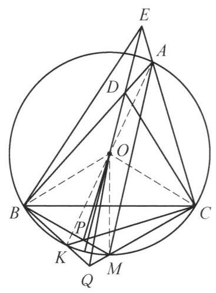

::: {.problem-meta-bar}
第 2 讲 相似三角形
竞赛难度
相似三角形 中点
:::

## 题目

锐角 $\triangle  {ABC}$ 中， ${AB} > {AC}$ ， $M$ 为其外接圆 $O$ 上劣弧 ${BC}$ 的中点， $K$ 为 $A$ 的对径点. 过 $O$ 作 ${AM}$ 的平行线交 ${AB}$ 于 $D$ ，交 ${CA}$ 的延长线于 $E$ . 直线 ${BM}$ 交直线 ${CK}$ 于 $P$ ，直线 ${CM}$ 交直线 ${BK}$ 于 $Q$ . 证明: $\angle {OPB} + \angle {OEB} = \angle {OQC} + \; \angle {ODC}$ .

图 2-2

## 参考解答

::: {.callout-important title="标准解答" collapse="false"}
如图 2-2，连接 ${AK},{BO},{CO},{OM}.$ 由 ${OD}//{AM}$ ，知 $\angle {BDO} = \angle {BAM} = \angle {BCM} = \angle {CBP}$ . 注意到 $\angle {DBO} = {90}^{ \circ  } - \angle {ACB} = \angle {BCP}$ ,故 $\triangle {BOD} \backsim \; \triangle {CPB}$ ,于是有 $\frac{BD}{CB} = \frac{BO}{CP} = \frac{CO}{CP}$ ,故 $\frac{BD}{CO} = \frac{BC}{CP}$ ,而 $\angle {DBC} = \angle {AKC} = \angle {OCP}$ ,所以 $\triangle {DBC} \backsim  \triangle {OCP}$ . 同理,有 $\triangle {ECB} \backsim  \triangle {OBQ}$ .

所以

$$
\angle {OPB} - \angle {OQC} = \angle {OMB} + \angle {POM} - \angle {OMC} + \angle {QOM}
$$

$$
= \angle {POM} + \angle {QOM}
$$

$$
= \angle {POM} + \angle {COM} - \angle {BOM} + \angle {QOM}
$$

$$
= \angle {COP} - \angle {BOQ}
$$

$$
= \angle {BDC} - \angle {CEB}
$$

$$
= \angle {BAC} + \angle {ACD} - \angle {CAB} + \angle {ABE}
$$

$$
= \angle {ACD} + \angle {ABE}
$$

$$
= \angle {ACD} + \angle {AED} - \angle {ADE} + \angle {ABE}
$$

$$
= \angle {ODC} - \angle {OEB}\text{ . }
$$

即 $\angle {OPB} + \angle {OEB} = \angle {OQC} + \angle {ODC}$ .

注:通过比例关系导出 $\triangle  {DBC} \backsim   \triangle  {OCP}$ 及 $\triangle  {ECB} \backsim   \triangle  {OBQ}$ 是本题的关键.
:::

## 解题思路与分析

::: {.callout-note title="思路还原与分析" collapse="false"}
这份证明之所以让人觉得“费解”甚至“像变魔术”，主要有以下两个原因：
1. **前半部分的跳跃**：拿到题目后，为什么要去证 $\triangle DBC \sim \triangle OCP$？通过半径 $BO = CO$ 把 $\triangle BOD \sim \triangle CPB$ 的比例进行“重组”是怎么想到的？
2. **后半部分“无中生有”的代数变形**：在角度计算中，解答凭空加减了许多值为 $0$ 的项（如 $\angle OMB - \angle OMC$、$\angle COM - \angle BOM$、$\angle AED - \angle ADE$），让人看不出背后的几何动机。

实际上，如果剥开解答为了“写成紧凑的一行连等式”而特意包装的外壳，还原出探索这道题的**真实逆向思维过程**，你会发现每一步都有极其自然的几何动因。

---

### 一、 破题立意：利用“对称共轭性”重组结论

审题时首先观察图形的对称结构（即 $B$ 与 $C$ 互换时的对应关系）：
* $M$ 是弧 $BC$ 中点，$K$ 是 $A$ 的对径点，这两点关于 $B, C$ 是对称的。
* 当 $B \leftrightarrow C$ 互换时，点 $D(AB \cap OE)$ 与点 $E(AC \cap OD)$ 互换，点 $P(BM \cap CK)$ 与点 $Q(CM \cap BK)$ 互换。

待证结论为 $\angle OPB + \angle OEB = \angle OQC + \angle ODC$。面对这种高度对称的几何恒等式，最自然的想法是将**地位对等的角放在一起比较**：
$$\angle OPB - \angle OQC = \angle ODC - \angle OEB$$
移项后，等式左边 $\angle OPB - \angle OQC$ 完全属于圆下方的 $\{P, Q\}$ 系统，等式右边 $\angle ODC - \angle OEB$ 完全属于三角形上方的 $\{D, E\}$ 系统。**整道题的核心任务，就变成了寻找连接“上方 $\{D, E\}$”与“下方 $\{P, Q\}$”的桥梁。**

---

### 二、 核心桥梁：$\triangle DBC \sim \triangle OCP$ 是怎么想出来的？

这并非凭空猜测，而是“顺向导角”与“逆向目标分析”碰撞的结果：

1. **第一步：顺向翻译条件，自然撞见第一组相似**
题目给出了两个极其明显的角度条件：“$OD \parallel AM$（角平分线）”和“$K$ 为对径点”。只要把它们翻译成角度：
* 由 $OD \parallel AM$ 及弧 $BC$ 中点 $M$，立刻得到 $\angle BDO = \angle BAM = \angle CBM = \angle CBP$。
* 由外心 $O$ 和直径 $AK$，立刻得到 $\angle DBO = 90^\circ - \angle ACB = \angle BCP$。

不需要任何技巧，顺手导角就会自动推导出 **$\triangle BOD \sim \triangle CPB$**。

2. **第二步：发现缺口，利用“半径相等”重组相似（关键定式）**
虽然拿到了 $\triangle BOD \sim \triangle CPB$，但观察我们的目标角 $\angle ODC$ 和 $\angle OPB$：
* $\angle ODC$ 是由线段 **$CD$** 构成的，而 $CD$ 不在 $\triangle BOD$ 中（它是 $\triangle DBC$ 的第三边）；
* $\angle OPB$ 是由线段 **$OP$** 构成的，而 $OP$ 也不在 $\triangle CPB$ 中（它是 $\triangle OCP$ 的第三边）。

**“已知相似的三角形里没有我想要的线段 $CD$ 和 $OP$，我需要把相似转移到包含 $CD$ 和 $OP$ 的 $\triangle DBC$ 和 $\triangle OCP$ 上去！”**

在平面几何中，将一组相似转化为另一组相似的经典手法就是**利用等线段替换比例项**。注意到 $\triangle DBC$ 的两边是 $BD, BC$，而 $\triangle OCP$ 的两边是 $CO, CP$。利用外接圆半径相等（**$BO = CO$**）作为跳板：
$$\triangle BOD \sim \triangle CPB \implies \frac{BD}{CB} = \frac{BO}{CP} \xrightarrow{BO = CO} \frac{BD}{CO} = \frac{BC}{CP}$$
两边比例就位后，只需验证夹角 $\angle DBC$ 与 $\angle OCP$ 是否相等。由于 $\triangle OCK$ 是等腰三角形（$OC=OK$），$\angle OCP = \angle OKC = \angle AKC = \angle DBC$，于是 **$\triangle DBC \sim \triangle OCP$**（以及对称的 **$\triangle ECB \sim \triangle OBQ$**）便水到渠成。

---

### 三、 拆解魔术：后半段的“长串角度加减”到底在算什么？

这是原证明最让人困惑的地方。既然已经证出了 $\triangle OCP \sim \triangle DBC$ 和 $\triangle OBQ \sim \triangle ECB$，为什么不能直接得出结论？

因为相似直接给我们的对应角是 **$\angle COP = \angle BDC$** 和 **$\angle BOQ = \angle CEB$**，而不是题目要求的 $\angle OPB, \angle OQC$ 和 $\angle ODC, \angle OEB$！
* 在 $\triangle OCP$ 中，内角是 $\angle OPC$（$OP$ 与 $CK$ 的夹角），但题目要的是 **$\angle OPB$（$OP$ 与 $BM$ 的夹角）**。
* 在 $\triangle DBC$ 中，内角是 $\angle BDC$（$CD$ 与 $AB$ 的夹角），但题目要的是 **$\angle ODC$（$CD$ 与 $DE$ 的夹角）**。

**原解答那串令人眼花缭乱的等式，本质上只是在做一件事：计算“目标角”与“相似对应角”之间的偏差（Offset），并利用对称性证明左右两边的偏差恰好抵消！**

我们把这串代数变形还原为直观的几何图像，你就能瞬间看懂：

#### 1. 下半部分：利用对称轴 $OM$ 消去偏差（对应原解答第 1～4 行）
我们要把 $\angle OPB - \angle OQC$ 转化为已知的 $\angle COP - \angle BOQ$。
注意到 $M$ 是弧 $BC$ 中点，所以 **$OM$ 是整个圆下方的对称轴**，等腰 $\triangle OBM \cong \triangle OCM$，这给我们提供了两个天然相等的常量：
$$\angle OMB = \angle OMC, \qquad \angle BOM = \angle COM$$

现在，以对称轴 $OM$ 为基准，用外角定理把点 $P, Q$ 处的角转化到圆心 $O$ 处：
* **看点 $P$（$\triangle OPM$ 的外角）**：
  $$\angle OPB = \angle OMB + \angle POM$$
  而我们需要的相似角是 $\angle COP = \angle COM + \angle POM$。两式都有 $\angle POM$！说明 $\angle OPB$ 与 $\angle COP$ 之间只差了一个固定常量 $(\angle OMB - \angle COM)$。
* **看点 $Q$（$\triangle OQM$ 的外角）**：
  $$\angle OQC = \angle OMC - \angle QOM$$
  而我们需要的相似角是 $\angle BOQ = \angle BOM - \angle QOM$。两式都有 $-\angle QOM$！说明 $\angle OQC$ 与 $\angle BOQ$ 之间也只差了一个固定常量 $(\angle OMC - \angle BOM)$。

由于对称性，这两个固定常量完全相等！因此两式相减时，$\angle POM$ 和 $\angle QOM$ 组合起来，刚好把常量偏差抵消掉：
$$\angle OPB - \angle OQC = \angle COP - \angle BOQ$$
> **真相大白**：原解答的前四行并不是凭空凑出了 $-\angle OMC$ 和 $+\angle COM - \angle BOM$，而是先用外角定理把 $\angle OPB, \angle OQC$ 拆成以 $OM$ 为基准的 $\angle POM + \angle QOM$，然后再把基准线从 $OM$ 换回 $OC$ 和 $OB$（即代入 $\angle POM = \angle COP - \angle COM$ 和 $\angle QOM = \angle BOM - \angle BOQ$）。

---

#### 2. 上半部分：利用等腰 $\triangle ADE$ 消去偏差（对应原解答第 5～9 行）
接下来，通过相似代换，式子变成了 $\angle BDC - \angle CEB$，我们需要把它变成目标 $\angle ODC - \angle OEB$。

**其实这里根本不需要像原解答那样绕一大圈！** 
因为 $DE \parallel AM$（$\angle BAC$ 的平分线），所以 $\triangle ADE$ 是一个等腰三角形，天然具有相等的底角：
$$\angle ADE = \angle AED$$

直接观察图 2-2 中顶点 $D$ 和顶点 $E$ 处的角分拆：
* **在顶点 $D$ 处**：射线 $DO$ 在 $\angle BDC$ 内部，且 $\angle BDO = \angle ADE$（对顶角），因此直接有：
  $$\angle BDC = \angle ODC + \angle BDO = \angle ODC + \angle ADE$$
* **在顶点 $E$ 处**：射线 $EO$（即 $ED$）在 $\angle CEB$ 内部，因此直接有：
  $$\angle CEB = \angle OEB + \angle AED$$

因为 $\angle ADE = \angle AED$，将上面两式直接相减，**一步就能得出**：
$$\angle BDC - \angle CEB = (\angle ODC + \angle ADE) - (\angle OEB + \angle AED) = \angle ODC - \angle OEB$$

> **为什么原解答写得那么复杂？**
> 原解答的作者没有直接在顶点 $D, E$ 处做角的加减，而是先对 $\triangle ADC$ 和 $\triangle ABE$ 使用外角定理（将 $\angle BDC, \angle CEB$ 展开为 $\angle BAC + \angle ACD$ 等消去 $\angle BAC$），然后再对 $\triangle EDC$ 和 $\triangle EBD$ 逆用外角定理凑回 $\angle ODC$ 和 $\angle OEB$。这种写法虽然避开了说明“射线 $DO$ 在 $\angle BDC$ 内部”的位置关系，但在视觉上造成了极大的阅读障碍。

---

### 总结：这道题的思维路线图

如果把整道题的思考过程画成一张路线图，它其实非常清晰：

$$\begin{array}{ccccc}
\text{目标：}\angle OPB - \angle OQC & \xleftarrow[\text{外角定理 + 对称性}]{\text{关于对称轴 } OM \text{ 换基准}} & \angle COP - \angle BOQ \\
& & \parallel \text{（核心相似桥梁）} \\
\text{目标：}\angle ODC - \angle OEB & \xleftarrow[\angle ADE = \angle AED]{\text{等腰 }\triangle ADE\text{ 抵消偏差}} & \angle BDC - \angle CEB
\end{array}$$

当你以后再遇到类似“一长串莫名其妙的加零减零”的几何角度证明时，不妨先找出图形中的**对称轴或等腰三角形**——那些看似突兀的代数项，往往只是为了把角度转换到对称基准线上而引入的“脚手架”。
:::

## 分步证明

::: {.callout-tip title="分步推理与几何步骤" collapse="false"}
### 步骤 0：0️⃣ 题设构型与基准图形

在锐角 $\triangle ABC$ 中，$AB > AC$，$O$ 为外接圆心。
$M$ 为劣弧 $BC$ 的中点（$BM = CM$），$K$ 为点 $A$ 的对径点（$AK$ 为外接圆直径）。
过 $O$ 作 $AM$ 的平行线，交边 $AB$ 于点 $D$，交射线 $CA$ 的延长线于点 $E$。
直线 $BM$ 与直线 $CK$ 相交于点 $P$；直线 $CM$ 与直线 $BK$ 相交于点 $Q$。
求证目标： $\angle OPB + \angle OEB = \angle OQC + \angle ODC$

### 步骤 1：① 平行线导角：∠BDO=∠CBP 与 ∠DBO=∠BCP

连接辅助线段 $BO, CO, OM$ 及直径 $AK$：
1. 第一组等角 由 $OD \parallel AM$ 得同位角 $\angle BDO = \angle BAM$。由同弧所对圆周角相等知 $\angle BAM = \angle BCM$；又 $M$ 为劣弧 $BC$ 中点，对应圆周角 $\angle BCM = \angle CBM = \angle CBP$。故：
$\angle BDO = \angle BAM = \angle BCM = \angle CBP$
2. 第二组等角 由于 $AK$ 是直径，有 $\angle ACK = 90^\circ$。在直角 $\triangle ACK$ 中，$\angle BCK = 90^\circ - \angle ACB$。
在等腰 $\triangle AOB$ 中，底角 $\angle ABO = 90^\circ - \angle ACB$。
因为 $B,D,A$ 共线且 $C,P,K$ 共线，故导出：
$\angle DBO = 90^\circ - \angle ACB = \angle BCP$

### 步骤 2：② 关键相似：△BOD ∽ △CPB 与 △DBC ∽ △OCP

由第 ① 步的两组对应等角，立即得到第一对相似三角形：
$\triangle BOD \sim \triangle CPB$
根据对应边成比例：
$$\frac{BD}{CP} = \frac{BO}{CB} \implies \frac{BD}{BO} = \frac{CB}{CP}$$
注意到 $BO = CO$（外接圆半径），代换得：
$$\frac{BD}{CO} = \frac{BC}{CP} \iff \frac{BD}{BC} = \frac{CO}{CP}$$
又对应夹角 $\angle DBC = \angle B$；由于直径 $AK$ 使得 $\angle AKC = \angle B$，直角 $\triangle ACK$ 给出 $\angle OCP = 90^\circ - \angle ACB = \angle B$。
因此两边成比例且夹角相等 $\angle DBC = \angle OCP$，导出第二对相似三角形：
$\triangle DBC \sim \triangle OCP \implies \angle COP = \angle BDC$

### 步骤 3：③ 对称侧相似：△ECB ∽ △OBQ

完全平行地，考察直线 $OE \parallel AM$ 与点 $Q$（直线 $CM$ 与 $BK$ 的交点）：
利用对称性同理可证 $\triangle COE \sim \triangle BQC$，借助外接圆半径 $CO = BO$ 进行比例转置，完全类似地可导出对称侧的关键相似三角形：
$\triangle ECB \sim \triangle OBQ$
由相似三角形对应角相等，立即得到对称侧的等角关系：
$\angle BOQ = \angle CEB, \quad \angle BQO = \angle CBE$

### 步骤 4：④ 角度差转换：∠OPB - ∠OQC = ∠BDC - ∠CEB

以底端中点 $M$ 为基准，利用圆心角与外角关系及对称性（$\angle OMB = \angle OMC$）拆分角差：
$$\angle OPB - \angle OQC = (\angle OMB + \angle POM) - (\angle OMC - \angle QOM)$$
$$= \angle POM + \angle QOM = \angle COP - \angle BOQ$$
代入第 ② 步和第 ③ 步导出的相似三角形对应角：
$$\angle COP = \angle BDC, \quad \angle BOQ = \angle CEB$$
从而立即建立关键的角度差恒等式：
$\angle OPB - \angle OQC = \angle BDC - \angle CEB$

### 步骤 5：⑤ 外角拆分与移项得证 (Q.E.D.)

进一步利用三角形外角定理拆分差值 $\angle BDC - \angle CEB$：
- 在 $\triangle ADC$ 中，边 $AB$ 上的外角 $\angle BDC = \angle BAC + \angle ACD$；
- 在 $\triangle ABE$ 中，外角 $\angle CAB = \angle CEB + \angle ABE \implies \angle CEB = \angle CAB - \angle ABE$；
两式相减（$\angle BAC = \angle CAB$ 互相抵消）：
$$\angle BDC - \angle CEB = \angle ACD + \angle ABE$$
再由截线 $\triangle ADE$ 中的外角关系，可知 $\angle ODC - \angle OEB = \angle ACD + \angle ABE$。
因此得到：
$$\angle BDC - \angle CEB = \angle ODC - \angle OEB$$
与第 ④ 步结论联立：
$$\angle OPB - \angle OQC = \angle ODC - \angle OEB$$
移项整理即得题设结论：

$\mathbf{\angle OPB + \angle OEB = \angle OQC + \angle ODC}$
:::

## 动态演示

::: {.demo-link-container}
[在新窗口打开交互式分步演示](../demos/03.html){.demo-link target="_blank" rel="noopener"}
:::

  <iframe src="../demos/03.html" title="例 3：共轭相似与反交平行线角度转换 分步演示" loading="lazy"></iframe>

