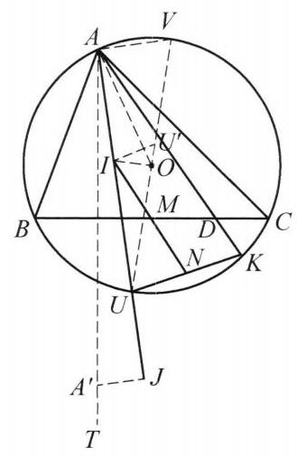

::: {.problem-meta-bar}
第 2 讲 相似三角形
竞赛难度
相似三角形 中点 相似
:::

## 题目

设 $\triangle {ABC}$ 的外接圆为圆 $O$ ，且 $I$ ， $J$ 分别是 $\triangle {ABC}$ 的内心和 $A$ -旁心， ${AJ}$ 交圆 $O$ 于点 $U$ ，点 $D$ 在 ${BC}$ 上且满足 ${DA} = {DJ},{AD}$ 交圆 $O$ 于点 $K, M$ 是 ${BC}$ 的中点， ${IM}$ 交 ${UK}$ 于点 $N$ . 证明: ${MI} = {MN}$ .

图 2-7

## 参考解答

::: {.callout-important title="标准解答" collapse="false"}
如图 2-7,设 ${A}^{\prime }$ 为 $A$ 关于 ${BC}$ 的对称点. 因为 $\angle {AOB} = 2\angle {ACB} = \angle {AC}{A}^{\prime },\angle {A}^{\prime }{AC} = \angle {BAO}$ ，所以 $\triangle {AOB} \backsim  \triangle {AC}{A}^{\prime }$ ，于是 $\frac{AO}{AB} = \frac{AC}{A{A}^{\prime }}$ ，即

$$
{AO} \cdot  A{A}^{\prime } = {AB} \cdot  {AC}.
$$

①

由 $\triangle {AIB} \backsim  \triangle {ACJ}$ ，得 $\frac{AI}{AB} = \frac{AC}{AJ}$ ，即

$$
{AI} \cdot  {AJ} = {AB} \cdot  {AC}.
$$

②

由①、②得 ${AO} \cdot  A{A}^{\prime } = {AI} \cdot  {AJ}$ ，结合 $\angle {OAI} = \angle {JA}{A}^{\prime }$ ，知 $\triangle  {AIO} \backsim \; \triangle  A{A}^{\prime }J$ .

因为 $U$ 为弧 $\overset{\text{ ⏜ }}{BC}$ 的中点，所以， $U, M, O$ 三点共线. 设 ${UO}$ 与圆 $O$ 交于点 $V$ , 则 $\angle {VAU} = {90}^{ \circ  }$ . 由于 ${DA} = {DJ}$ ，且点 $D$ 在 $A{A}^{\prime }$ 的中垂线上，故 $D$ 是 $\triangle  {A{A}^{\prime }}J$ 的外心. 设 $T$ 在 $A{A}^{\prime }$ 的延长线上，且

$$
\angle {VUK} = \angle {VAK} = {90}^{ \circ  } - \angle {DAJ} = \angle J{A}^{\prime }T = \angle {OIU}.
$$

设 ${U}^{\prime }$ 是 $U$ 关于 ${BC}$ 的对称点,则

$$
{UI} = {2R} \cdot  \sin \frac{A}{2},
$$

$$
U{U}^{\prime } = {2UM} = {4R}{\sin }^2\frac{A}{2},
$$

$$
U{I}^2 = {UO} \cdot  U{U}^{\prime },
$$

故 $\triangle {UIO} \backsim  \triangle U{U}^{\prime }I$ ,所以, $\angle U{U}^{\prime }I = \angle {UIO}$ ,于是 $\angle {VUK} = \angle U{U}^{\prime }I$ ,故 ${UN}// \; {U}^{\prime }I$ ,又 $M$ 是 $U{U}^{\prime }$ 的中点,故 ${MI} = {MN}$ ,原问题得证.

注: 该问题关键是性质的转化,首先用对称的方法将 $D$ 转化为 $\triangle A{A}^{\prime }J$ 的外心,刻画 $D$ 在 ${BC}$ 上,再通过相似刻画 $\triangle A{A}^{\prime }J$ .
:::

## 解题思路与分析

::: {.callout-note title="思路还原与分析" collapse="false"}
数学竞赛中的平面几何解答，最让人头疼的地方就在于**“书写顺序”与“思考顺序”往往是完全相反的**。成文的证明为了追求简洁优雅，会把最后才凑出来的辅助线（如本题中的对称点 $A'$ 和 $U'$）直接写在第一句或半路上，撤掉了所有的“脚手架”，让人感觉像变魔术一样。

如果把这个证明还原为解题者真实的**“两头凑”（从结论倒推 + 从条件顺推）**过程，你会发现每一步辅助线其实都是被逼出来的自然选择。我们可以把思考过程拆解为以下三个阶段：

---

## 第一阶段：从结论倒推——为什么要作对称点 $U'$？

我们先看要证的结论：**$MI = MN$**（即 $M$ 是 $IN$ 的中点），其中 $N$ 是 $IM$ 与 $UK$ 的交点。

1. **消去交点 $N$（中心对称/平行转化）：**
点 $N$ 只是一个由两条线相交产生的“衍生点”，直接算线段长很麻烦。在几何中，要证明某条线段被已知中点 $M$ 平分，最自然的想法是**构造关于点 $M$ 的中心对称（或8字形全等）**。
观察一下：$N$ 在直线 $UK$ 上，而点 $U$ 恰好在过 $M$ 且垂直于 $BC$ 的中垂线 $OM$ 上！
如果我们把点 $U$ 关于点 $M$ 对称过去得到点 $U'$（因为 $UM \perp BC$，这也等价于**将 $U$ 关于 $BC$ 对称得到 $U'$**），那么 $M$ 就是 $UU'$ 的中点。
在 $\triangle U'MI$ 和 $\triangle UMN$ 中，既然 $MU' = MU$，要想证 $MI = MN$，当且仅当 **$\triangle U'MI \cong \triangle UMN$**，也就是当且仅当 **$U'I \parallel UK$**！

2. **把平行转化为角相等：**
怎么证 $U'I \parallel UK$？看截线 $UV$（即直线 $UU'$）：
$$U'I \parallel UK \iff \angle UU'I = \angle VUK$$
走到这一步，点 $N$ 就彻底从题目里消失了！

3. **化简 $\angle UU'I$（发现 $\triangle UIO \sim \triangle UU'I$）：**
仔细看左边的角 $\angle UU'I$：它涉及的点 $U, U', I$ **完全由 $\triangle ABC$ 本身决定**，与后面复杂的点 $D$、点 $K$ 毫无关系！这说明 $\angle UU'I$ 是 $\triangle ABC$ 固有的一个角。怎么把它转化成更熟悉的角？
连接 $UB$，在关于内心和外接圆的基本构图中，有两个极其经典的熟知结论：
* **鸡爪定理：** $UI = UB$（即解答中的 $2R\sin\frac{A}{2}$）。
* **直角三角形射影定理：** 因为 $UV$ 是直径，$\angle UBV = 90^\circ$，且 $BM \perp UV$，所以 $UB^2 = UM \cdot UV$。

注意 $UV = 2UO$，而 $2UM = UU'$，所以 $UM \cdot UV = UU' \cdot UO$。结合 $UI = UB$，立刻得到：
$$UI^2 = UU' \cdot UO$$
共线三点 $U, U', O$ 加上这个乘积式，就是标准的**反平行（共角子母相似）模型**：$\triangle UIO \sim \triangle UU'I$！
于是，陌生的 $\angle UU'I$ 就被转化成了位于角平分线 $AU$ 上的角 **$\angle UIO$**。

> **第一阶段小结：** 从结论倒推，我们发现只需要证明 **$\angle VUK = \angle UIO$**。

---

## 第二阶段：从怪异条件顺推——为什么要作对称点 $A'$？

现在看目标的另一半：怎么把 $\angle VUK$ 算出来？这必须用到题目里最奇特的条件：**点 $D$ 在 $BC$ 上，且 $DA = DJ$**。

1. **利用外接圆转化 $\angle VUK$：**
因为 $U, K, A, V$ 四点共圆，所以 $\angle VUK = \angle VAK$。
又因为 $UV$ 是圆 $O$ 的直径，所以 $\angle VAU = 90^\circ$。注意到 $K$ 在 $AD$ 上、$U$ 在 $AJ$ 上，因此：
$$\angle VUK = \angle VAK = 90^\circ - \angle UAK = 90^\circ - \angle DAJ$$
问题变成了：怎么处理 **$\angle DAJ$**？

2. **破译“$D \in BC$ 且 $DA = DJ$”：**
为什么这个条件很难直接用？因为“$DA = DJ$”说明 $D$ 在 $AJ$ 的中垂线上，而“$D \in BC$”说明 $D$ 是 $BC$ 与 $AJ$ 中垂线的交点。两条直线的交点在纯几何里很难倒角，除非我们能把 $D$ 变成某个三角形的**外心**！
怎么变外心？我们已经有 $DA = DJ$ 了，还差一个点到 $D$ 的距离也等于 $DA$。
想想看：**既然 $D$ 在直线 $BC$ 上，那么 $BC$ 作为中垂线能提供什么等长线段？**
只要作点 $A$ 关于 $BC$ 的对称点 $A'$，那么 $BC$ 就是 $AA'$ 的中垂线，对于 $BC$ 上的任意一点 $D$，天然就有 **$DA = DA'$**！
结合已知的 $DA = DJ$，瞬间得到：
$$DA = DA' = DJ$$
这样一来，“$D$ 在 $BC$ 上”和“$DA = DJ$”这两个割裂的条件，完美融合成了一个几何身份：**$D$ 是 $\triangle AA'J$ 的外心**！

3. **利用外心性质处理 $90^\circ - \angle DAJ$：**
在一个三角形中，**“$90^\circ -$ 外心与底边的夹角”** 是最经典的圆心角转圆周角结构！
在 $\triangle AA'J$ 中，$D$ 是外心，$AJ$ 是弦，所以 $\angle ADJ$ 对应圆周角 $\angle AA'J$（此处为钝角，故对应其补角 $\angle JA'T$）。在等腰 $\triangle DAJ$ 中，立刻有：
$$90^\circ - \angle DAJ = \frac{1}{2}\angle ADJ = 180^\circ - \angle AA'J = \angle JA'T$$

> **第二阶段小结：** 从条件顺推，通过对称点 $A'$ 将 $D$ 转化为外心，我们发现 **$\angle VUK = \angle JA'T$**。

---

## 第三阶段：中间会师——为什么会有 $\triangle AIO \sim \triangle AA'J$？

现在，把第一阶段（倒推）和第二阶段（顺推）的结果放在一起：
* 第一阶段告诉我们，要证结论，只需证 $\angle VUK = \angle OIU$；
* 第二阶段告诉我们，已知条件等价于 $\angle VUK = \angle JA'T$。

所以，整道题的最后一公里，就是证明 **$\angle OIU = \angle JA'T$**！
看这两个角的邻补角（因为 $A, I, U, J$ 共线，$A, A', T$ 共线）：
$$\angle OIU = \angle JA'T \iff \angle AIO = \angle AA'J$$

当你把目光聚焦在 **$\triangle AIO$** 和 **$\triangle AA'J$** 上时，答案就呼之欲出了：
1. **看公共顶点 $A$ 处的角：**
$AA' \perp BC$，所以 $AA'$ 其实就是 $\triangle ABC$ 从 $A$ 引出的**高线**；$AO$ 是**外接圆半径**；而 $AIJ$ 是**角平分线**。
由平面几何最基础的“高线与外接圆半径关于角平分线对称（等角共轭）”，立刻知道 $\angle OAI = \angle JAA'$！
2. **看夹这个角的两边之比：**
我们要证 $\triangle AIO \sim \triangle AA'J$，只需证 $\frac{AO}{AI} = \frac{AJ}{AA'}$，即：
$$AO \cdot AA' = AI \cdot AJ$$
而这恰好是三角形中的两个课本级恒等式（都等于 $AB \cdot AC$）：
* 设 $A$ 到 $BC$ 的高为 $h_a$，熟知 $2R \cdot h_a = AB \cdot AC$。而 $AO = R$，$AA' = 2h_a$，所以 $AO \cdot AA' = AB \cdot AC$（即解答中的①式）。
* 在内心-旁心基本图形中，熟知 $\triangle AIB \sim \triangle ACJ$，直接得出 $AI \cdot AJ = AB \cdot AC$（即解答中的②式）。

两边成比例且夹角相等，$\triangle AIO \sim \triangle AA'J$ 就这样水到渠成地证出来了！

---

## 总结：探索路径 vs 书写路径

你可以对比一下**真实的思考方向**与**解答的书写方向**：

* **真实的思考流（两头凑）：**
  * **倒推：** 要证 $MI=MN \xrightarrow{\text{构造中心对称点 } U'} U'I \parallel UK \implies \angle UU'I = \angle VUK \xrightarrow{UI^2=UO\cdot UU'} \angle OIU = \angle VUK$。
  * **顺推：** $\angle VUK = 90^\circ - \angle DAJ \xrightarrow{\text{作对称点 } A' \text{ 使 } D \text{ 为外心}} \angle VUK = \angle JA'T$。
  * **会师：** 只需证 $\angle OIU = \angle JA'T \iff \angle AIO = \angle AA'J \xleftarrow{AO\cdot AA' = AB\cdot AC = AI\cdot AJ} \triangle AIO \sim \triangle AA'J$。
* **解答的书写流（从会师处反写）：**
  先直接抛出对称点 $A'$ 证 $\triangle AIO \sim \triangle AA'J$ $\rightarrow$ 再利用外心导角得出 $\angle VUK = \angle OIU$ $\rightarrow$ 最后抛出对称点 $U'$ 证 $\triangle UIO \sim \triangle UU'I$ 推出平行与中点。

把最后的“会师点”放到第一行写，虽然让证明看起来像一气呵成的神来之笔，但也掩盖了原本非常自然的探索动机。希望这个拆解能帮你彻底看清这道题背后的思考脉络！
:::

## 分步证明

::: {.callout-tip title="分步推理与几何步骤" collapse="false"}
### 步骤 0：构型引入：外接圆、内心与已知条件

给定 △ABC 与其外接圆 O。
I 为内心，J 为 A-旁心，内角平分线 AJ 交圆 O 于劣弧中点 U。
M 是 BC 中点，故 U, M, O 三点共线且垂直于 BC。
点 D 在边 BC 上，满足 DA = DJ；直线 AD 交圆 O 于点 K。
连接 IM 与 UK，交于点 N。
求证目标：MI = MN。

### 步骤 1：步骤一：取对称点 A'，导出相似 △AIO ∽ △AA'J

作点 A 关于 BC 的对称点 A'。
由圆周角定理，∠AOB = 2∠ACB = ∠ACA'，且易得 ∠BAO = 90° - ∠ACB = ∠A'AC，
故 △AOB ∽ △ACA'，得到积式关系：
AO · AA' = AB · AC   ①
又由内心与旁心的经典相似性质 △AIB ∽ △ACJ，得：
AI · AJ = AB · AC   ②
比较 ①、② 得 AO · AA' = AI · AJ ⇔ AO / AJ = AI / AA'。
结合公共夹角 ∠OAI = ∠JAA' = |B - C| / 2，由边角相似判定：
△AIO ∽ △AA'J ⇒ ∠AIO = ∠AA'J。

### 步骤 2：步骤二：点 D 转化为 △AA'J 外心与角转移

因为 BC 是线段 AA' 的垂直平分线，点 D 在 BC 上，故 DA = DA'。
结合已知条件 DA = DJ，得到：
DA = DA' = DJ
因此 D 是 △AA'J 的外心！
在等腰 △DAJ 中，由外心性质知底角 ∠DAJ = 90° - ∠AA'J。
设 UV 为直径，则 ∠VAU = 90°。在圆内接四边形 VAUK 中对角互补：
∠VUK = 180° - ∠VAK = 180° - (90° + ∠DAJ) = 90° - ∠DAJ = ∠AA'J。
由于步骤一已证 ∠AA'J = ∠AIO，且 A, I, U 共线，故：
∠VUK + ∠OIU = 180°。

### 步骤 3：步骤三：鸡爪定理与对称点 U' 导出相似 △UIO ∽ △UU'I

取点 U 关于 BC 的对称点 U'。
由鸡爪定理，UI = 2R · sin(A / 2)。
由垂径关系，中点到弧中点距离 UM = 2R · sin²(A / 2)。
因对称性知 UU' = 2UM = 4R · sin²(A / 2)。
从而建立度量恒等式：
UI² = (2R sin(A/2))² = 4R² sin²(A/2) = R · (4R sin²(A/2)) = UO · UU'
即 UI / UU' = UO / UI。结合公共夹角 ∠OUI = ∠IUU'，得出：
△UIO ∽ △UU'I ⇒ ∠UU'I = ∠UIO。

### 步骤 4：步骤四：同旁内角互补导出关键平行线 UN // U'I

综合前两步所得的角关系：
步骤二已证：∠VUK + ∠OIU = 180°；
步骤三已证：∠UU'I = ∠UIO。
将两式联立代换，即可直接得出：
∠VUK + ∠UU'I = 180°
注意直线 UV 即为割线所在轴。
直线 UK（即 UN）与直线 U'I 被截线 UV 所截，同旁内角严格互补！
由平行线判定定理，立即推得：
UN // U'I。

### 步骤 5：步骤五：中点截线与全等，推得最终结论 MI = MN

考虑截线 IMN 穿过两平行线 UN // U'I：
① M 为线段 UU' 的中点，即 MU = MU'；
② 两直线平行，内错角相等：∠MUN = ∠MU'I；
③ 直线相交对顶角相等：∠UMN = ∠U'MI。
由角边角公理（ASA），判定三角形全等：
△MUN ≅ △MU'I
从而对应线段相等：
MI = MN
原题获证！
:::

## 动态演示

::: {.demo-link-container}
[在新窗口打开交互式分步演示](../demos/07.html){.demo-link target="_blank" rel="noopener"}
:::

  <iframe src="../demos/07.html" title="例 7：外心与内心连线上的线段等长证明 分步演示" loading="lazy"></iframe>

