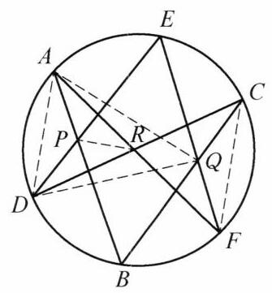

::: {.problem-meta-bar}
第 3 讲 点共线与线共点
竞赛难度
点共线与线共点
:::

## 题目

(帕斯卡定理)圆内接六边形的三组对边的交点共线.

## 参考解答

::: {.callout-important title="标准解答" collapse="false"}
如图 3-1,设圆内接六边形为 ${ABCDEF}$ ,直线 ${AB}$ 与 ${DE}$ 交于点 $P$ ,直线 ${BC}$ 与 ${EF}$ 交于点 $Q$ ,直线 ${CD}$ 与 ${FA}$ 交于点 $R$ . 因为 $\angle {DCB} = \angle {DAB},\angle {BCF} = \; \angle {BAF},\angle {FRP} = {180}^{ \circ  } - \angle {ARP},\angle {PRC} = {180}^{ \circ  } - \; \angle {PRD},\angle {CFE} = \angle {RDE},\angle {EFR} = \angle {EDA}$ ,所以

$$
\frac{\sin \angle {DCB}}{\sin \angle {BCF}} \cdot  \frac{\sin \angle {FRP}}{\sin \angle {PRC}} \cdot  \frac{\sin \angle {CFE}}{\sin \angle {EFA}} =
$$

$$
\frac{\sin \angle {DAB}}{\sin \angle {BAF}} \cdot  \frac{\sin \angle {ARP}}{\sin \angle {PRD}} \cdot  \frac{\sin \angle {RDE}}{\sin \angle {EDA}}.
$$

图 3-1

对 $\triangle {ADR}$ 和点 $P$ ,用第一角元形式的塞瓦定理,得

$$
\frac{\sin \angle {DAB}}{\sin \angle {BAF}} \cdot  \frac{\sin \angle {ARP}}{\sin \angle {PRD}} \cdot  \frac{\sin \angle {RDE}}{\sin \angle {EDA}} = 1,
$$

故

$$
\frac{\sin \angle {DCB}}{\sin \angle {BCF}} \cdot  \frac{\sin \angle {FRP}}{\sin \angle {PRC}} \cdot  \frac{\sin \angle {CFE}}{\sin \angle {EFA}} = 1.
$$

注意到 ${BC}$ 与 ${FE}$ 交于点 $Q$ ,故由第一角元形式的塞瓦定理得 ${BC},{FE},{RP}$ 三线共点于 $Q$ ,即 $P, Q, R$ 三点共线.

注:类似的结论, 对于椭圆、双曲线、抛物线也同样成立, 即我们有如下结论:

如果一个六边形内接于一条二次曲线 (椭圆、双曲线、抛物线), 那么它的三对对边的交点在同一条直线上.
:::

## 解题思路与分析

::: {.callout-note title="思路还原与分析" collapse="false"}
这段证明之所以读起来让人觉得“费解”、甚至有些莫名其妙，主要有两个原因：

1. **书写顺序完全是“倒果为因”的综合法**：它一上来先抛出了 6 个角度相等（或互补）的式子，在读者完全不知道为什么要关注这些角的时候，强行拼凑出一组复杂的正弦乘积相等；
2. **配图（图 3-1）存在严重的视觉误导**：图 3-1 中画出了两条虚线 $AQ$ 和 $DQ$，但**整篇证明根本没有用到 $AQ$ 和 $DQ$**！相反，证明真正需要用到的核心连线 $RQ$，图上反而没画出来。如果你一边看图一边读证明，视线很容易被 $AQ, DQ$ 带偏。

如果我们把那两条多余的虚线 $AQ, DQ$ 擦掉，用**“执果索因（逆向分析）”**和**“高等几何背景（线束与对偶）”**两个维度来拆解，你会发现这个证法其实非常自然、对称。

---

## 一、 逆向复盘：这个证明是怎么“倒推”出来的？

假设你现在要独立发明这个证明，你的思考路径应该是这样的四步：

### 第一步：把“三点共线”转化为“三线共点”
我们要证 $P, Q, R$ 三点共线。
已知 $Q$ 是直线 $BC$ 与 $FE$ 的交点。那么，“$P, Q, R$ 三点共线”就等价于说：**直线 $RP$ 也经过点 $Q$**，即 **$BC, FE, RP$ 三线共点（于点 $Q$）**。

一旦问题变成“证明三线共点”，最顺手的工具自然就是**塞瓦定理（特别是角元塞瓦定理）**。

### 第二步：为这三条线寻找“宿主三角形” $\triangle CFR$
要用角元塞瓦定理证明 $BC, FE, RP$ 三线共点，必须先找到一个三角形，使得这三条线恰好是从它的三个顶点发出的塞瓦线（Cevian）：
* 第一条线是 $CB$（过点 $C$）；
* 第二条线是 $FE$（过点 $F$）；
* 第三条线是 $RP$（过点 $R$）。

天然地，这个宿主三角形就是 **$\triangle CFR$**（图 3-1 右侧由实线 $CR, FR$ 和虚线 $CF$ 围成的三角形）！
而且更妙的是，点 $R$ 本身就是 $CD$ 与 $FA$ 的交点，这意味着 $\triangle CFR$ 的两条边 $RC$ 和 $RF$ 本来就是现成的六边形边所在直线（即直线 $CD$ 和直线 $FA$）！

于是，在 $\triangle CFR$ 中，要证 $CB, FE, RP$ 共点于 $Q$，只需证角元塞瓦等式：
$$\underbrace{\frac{\sin \angle DCB}{\sin \angle BCF}}_{\text{顶点 } C\text{ 处}} \cdot \underbrace{\frac{\sin \angle FRP}{\sin \angle PRC}}_{\text{顶点 } R\text{ 处}} \cdot \underbrace{\frac{\sin \angle CFE}{\sin \angle EFA}}_{\text{顶点 } F\text{ 处}} = 1$$

### 第三步：顺着“八字形”找到孪生三角形 $\triangle ADR$
怎么证上面这个乘积等于 $1$ 呢？硬算肯定不行，最聪明的方法是**找另一个已经三线共点的三角形，把正弦比“搬运”过去**。

观察图 3-1，直线 $CD$ 和 $FA$ 相交于 $R$，形成了一个经典的**“八字形（沙漏形）”**：右边连虚线 $CF$ 得到 $\triangle CFR$，左边连虚线 $AD$ 就得到它的孪生三角形 **$\triangle ADR$**！

而在左边的 $\triangle ADR$ 中，天然就有一组已经共点的三条线——因为点 $P$ 是 $AB$ 和 $DE$ 的交点，所以从 $\triangle ADR$ 三个顶点发出的三条线 **$AB$、$RP$、$DE$ 天然共点于 $P$**！

对 $\triangle ADR$ 和共点 $P$ 直接写出角元塞瓦定理，天然就有：
$$\underbrace{\frac{\sin \angle DAB}{\sin \angle BAF}}_{\text{顶点 } A\text{ 处}} \cdot \underbrace{\sin \angle ARP \over \sin \angle PRD}_{\text{顶点 } R\text{ 处}} \cdot \underbrace{\frac{\sin \angle RDE}{\sin \angle EDA}}_{\text{顶点 } D\text{ 处}} = 1$$

### 第四步：利用圆周角完成“一键替换”
把这两个孪生三角形放在一起对比，你会发现它们的每一项都通过**同弧所对的圆周角**（以及顶点 $R$ 处的邻补角）完美地一一对应：

| 对应位置 | 目标三角形 $\triangle CFR$（待证共点于 $Q$） | 已知三角形 $\triangle ADR$（已知共点于 $P$） | 相等的几何原因（见图 3-1） |
| :--- | :--- | :--- | :--- |
| **第一组顶点 ($C \leftrightarrow A$)** | 塞瓦线 $CB$ 分 $\angle DCF$ 为： $\angle DCB$ 与 $\angle BCF$ | 塞瓦线 $AB$ 分 $\angle DAF$ 为： $\angle DAB$ 与 $\angle BAF$ | 同对 $\overset{\frown}{DB} \implies \angle DCB = \angle DAB$ 同对 $\overset{\frown}{BF} \implies \angle BCF = \angle BAF$ |
| **第二组顶点 ($F \leftrightarrow D$)** | 塞瓦线 $FE$ 分 $\angle CFA$ 为： $\angle CFE$ 与 $\angle EFA$ | 塞瓦线 $DE$ 分 $\angle CDA$ 为： $\angle RDE$ 与 $\angle EDA$ | 同对 $\overset{\frown}{CE} \implies \angle CFE = \angle CDE = \angle RDE$ 同对 $\overset{\frown}{EA} \implies \angle EFA = \angle EDA$ |
| **公共顶点 ($R \leftrightarrow R$)** | 塞瓦线 $RP$ 分 $\angle FRC$ 为： $\angle FRP$ 与 $\angle PRC$ | 塞瓦线 $RP$ 分 $\angle ARD$ 为： $\angle ARP$ 与 $\angle PRD$ | $A,R,F$ 共线 $\implies \angle FRP = 180^\circ - \angle ARP$ $D,R,C$ 共线 $\implies \angle PRC = 180^\circ - \angle PRD$ |

看懂了这个表格，你就明白教材开头那串令人头晕的角相等是怎么来的了——作者只是在草稿纸上写出了上面两个角元塞瓦式，比对了一下对应项，然后把“比对结果”放在了证明的第一句话而已。

---

## 二、 降维视角：为什么偏偏能这么巧合地配对？

如果你进一步追问：**“为什么在 $\triangle CFR$ 和 $\triangle ADR$ 中，塞瓦线分出来的六个角恰好能两两配成同弧圆周角？而且为什么书后紧接着加了一个关于二次曲线的‘注’？”**

这其实触及到了帕斯卡定理最本质的**射影几何背景——线束（Pencil of lines）与交比（Cross-ratio）**。这个角元塞瓦证法，本质上是**将射影几何中的“二次曲线线束交比证法”直接翻译成了初等三角语言**。

我们可以把六边形的六个顶点按奇偶分成两组：$\{A, C, E\}$ 和 $\{B, D, F\}$。
1. **顶点 $A$ 和 $C$ 处的线束同构**：
* 在 $\triangle ADR$ 的顶点 $A$ 处，形成角度的三条射线是 $AD, AB, AF$ —— 它们正是从点 $A$ 向圆上另外三点 $\{D, B, F\}$ 发出的线束 $A(D, B, F)$；
* 在 $\triangle CFR$ 的顶点 $C$ 处，形成角度的三条射线是 $CD, CB, CF$ —— 它们正是从点 $C$ 向**同一组点** $\{D, B, F\}$ 发出的线束 $C(D, B, F)$！
* 在圆中，从圆周上任意两点（$A$ 和 $C$）向圆上另外三点（$D, B, F$）引射线，对应的夹角必然相等，因此 $\frac{\sin \angle DAB}{\sin \angle BAF} = \frac{\sin \angle DCB}{\sin \angle BCF}$ 是必然成立的。
2. **顶点 $D$ 和 $F$ 处的线束同构**：
* 同理，从点 $D$ 发出的三条射线 $DC, DE, DA$ 是向 $\{C, E, A\}$ 发出的线束 $D(C, E, A)$；
* 从点 $F$ 发出的三条射线 $FC, FE, FA$ 也是向**同一组点** $\{C, E, A\}$ 发出的线束 $F(C, E, A)$！
* 因此它们夹角的正弦比 $\frac{\sin \angle RDE}{\sin \angle EDA}$ 与 $\frac{\sin \angle CFE}{\sin \angle EFA}$ 也必然相等。
3. **与二次曲线（注）的联系**：
* 当把圆推广到一般的椭圆、双曲线、抛物线时，同弧所对的圆周角不再直接相等，单个三线束的正弦比不再相等；但只要引入第四条射线构成**四线束交比**（由角元正弦之比复合而成），根据**沙尔定理（Chasles' Theorem）**，二次曲线上动点向四定点张成的线束交比恒定不变：
$$A(D, B, E, F) = C(D, B, E, F)$$
* 教材的这个证法，正是利用了两条基准边 $CD$ 和 $AF$ 的交点 $R$ 作为“桥梁”（公共塞瓦线 $RP$ 消去了第四条射线的自由度），把四线束交比拆成了两个八字形三角形 $\triangle ADR$ 与 $\triangle CFR$ 的角元塞瓦定理。

所以，记住**“对顶八字形（$\triangle ADR$ 与 $\triangle CFR$）+ 奇偶顶点线束配对”**这个骨架，这个证明就完全不需要死记硬背了。
:::

## 分步证明

::: {.callout-tip title="分步推理与几何步骤" collapse="false"}
### 步骤 0：圆内接六边形 ABCDEF 构型

已知六边形 ABCDEF 内接于圆 ⊙O。

帕斯卡定理（Pascal's Theorem）是射影几何与欧几里得几何中最著名的经典定理之一：

圆内接六边形的三对对边所在直线的交点必在同一直线上。

我们首先建立六边形的基础构型，观察六个顶点在圆周上的几何分布。

### 步骤 1：对边延长相交得交点 P, Q, R

分别延长六边形的三对对边，得到三对交点：

• 直线 AB 与 DE 交于点 P；

• 直线 CD 与 FA 交于点 R；

• 直线 BC 与 EF 交于点 Q。

本证明的核心目标：证明这三个交点 P, Q, R 三点共线。

### 步骤 2：聚焦 △ADR 与圆周角等量代换

将视点转换至由边交织而成的关键三角形 △ADR，利用同弧圆周角相等与平角补角性质建立角量对应：

• 弦 DB 所对圆周角：∠DCB = ∠DAB

• 弦 BF 所对圆周角：∠BCF = ∠BAF

• 点 R 处平角补角关系（互补角正弦值相等）：

&nbsp;&nbsp;∠FRP = 180° − ∠ARP ⟹ sin∠FRP = sin∠ARP

&nbsp;&nbsp;∠PRC = 180° − ∠PRD ⟹ sin∠PRC = sin∠PRD

• 弦 CE 所对圆周角：∠CFE = ∠RDE

• 弦 EA 所对圆周角：∠EFR = ∠EDA

### 步骤 3：角元塞瓦定理应用于 △ADR 与点 P

在 △ADR 中，从三个顶点引向点 P 的三条射线：

• 射线 PA 即直线 AB；

• 射线 PD 即直线 DE；

• 射线 PR 连结顶点 R 与点 P。

因直线 PA, PD, PR 显然共点于 P，由第一角元形式的塞瓦定理（Trigonometric Ceva's Theorem）：

sin ∠DABsin ∠BAF · 
sin ∠ARPsin ∠PRD · 
sin ∠RDEsin ∠EDA = 1

### 步骤 4：正弦等比代换转移至 △RCF

利用 Step 2 中的同弧圆周角相等与补角正弦不变性进行等比代换：

sin ∠DCBsin ∠BCF = sin ∠DABsin ∠BAF ，
sin ∠FRPsin ∠PRC = sin ∠ARPsin ∠PRD ，
sin ∠CFEsin ∠EFR = sin ∠RDEsin ∠EDA

代入 Step 3 的等式，立即导出对 △RCF 的正弦比乘积关系：

sin ∠DCBsin ∠BCF · 
sin ∠FRPsin ∠PRC · 
sin ∠CFEsin ∠EFR = 1

### 步骤 5：角元塞瓦逆定理导出三点共线

在 △RCF 中，三条射线 CB, FE, RP 分割顶角的正弦比乘积恒等于 1。

根据第一角元形式的塞瓦定理逆定理：

三条直线 BC, FE, RP 必共点！

又由已知条件，直线 BC 与 FE 本就交于点 Q，因此直线 RP 必须通过点 Q，即：

点 Q 落在直线 RP 上。

∴ P, Q, R 三点共线！（帕斯卡线）

证毕。
:::

## 动态演示

::: {.demo-link-container}
[在新窗口打开交互式分步演示](../demos/02.html){.demo-link target="_blank" rel="noopener"}
:::

  <iframe src="../demos/02.html" title="例 2：帕斯卡定理（圆内接六边形对边交点共线） 分步演示" loading="lazy"></iframe>

