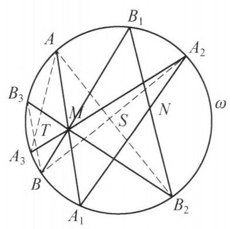

::: {.problem-meta-bar}
第 3 讲 点共线与线共点
竞赛难度
点共线与线共点
:::

## 题目

已知 $A, B, C$ 为圆 $\omega$ 上任意三点, $M, N$ 为平面上任意两点, ${AM}$ 与 $\omega$ 的另一个交点为 ${A}_1,{A}_{1}N$ 与 $\omega$ 的另一个交点为 ${A}_2,{A}_{2}M$ 与 $\omega$ 的另一个交点为 ${A}_3$ . 类似定义 ${B}_1,{B}_2,{B}_3,{C}_1,{C}_2,{C}_3$ . 证明: $A{A}_3, B{B}_3, C{C}_3$ 三线共点.

图 3-2

## 参考解答

::: {.callout-important title="标准解答" collapse="false"}
如图 3-2,只需证明: $A{A}_3, B{B}_3,{MN}$ 三线共点,因为同理也有 $A{A}_3, C{C}_3,{MN}$ 三线共点,于是 $A{A}_3, B{B}_3, C{C}_3$ 三线共点于 $A{A}_3$ 与 ${MN}$ 的交点.

设 $A{B}_2$ 与 ${A}_{2}B$ 交于点 $S, A{A}_3$ 与 $B{B}_3$ 交于 $T$ .

对六边形 $A{A}_3{A}_{2}B{B}_3{B}_2$ ,用帕斯卡定理,知 $T$ , $S, M$ 三点共线.

对六边形 ${A}_1{A}_{2}B{B}_1{B}_{2}A$ ,用帕斯卡定理,知 $M$ , $N, S$ 三点共线.

所以, $M, N, T$ 三点共线.

即 $A{A}_3, B{B}_3,{MN}$ 三线共点. 原问题得证.

注:对于圆上点较多的情形，可以考虑用帕斯卡定理证明共线.
:::

## 解题思路与分析

::: {.callout-note title="思路还原与分析" collapse="false"}
这个证明初看确实像“神来之笔”——突然引入直线 $MN$，又凭空构造出交叉弦交点 $S$，两次帕斯卡定理一摆就证完了。但实际上，如果把它的思维过程拆解开，你会发现每一步都是被题目条件**“逼”**出来的必然选择。

我们可以从**初等几何的逆向破题手筋**和**射影几何的高观点背景**两个维度，完整还原这个证明的诞生过程：

---

## 一、 初等破题还原：如何一步步凑出这两个六边形？

### 第 1 步：利用对称性“消元”（为什么想到拉入直线 $MN$？）
原题有 $A, B, C$ 三个起点，每个起点经过 3 次连线投射，圆上共有 **12 个点**。如果同时处理 $A, B, C$ 三组点，图形会复杂到无法下手。

破题的第一直觉是**寻找不动点**：
* 既然 $A, B, C$ 是圆 $\omega$ 上**任意**三点，说明不管起点怎么变，所有形如 $XX_3$ 的直线都会交于**同一个定点**（记为 $T$）。
* 这个定点 $T$ 的位置只能由题目中固定的元素决定。题目里固定的元素只有：**圆 $\omega$、点 $M$、点 $N$**。
* 由圆和两个定点构成的图形，天然关于直线 $MN$ 对称（或在射影意义下以 $MN$ 为唯一特征直线），因此**这个公共交点 $T$ 必然落在直线 $MN$ 上**！

一旦猜到交点在 $MN$ 上，就可以立刻**把点 $C$ 彻底扔掉**：
只要能证明任意两条线 $AA_3$ 与 $BB_3$ 的交点 $T$ 落在 $MN$ 上，就说明 $BB_3$ 必过“$AA_3$ 与 $MN$ 的唯一交点”；同理，$CC_3$ 也必过“$AA_3$ 与 $MN$ 的唯一交点”。这样，原本 12 个点的“三线共点”问题，瞬间降维成了 8 个点的**“$M, N, T$ 三点共线”**问题。

---

### 第 2 步：帕斯卡定理的“8点困境”（为什么要分两次用？）
把点 $C$ 拿掉后，圆上还剩 8 个点：$A, A_1, A_2, A_3$ 和 $B, B_1, B_2, B_3$。我们把已知的弦交点按生成步骤列出来：
1. **第 1 步（过 $M$）**：$AA_1 \cap BB_1 = M$
2. **第 2 步（过 $N$）**：$A_1A_2 \cap B_1B_2 = N$
3. **第 3 步（过 $M$）**：$A_2A_3 \cap B_2B_3 = M$
4. **第 4 步（交于 $T$）**：$A_3A \cap B_3B = T$

我们要证 $M, N, T$ 共线。圆上多点共线问题首选**帕斯卡定理**，但这里有一个致命障碍：
* 观察点 $A$ 的轨迹：$A \xrightarrow{M} A_1 \xrightarrow{N} A_2 \xrightarrow{M} A_3 \xrightarrow{T} A$，这是一个**4 步闭环（圆内接四边形）**；点 $B$ 也是同样的 4 步闭环。两边合起来有 **8 个点**。
* 而**帕斯卡定理只能处理 6 个点**（本质上是两组 3 步折线交错闭合而成的六边形）。
* 如果你想用一次帕斯卡定理直接算出 $M, N, T$ 共线，生成 $N$ 需要用到 $\{A_1, A_2, B_1, B_2\}$，生成 $T$ 需要用到 $\{A, A_3, B, B_3\}$——这两组点**完全不相交**，根本拼不成一个六边形！

---

### 第 3 步：“连对角线剖分”逼出辅助点 $S$
在初等几何里，当我们手头只有处理“三角形（3 顶点）”的工具，却遇到了“四边形（4 顶点）”时，最标准的操作是什么？**连对角线，把四边形剖分成两个三角形！**

对于四边形折线 $A - A_1 - A_2 - A_3 - A$ 和 $B - B_1 - B_2 - B_3 - B$，我们从中间节点 **$A_2, B_2$** 处将其切开，分成前半段（第 1、2 步）和后半段（第 3、4 步）：

1. **前半段（第 1、2 步）**：
* 包含折线 $A - A_1 - A_2$ 和 $B - B_1 - B_2$，共有 **6 个点** $\{A, A_1, A_2, B, B_1, B_2\}$。
* 已知两组对边交点：$AA_1 \cap BB_1 = M$，$A_1A_2 \cap B_1B_2 = N$。
* 为了把这两条折线首尾相连闭合成一个圆内接六边形 $A A_1 A_2 B B_1 B_2 A$，**唯一缺失的第三组对边就是将首尾交叉连接：连结 $A_2B$ 和 $B_2A$**！
* 设这两条交叉弦的交点为 $S$，对这个六边形用帕斯卡定理，立刻得到：**$M, N, S$ 共线**。

2. **后半段（第 3、4 步）**：
* 包含折线 $A - A_3 - A_2$ 和 $B - B_3 - B_2$，同样只有 **6 个点** $\{A, A_3, A_2, B, B_3, B_2\}$。
* 已知两组对边交点：$AA_3 \cap BB_3 = T$，$A_3A_2 \cap B_3B_2 = M$。
* 为了把这两条折线首尾相连闭合成六边形 $A A_3 A_2 B B_3 B_2 A$，它的首尾端点**依然是 $A, A_2$ 和 $B, B_2$**！
* 所以，用来闭合它的第三组对边，**自动就是刚才那两条交叉弦 $A_2B$ 和 $B_2A$（交点依然是同一个 $S$）**！对这个六边形用帕斯卡定理，立刻得到：**$T, M, S$ 共线**。

3. **点 $M$ 出现两次的“焊接”作用**：
* 为什么题目要求第 1 步和第 3 步都经过同一个点 $M$（即 $M \to N \to M$）？
* 假设第 1 步过的是 $M_1$，第 3 步过的是 $M_3$，那我们只能推出“$M_1, N, S$ 共线”和“$T, M_3, S$ 共线”，这两条线在点 $S$ 处是折断的。
* 恰恰因为 $M_1$ 和 $M_3$ 是**同一个点 $M$**，前半段的帕斯卡线（直线 $MS$）与后半段的帕斯卡线（也是直线 $MS$）拥有两个公共点 $M$ 和 $S$，从而被死死“焊”成了同一条直线！因此 $M, N, T, S$ 四点共线。

> **破题小结**：辅助点 $S = AB_2 \cap A_2B$ 绝非凭空捏造，它是将 4 步闭环拆分为前后两个 3 步闭环时，公共边界顶点 $\{A, A_2\}$ 与 $\{B, B_2\}$ 唯一能连出的“公共对角线交点”。

---

## 二、 高观点降维打击：这道题的射影几何与群论本质

如果你从**圆上的对合变换（Involution）**与**群论共轭**的视角来看，就能一眼看穿这道题的构造源码：

1. **定义圆上的中心对合变换**：
对于平面上任意定点 $P$，我们可以定义一个圆 $\omega$ 到自身的映射 $i_P: \omega \to \omega$，它将圆上任意一点 $X$ 映为直线 $XP$ 与圆 $\omega$ 的另一个交点。
显然，连做两次回到原地，即 $i_P^2 = \text{id}$（恒等变换），这在射影几何中称为以 $P$ 为中心的**透视对合（Desargues/Frégier 对合）**。

2. **题目的生成过程就是“共轭变换”**：
按题意，从 $A$ 到 $A_3$ 的三次连线操作，写成映射复合就是：
$$A_3 = (i_M \circ i_N \circ i_M)(A)$$
记复合变换 $f = i_M \circ i_N \circ i_M$。

3. **对合的共轭依然是对合**：
在群论中，一个 2 阶元（对合 $i_N$）被另一个 2 阶元（对合 $i_M$）共轭后，得到的依然是 2 阶元！直接验证：
$$f^2 = (i_M \circ i_N \circ i_M) \circ (i_M \circ i_N \circ i_M) = i_M \circ i_N \circ \underbrace{(i_M^2)}_{\text{id}} \circ i_N \circ i_M = i_M \circ \underbrace{(i_N^2)}_{\text{id}} \circ i_M = i_M^2 = \text{id}$$
这说明，复合映射 $f: A \mapsto A_3$ 本身也是圆 $\omega$ 上的一个**射影对合变换**！

4. **Frégier 定理直接给出共点结论**：
射影几何中的 **Frégier 定理**指出：**圆（或任意非退化二次曲线）上的任何一个对合变换，都必然存在唯一的一个“对合中心” $T$，使得所有对应点连线 $X f(X)$ 都经过定点 $T$**。
* 因为 $A_3 = f(A),\ B_3 = f(B),\ C_3 = f(C)$，所以弦 $AA_3, BB_3, CC_3$（乃至圆上任意一点 $X$ 生成的 $XX_3$）都必然交于对合 $f$ 的中心 $T$！
* 不仅如此，在射影平面 $\mathbb{RP}^2$ 中，$i_M$ 是以 $M$ 为中心、以 $M$ 关于圆 $\omega$ 的极线 $m$ 为轴的**调和透射（Harmonic Homology）**。将对合中心 $N$ 通过 $i_M$ 进行共轭，新的对合中心 $T$ 就是点 $N$ 在调和透射 $i_M$ 下的像——即**点 $T$ 必然落在直线 $MN$ 上，且 $T, N$ 关于点 $M$ 与极线 $m$ 调和共轭**！

命题人正是利用“对合变换的共轭仍是对合”这一射影几何性质设计出了题目，再通过将 4 步路径对角剖分为两个帕斯卡六边形，将其包装成了一道纯初等几何竞赛题。
:::

## 分步证明

::: {.callout-tip title="分步推理与几何步骤" collapse="false"}
### 步骤 0：已知构型与交点生成

已知 $A, B, C$ 为圆 $\omega$ 上任意三点，$M, N$ 为平面上任意两点。
从点 $A$ 出发，依次通过定点 $M, N, M$ 作割线：
① 割线 $AM$ 与圆交于 $A_1$；
② 割线 $A_1N$ 与圆交于 $A_2$；
③ 割线 $A_2M$ 与圆交于 $A_3$。
同理，从点 $B$ 出发依次得到 $B_1$, $B_2$, $B_3$。
求证：$AA_3, BB_3, CC_3$ 三线共点。

### 步骤 1：目标转化：只需证明 AA₃, BB₃, MN 三线共点

设直线 $AA_3$ 与 $BB_3$ 相交于点 $T$。
若能证明点 $T$ 恒在定直线 $MN$ 上（即 $M, N, T$ 三点共线）：
则交点 $T$ 的位置完全由割线生成路径及定点 $M, N$ 决定，不依赖于所选的特定点对。
同理必有 $AA_3$ 与 $CC_3$ 亦相交于直线 $MN$ 上的唯一点 $T$，从而原命题即等价于证明：
$M, N, T$ 三点共线（即 $AA_3, BB_3, MN$ 三线共点于 $T$）。

### 步骤 2：引对边交点 S，构造六边形 A₁A₂BB₁B₂A

连结弦 $AB_2$ 与弦 $A_2B$，设它们相交于点 $S$。
在圆 $\omega$ 上选取六个有序顶点：
$A_1 \to A_2 \to B \to B_1 \to B_2 \to A$。
这六个点构成一个圆内接六边形 $A_1A_2BB_1B_2A$。
我们将对该内接六边形应用射影几何的经典基石——帕斯卡定理（Pascal's Theorem）。

### 步骤 3：第一次帕斯卡定理 ⇒ M, N, S 三点共线

对圆内接六边形 $A_1A_2BB_1B_2A$，考察其三对对边的交点：
1️⃣ 对边 $A_1A_2$ 与 $B_1B_2$：由定义均过定点 $N$，交点为 $N$；
2️⃣ 对边 $A_2B$ 与 $B_2A$：由设交点为 $S$；
3️⃣ 对边 $BB_1$ 与 $AA_1$：由定义均过定点 $M$，交点为 $M$。
根据帕斯卡定理，圆内接六边形的三对对边交点共线，因此：
$M, N, S$ 三点共线，即点 $S$ 必落在直线 $MN$ 上！

### 步骤 4：第二次帕斯卡定理 ⇒ T, M, S 三点共线

再在圆 $\omega$ 上构造第二个内接六边形：
$A \to A_3 \to A_2 \to B \to B_3 \to B_2$。
同样分析其三对对边的交点：
1️⃣ 对边 $AA_3$ 与 $BB_3$：相交于点 $T$；
2️⃣ 对边 $A_3A_2$ 与 $B_3B_2$：由定义均过定点 $M$，交点为 $M$；
3️⃣ 对边 $A_2B$ 与 $B_2A$：相交于点 $S$。
由帕斯卡定理，这三对对边的交点亦必共线，因此：
$T, M, S$ 三点共线，即点 $T$ 落在直线 $MS$ 上！

### 步骤 5：共线传递与最终结论：三线共点得证

综合前后两步：
由步骤 3 知 $M, N, S$ 共线；由步骤 4 知 $T, M, S$ 共线。
由于点 $M, S$ 为相异两点，两条直线重合，故：
$M, N, S, T$ 四点共线！
从而点 $T = AA_3 \cap BB_3$ 落在直线 $MN$ 上，即 $AA_3, BB_3, MN$ 三线共点于 $T$。
同理，$CC_3$ 亦过该交点 $T$。
由此得证：$AA_3, BB_3, CC_3$ 三线共点于 $T$。原命题获证！🎉
:::

## 动态演示

::: {.demo-link-container}
[在新窗口打开交互式分步演示](../demos/03.html){.demo-link target="_blank" rel="noopener"}
:::

  <iframe src="../demos/03.html" title="例 3：圆上三点切线交点与三线共点 分步演示" loading="lazy"></iframe>

