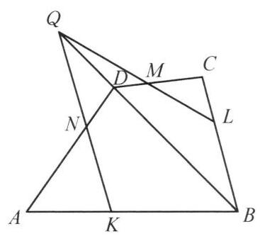

::: {.problem-meta-bar}
第 3 讲 点共线与线共点
竞赛难度
点共线与线共点
:::

## 题目

设点 $P$ 是凸四边形 ${ABCD}$ 所在平面上一点， $\angle {APB}$ ， $\angle {BPC}$ ， $\angle {CPD}$ ， $\angle {DPA}$ 的平分线分别交 ${AB}$ ， ${BC}$ ， ${CD}$ ， ${DA}$ 于点 $K$ ， $L$ ， $M$ ， $N$ .

## 参考解答

::: {.callout-important title="标准解答" collapse="false"}
(1)寻找一点 $P$ ，使得 ${KLMN}L$ 是平行四边形；

(2)求所有这样的点 $P$ 的轨迹.

图 3-5

解(1)设点 $P$ 是 ${AC}$ 与 ${BD}$ 的垂直平分线的交点，则 ${PA} = {PC}$ ， ${PB} = {PD}$ ，因为 ${PK}$ 平分 $\angle {APB}$ ， ${PL}$ 平分 $\angle {BPC}$ ,所以

$$
\frac{AK}{KB} = \frac{PA}{PB} = \frac{PC}{PB} = \frac{CL}{LB},
$$

故 ${KL}//{AC}$ .

同理, ${MN}//{AC}$ .

所以 ${KL}//{MN}$ .

同理可得 ${LM}//{NK}$ ,所以 ${KLMN}$ 是平行四边形.

(2)如图 3-5，设 ${KLMN}$ 是平行四边形，则

$$
\frac{AK}{KB} \cdot  \frac{BL}{LC} \cdot  \frac{CM}{MD} \cdot  \frac{DN}{NA}
$$

$$
= \frac{PA}{PB} \cdot  \frac{PB}{PC} \cdot  \frac{PC}{PD} \cdot  \frac{PD}{PA}
$$

①

$$
= 1\text{ . }
$$

假设 ${KN}$ 与 ${BD}$ 交于点 $Q$ ,对 $\triangle {ABD}$ 及直线 ${KNQ}$ ,用梅涅劳斯定理,有

$$
\frac{DN}{NA} \cdot  \frac{AK}{KB} \cdot  \frac{BQ}{QD} = 1,
$$

结合①式得

$$
\frac{BL}{LC} \cdot  \frac{CM}{MD} \cdot  \frac{DQ}{QB} = 1
$$

在 $\triangle {BCD}$ 中应用梅涅劳斯定理的逆定理得, $Q, M, L$ 三点共线, ${KN}$ 与 ${LM}$ 交于点 $Q$ ,这不可能. 故 ${KN}//{BD}//{LM}$ ,因此

$$
\frac{PA}{PB} = \frac{AK}{KB} = \frac{AN}{ND} = \frac{PA}{PD},
$$

于是有 ${PB} = {PD}$ .

同理有 ${PA} = {PC}$ .

所以 $P$ 点的轨迹是 ${AC}$ 与 ${BD}$ 的垂直平分线的交点这一个点.

注: 反证法在几何证明中并不多见. 本题利用反证法证明 ${NK}//{BD}//{ML}$ ,关系式 $\frac{AK}{KB} \cdot  \frac{BL}{LC} \cdot  \frac{CM}{MD} \cdot  \frac{DN}{NA} = 1$ 是关键.
:::

## 解题思路与分析

::: {.callout-note title="思路还原与分析" collapse="false"}
这个证明之所以让人感到“费解”、像是在变魔术，是因为教材的书写顺序掩盖了**逆向探索的直觉**，并且为了迁就初等欧氏几何的语言（回避“无穷远点”），把一个非常自然的**三线共点性质**包装成了略显生硬的“反证法”。

如果把作者在草稿纸上的真实思考过程还原出来，其实经历了以下三个非常自然的阶段：

---

### 第一步：由第 (1) 问引发的“目标倒推”

在第 (1) 问中，为了构造平行四边形 $KLMN$，作者借用了类似**瓦里尼翁平行四边形（Varignon's Theorem，连接四边形各边中点所得图形）**的思路：利用原四边形的两条对角线 $AC$ 和 $BD$ 作为“平行中介”，让 $KL \parallel AC \parallel MN$ 且 $KN \parallel BD \parallel LM$，从而顺理成章地利用比例线段推出 $PA = PC$ 和 $PB = PD$。

到了第 (2) 问求轨迹时，解题者心里其实已经有了强烈的预感：**满足条件的点 $P$ 很可能只有这一个！** 
要想证明点 $P$ 唯一，就必须反过来证明：**只要 $KLMN$ 是平行四边形，它的两组对边就别无选择，必须分别平行于对角线 $AC$ 和 $BD$。**

因此，第 (2) 问从一开始的攻坚目标就极其明确：**已知 $KN \parallel LM$，如何证明它们一定平行于对角线 $BD$？**

---

### 第二步：代数本能与“对角线搭桥”

手头的已知条件是四条角平分线交于点 $P$。由角平分线定理，四个分点给出了四组线段比：
$$\frac{AK}{KB} = \frac{PA}{PB}, \quad \frac{BL}{LC} = \frac{PB}{PC}, \quad \frac{CM}{MD} = \frac{PC}{PD}, \quad \frac{DN}{NA} = \frac{PD}{PA}$$

观察等号右边的四个分式，分子分母首尾相接。任何一个熟悉几何代数化的解题者，都会本能地将它们**连乘消去（Telescoping）**，从而无条件地得到关系式 ①：
$$\frac{AK}{KB} \cdot \frac{BL}{LC} \cdot \frac{CM}{MD} \cdot \frac{DN}{NA} = 1$$

接下来是关键：**四边形四条边上的分点比例连乘等于 $1$，在几何上意味着什么？**
* 如果把四边形 $ABCD$ 沿着对角线折起来变成**空间四边形**，这个式子就是立体几何中著名的“四点 $K, L, M, N$ 共面”的充要条件（空间梅涅劳斯定理）。
* 回到平面上，四边形本身没有直接的梅涅劳斯定理。要想利用这个乘积为 $1$ 的条件，最标准的手法就是**连结对角线 $BD$，把四边形切分成两个共享底边 $BD$ 的三角形 $\triangle ABD$ 和 $\triangle BCD$**。

此时，对角线 $BD$ 就成了连接左上角（$K, N$）和右下角（$L, M$）的**唯一桥梁**：
1. 在 $\triangle ABD$ 中，直线 $KN$ 截三边（假设交对角线 $BD$ 于点 $Q$），梅涅劳斯定理可以把前两项乘积 $\frac{DN}{NA} \cdot \frac{AK}{KB}$ 转化为对角线上的比例 $\frac{QD}{BQ}$。
2. 在 $\triangle BCD$ 中，直线 $LM$ 截三边（假设交对角线 $BD$ 于点 $Q'$），梅涅劳斯定理可以把后两项乘积 $\frac{BL}{LC} \cdot \frac{CM}{MD}$ 转化为对角线上的比例 $\frac{Q'B}{DQ'}$。
3. 将两者结合关系式 ① 相乘，立刻得到 $\frac{QD}{BQ} = \frac{Q'D}{BQ'}$，这意味着点 $Q$ 与点 $Q'$ 必定重合！

这就揭示了隐藏在背后的核心几何引理：
> **引理：** 在四边形 $ABCD$ 中，四边上的点满足 $\frac{AK}{KB} \cdot \frac{BL}{LC} \cdot \frac{CM}{MD} \cdot \frac{DN}{NA} = 1$ 的充要条件是：**直线 $KN$、直线 $LM$ 与对角线 $BD$ 三线共点（或三线平行）**。

---

### 第三步：看穿“反证法”的伪装（射影几何视角）

理解了上面的引理，就能明白为什么书上的“反证法”看起来那么别扭了。

如果站在**射影几何（Projective Geometry）**的视角下，平行线本质上就是“相交于无穷远点”的直线。用射影几何的语言来写第 (2) 问，根本不需要反证法，完全是正向推导：
1. 由四条角平分线导出乘积关系式 ①，根据上述引理，**直线 $KN$、$LM$ 与对角线 $BD$ 必定三线共点**。
2. 因为 $KLMN$ 是平行四边形，所以 $KN \parallel LM$，即直线 $KN$ 与 $LM$ 相交于**无穷远点 $Q_\infty$**。
3. 既然三线共点，对角线 $BD$ 也必须经过这个无穷远点 $Q_\infty$，因此直接得出 $KN \parallel BD \parallel LM$！

**为什么教材非要写成反证法？**
因为在中学初等欧氏几何的体系里，没有“无穷远点”的概念，“相交”和“平行”被割裂成了两种对立的情况。如果直接假设 $KN \parallel BD$，连交点 $Q$ 都不存在，梅涅劳斯定理里的分式 $\frac{BQ}{QD}$ 根本无法动笔写出来。

为了能够合法地写出 $\frac{BQ}{QD}$ 并调用梅涅劳斯定理这件工具，教材作者**被迫**采用了反证法的外壳：先假装 $KN$ 与 $BD$ 不平行，设它们交于某个有限远处的点 $Q$（并画出了图 3-5 中那個看似交于点 $Q$ 的假想图），然后用梅涅劳斯定理推导出 $LM$ 也经过点 $Q$，最后再用已知条件 $KN \parallel LM$（没有有限远交点）把点 $Q$ 否定掉，从而逼出 $KN \parallel BD \parallel LM$ 的结论。

所以，书末“注”里提到的“利用反证法证明平行”，并不是什么奇思妙想的逻辑技巧，而是**将射影几何中“三线交于无穷远点”翻译成初等几何语言时不得不采取的技术性妥协**。
:::

## 分步证明

::: {.callout-tip title="分步推理与几何步骤" collapse="false"}
### 步骤 0：0️⃣ 构型与四条角平分线

给定凸四边形 ABCD 及其平面内任意点 P。
连结 PA, PB, PC, PD，分别作 ∠APB, ∠BPC, ∠CPD, ∠DPA 的角平分线，交各边于分点 K, L, M, N。
由三角形角平分线分对边成比例定理，各边分比恒等于点 P 到相邻两顶点的距离之比：

AKKB = PAPB,   
BLLC = PBPC,   
CMMD = PCPD,   
DNNA = PDPA

内接四边形 KLMN 何时能成为平行四边形？这取决于点 P 的空间位置约束。

### 步骤 1：1️⃣ 充分性构造：取中垂线交点 P

(1) 寻找满足条件的特殊点 P：
作四边形对角线 AC 与 BD 的垂直平分线（紫色虚线），设它们的交点为 P。
由垂直平分线的性质，点 P 到对角线两端点的距离严格相等：

PA = PC   且   PB = PD

代入 Step 0 的角平分线比例式中：

AKKB = PAPB = PCPB = CLLB

对应边分线段之比完全一致！

### 步骤 2：2️⃣ 充分性验证：KLMN 必为平行四边形

在 △ABC 中，由 AKKB = CLLB ⟺ BKKA = BLLC，根据平行线分线段成比例定理之逆定理：

KL ∥ AC

同理在 △ADC 中，由 MDCM = PDPC = PBPA = NDAN，得 MN ∥ AC。
因此两组边均平行于对角线 AC：

KL ∥ MN

完全同理可推得 LM ∥ BD ∥ NK。
两组对边分别平行，故 KLMN 必为平行四边形！充分性获证。

### 步骤 3：3️⃣ 必要性反证：梅氏定理导出平行

(2) 探求点 P 的全部轨迹（必要性证明）：
反之，设 KLMN 是平行四边形。将四个角平分线比例式依次连乘，各项首尾相消：

AKKB · BLLC · CMMD · DNNA = PAPB · PBPC · PCPD · PDPA = 1   ①

用反证法证明 KN ∥ BD：
假设 KN 与 BD 不平行，延长必交于点 Q。对 △ABD 及截线 KNQ，应用梅涅劳斯定理：

DNNA · AKKB · BQQD = 1

结合 ① 式相比消去对应项，立得：BLLC · CMMD · DQQB = 1。

### 步骤 4：4️⃣ 导出 PA=PC 且 PB=PD

在 △BCD 中应用梅涅劳斯定理的逆定理：
点 Q, M, L 必须三点共线！
这意味着直线 KN 与直线 LM 将在点 Q 处相交。
但这与已知条件“KLMN 是平行四边形”（KN ∥ LM，永不相交）产生致命矛盾！
故反证假设不成立，必有：

KN ∥ BD ∥ LM   且   KL ∥ AC ∥ MN

由 KN ∥ BD 得 PAPB = AKKB = ANND = PAPD ⟹ PB = PD！
同理由 KL ∥ AC 得 PA = PC！

### 步骤 5：5️⃣ 最终结论：点 P 的唯一轨迹

综上所述，充要条件完全闭环：
1. 充分性：若 P 为 AC 与 BD 的垂直平分线交点，则 PA=PC, PB=PD，直接导出 KLMN 为平行四边形；
2. 必要性：若 KLMN 为平行四边形，则必有 PA=PC 且 PB=PD，故点 P 必须同时落在对角线 AC 和 BD 的垂直平分线上。
对于任意一般凸四边形，两对角线 AC 与 BD 既不重合也不平行，其垂直平分线相交于唯一确定的交点。

核心结论：满足条件的点 P 的轨迹是 AC 与 BD 的垂直平分线的交点（唯一的一个点）。
:::

## 动态演示

::: {.demo-link-container}
[在新窗口打开交互式分步演示](../demos/06.html){.demo-link target="_blank" rel="noopener"}
:::

  <iframe src="../demos/06.html" title="例 6：四边形外接圆与交点线共点证明 分步演示" loading="lazy"></iframe>

