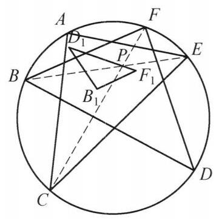

::: {.problem-meta-bar}
第 3 讲 点共线与线共点
竞赛难度
点共线与线共点 相似
:::

## 题目

圆内接六边形 ${ABCDEF}$ 满足: ${AB} \cdot  {CD} \cdot  {EF} = {BC} \cdot  {DE} \cdot  {AF}$ . 设点 $B$ 关于直线 ${AC}$ 的对称点为 ${B}_1$ ，点 $D$ 关于直线 ${CE}$ 的对称点为 ${D}_1$ ，点 $F$ 关于直线 ${EA}$ 的对称点为 ${F}_1$ . 证明 $\triangle {B}_1{D}_1{F}_1 \backsim  \triangle {BDF}$ .

图 3-6

## 参考解答

::: {.callout-important title="标准解答" collapse="false"}
如图 3-6, 由题设条件及正弦定理, 知

$$
\frac{\sin \angle {ACF}}{\sin \angle {ECF}} \cdot  \frac{\sin \angle {BEC}}{\sin \angle {BEA}} \cdot  \frac{\sin \angle {EAD}}{\sin \angle {CAD}}
$$

$$
= \frac{AF}{EF} \cdot  \frac{BC}{AB} \cdot  \frac{DE}{CD} = 1.
$$

所以,由角元塞瓦定理,得 ${CF},{BE},{AD}$ 交于一点 $P$ .

因为

$$
\angle {PC}{D}_1 = \angle {D}_1{CE} - \angle {PCE}
$$

$$
= \angle {ECD} - \angle {FCE}
$$

$$
= \angle {EAD} - \angle {FAE}
$$

$$
= \angle {EAD} - \angle {F}_1{AE}
$$

$$
= \angle {F}_{1}{AP}\text{ . }
$$

又

$$
\frac{{D}_{1}C}{CP} = \frac{DC}{CP} = \frac{FA}{AP} = \frac{{F}_{1}A}{AP},
$$

所以, $\triangle {D}_1{PC} \backsim  \triangle {F}_1{PA}$ ,故 $\frac{{D}_{1}P}{{F}_{1}P} = \frac{PC}{AP}$ ,结合 $\angle {APC} = \angle {FPD} = \angle {F}_{1}P{D}_1$ ,知 $\triangle {D}_{1}P{F}_1 \backsim  \triangle {CPA}$ ,而 $\triangle {CPA} \backsim  \triangle {DPF}$ ,故 $\triangle {D}_{1}P{F}_1 \backsim  \triangle {DPF}$ .

同理可得 $\triangle {B}_{1}P{F}_1 \backsim  \triangle {BPF},\triangle {B}_{1}P{D}_1 \backsim  \triangle {BPD}$ .

所以 $\triangle {B}_1{D}_1{F}_1 \backsim  \triangle {BDF}$ . 原问题得证.

注: ${AB} \cdot  {CD} \cdot  {EF} = {BC} \cdot  {DE} \cdot  {AF}$ 等价于 ${AD},{BE},{CF}$ 三线共点是常用转换,得到 $P$ 点后在图中导出相似即可得到结论.
:::

## 解题思路与分析

::: {.callout-note title="思路还原与分析" collapse="false"}
这份解答之所以让人觉得“费解”，是因为它采用了教材惯用的**“正向书写顺序”**（从已知直接空降辅助点和代数变形推到结论），把最关键的**“逆向探索过程”**（为什么想到找 $P$？为什么突然去证 $\triangle D_1PC \sim \triangle F_1PA$？）全部抹掉了。

如果把这道题从**命题人的构造底牌**和**解题者的逆向分析**两个维度拆解开，你会发现每一步其实都是顺藤摸瓜的必然选择。

---

### 一、 命题人的“底牌”：隐去中心 $P$ 的生成结构

看破这道题的第一步，是把题目的因果关系倒过来，还原命题人是怎么造出这道题的：

1. **真实的几何起点**：先在圆内画一个固定的 $\triangle ACE$，并在其内部**任取一点 $P$**。
2. **生成 $B, D, F$**：连接 $AP, EP, CP$ 并延长交圆于 $D, B, F$（此时 $AD, BE, CF$ 天然三线共点于 $P$）。
3. **抹去点 $P$（制造障眼法）**：命题人把点 $P$ 和三条连线擦掉，利用圆内接六边形的角元塞瓦定理，把“$AD, BE, CF$ 共点于 $P$”等价改写成边长条件 $AB \cdot CD \cdot EF = BC \cdot DE \cdot AF$。

也就是说，**点 $P$ 并不是证明过程中碰巧造出来的辅助点，而是整个图形的“生成中心”**。一旦恢复出点 $P$，原本受复杂代数式约束的六个动点，就变成了“固定 $\triangle ACE$ + 任意点 $P$”的确定性构型。

---

### 二、 逆向思维还原：那步“神来之笔”是怎么倒推出来的？

恢复出点 $P$ 后，我们的目标是证 $\triangle B_1D_1F_1 \sim \triangle BDF$。如果沿着**“从结论往已知倒推”**的思路，思维链条非常清晰，共有四个台阶：

#### 台阶 1：以 $P$ 为中心进行“剖分降维”（三点问题 $\to$ 两点问题）
* **困境**：$B_1, D_1, F_1$ 是分别关于 $\triangle ACE$ 的**三条不同边**作对称得到的。直接去算 $B_1D_1, D_1F_1, F_1B_1$ 的长度或夹角，意味着每次都要同时处理两个不同方向的轴对称，线段悬在空中，毫无着力点。
* **破局**：既然整个图形关于 $P$ 具有轮换对称性，自然想到以 $P$ 为中心，将大三角形拆成绕点 $P$ 的三个小三角形：$\triangle DPF, \triangle FPB, \triangle BPD$。
* **转化**：只要能证明将 $(B, D, F)$ 替换为 $(B_1, D_1, F_1)$ 后，绕 $P$ 的小三角形依然两两相似，即：
  $$\triangle D_1PF_1 \sim \triangle DPF, \quad \triangle F_1PB_1 \sim \triangle FPB, \quad \triangle B_1PD_1 \sim \triangle BPD$$
  那么利用公共边之比 $\frac{D_1P}{DP} = \frac{F_1P}{FP} = \frac{B_1P}{BP}$ 作为“粘合剂”，就能得出三组相似比完全相同，从而直接导出 $\triangle B_1D_1F_1 \sim \triangle BDF$。
* **收益**：此时问题降维成了只需证明**一个**子命题：$\triangle D_1PF_1 \sim \triangle DPF$（完全甩掉了 $B$ 和 $B_1$）。

#### 台阶 2：借桥过渡（把圆周上的 $D, F$ 换成对称轴上的顶点 $C, A$）
* **困境**：我们要证 $\triangle D_1PF_1 \sim \triangle DPF$，但 $D_1, F_1$ 的对称轴是 $CE$ 和 $EA$，轴上的顶点是 $A, C, E$，而 $\triangle DPF$ 里只有 $D, F$，怎么跟对称轴挂钩？
* **破局**：观察过点 $P$ 的两条相交弦 $AD$ 和 $CF$。在圆中，相交弦构成的 $\triangle DPF$ 天然与 $\triangle CPA$ 相似（对顶角相等、圆周角相等）！
* **转化**：既然 $\triangle DPF \sim \triangle CPA$，那么要证 $\triangle D_1PF_1 \sim \triangle DPF$，就**完全等价于证明**：
  $$\triangle PD_1F_1 \sim \triangle PCA$$

#### 台阶 3：共顶点旋转相似“换位”（手拉手模型实现“脱耦”）
这是全篇最核心的一步跃迁——**为什么想到去证 $\triangle PD_1C \sim \triangle PF_1A$？**
* **观察**：在目标 $\triangle PD_1F_1 \sim \triangle PCA$ 中，两个三角形**共顶点 $P$**。
* **破局**：在平面几何中，共顶点 $P$ 的旋转相似（手拉手模型）永远是**成对出现**的：
  $$\triangle PD_1F_1 \sim \triangle PCA \Longleftrightarrow \triangle PD_1C \sim \triangle PF_1A$$
* **为什么换位前做不出，换位后迎刃而解？（脱耦效应）**
  * **换位前（$\triangle PD_1F_1$）**：$D_1$ 和 $F_1$ 绑在同一个三角形里，你必须同时面对关于 $CE$ 和关于 $EA$ 的两次不同对称，边 $D_1F_1$ 是悬空的。
  * **换位后（$\triangle PD_1C$ 与 $\triangle PF_1A$）**：**两次对称被彻底拆开（脱耦）了！**
* 在 $\triangle PD_1C$ 中，只有对称点 $D_1$ 和顶点 $C$——而 **$C$ 恰好就在 $D \leftrightarrow D_1$ 的对称轴 $CE$ 上**！所以立刻有 $CD_1 = CD$。
* 在 $\triangle PF_1A$ 中，只有对称点 $F_1$ 和顶点 $A$——而 **$A$ 恰好就在 $F \leftrightarrow F_1$ 的对称轴 $EA$ 上**！所以立刻有 $AF_1 = AF$。

#### 台阶 4：按图索骥凑 SAS（水到渠成的验证）
一旦通过逆向分析锁定了“只需证 $\triangle PD_1C \sim \triangle PF_1A$”，接下来的操作就不再需要任何灵感，纯粹是围绕对称轴上的顶点 $C$ 和 $A$ 检验 **SAS 相似条件**：
1. **验夹边比（$\frac{D_1C}{CP} = \frac{F_1A}{AP}$）**：利用轴对称把 $D_1C, F_1A$ 还原为 $DC, FA$，即证 $\frac{DC}{CP} = \frac{FA}{AP}$，而这正是相交弦三角形 $\triangle PDC \sim \triangle PFA$ 的现成结论。
2. **验夹角（$\angle PCD_1 = \angle PAF_1$）**：同样利用轴对称，把关于 $CE, EA$ 翻折后的角还原回圆周角，发现它们都等于劣弧 $\overset{\frown}{DE}$ 与 $\overset{\frown}{FE}$ 所对圆周角之差（$\angle ECD - \angle FCE = \angle EAD - \angle FAE$）。

---

### 三、 思维路径对照总结

把书上的“正向写法”和真实的“逆向思考”放在一起对比，就能看清整道题的骨架：

$$\begin{array}{rcl}
\text{【终极目标】} & \triangle B_1D_1F_1 \sim \triangle BDF & \\
\Updownarrow & \footnotesize\text{（以共点 } P \text{ 为中心剖分，拆成 3 个对称子问题）} & \\
\text{【子目标 1】} & \triangle PD_1F_1 \sim \triangle PDF & \\
\Updownarrow & \footnotesize\text{（利用圆内相交弦 } AD \cap CF = P \text{，将 } \triangle PDF \text{ 替换为 } \triangle PCA\text{）} & \\
\text{【子目标 2】} & \triangle PD_1F_1 \sim \triangle PCA & \\
\Updownarrow & \footnotesize\text{（共顶点 } P \text{ 旋转相似“手拉手换位”，将 } D_1, F_1 \text{ 脱耦到各自的对称轴顶点 } C, A\text{）} & \\
\text{【核心桥梁】} & \triangle PD_1C \sim \triangle PF_1A & \\
\Updownarrow & \footnotesize\text{（利用轴对称性质 } CD_1=CD,\ AF_1=AF \text{ 还原回圆上原有的点）} & \\
\text{【已知基本事实】} & \triangle PDC \sim \triangle PFA \text{ 及同弧圆周角相等} &
\end{array}$$

### 四、 更深一层的几何背景：为什么绕 $P$ 剖分一定能成功？

也许你还会好奇：为什么点 $P$ 恰好能同时作为这三对三角形的公共相似中心？这难道不是一种巧合吗？

从几何变换的角度看，这并非巧合：
* 在证明中，$\triangle PD_1C$ 与 $\triangle PF_1A$ 是**同向相似（旋转相似）**，手拉手换位得到的 $\triangle PD_1F_1$ 与 $\triangle PCA$ 也是**同向相似**。
* 但由于相交弦构成的 $\triangle PCA$ 与 $\triangle PDF$（按 $C \leftrightarrow D, A \leftrightarrow F$ 对应）方向相反，是**反向相似（轴对称+位似）**，因此 $\triangle PD_1F_1$ 与 $\triangle PDF$ 实际上是以 $P$ 为不动点的**反向相似**。
* 同理，$\triangle PF_1B_1$ 与 $\triangle PFB$、$\triangle PB_1D_1$ 与 $\triangle PBD$ 也是以 $P$ 为中心的反向相似，且缩放比例均为 $k = \frac{PD_1}{PD} = \frac{PF_1}{PF} = \frac{PB_1}{PB}$。

换句话说，**存在一个以 $P$ 为中心的单一“反射位似变换”（即先关于过 $P$ 的某条定直线作轴对称，再以 $P$ 为中心进行位似缩放），将 $\triangle BDF$ 整体映射到了 $\triangle B_1D_1F_1$**。点 $P$ 本身就是这两个相似三角形的**自对应点（相似中心）**——正因为 $P$ 是整个变换的不动点，围绕 $P$ 进行拆解才成为了最贴合几何本质的破题方式。
:::

## 分步证明

::: {.callout-tip title="分步推理与几何步骤" collapse="false"}
### 步骤 0：初始构型与轴对称点定义

已知圆内接六边形 ABCDEF 满足 AB·CD·EF = BC·DE·AF。分别作点 B 关于直线 AC 的对称点 B₁、点 D 关于直线 CE 的对称点 D₁、点 F 关于直线 EA 的对称点 F₁。目标：证明新构成的三角形与原三角形相似，即 △B₁D₁F₁ ∽ △BDF。

### 步骤 1：角元塞瓦定理导出对角线共点于 P

在 △ACE 中考察三条主对角线 AD, BE, CF。由正弦定理与圆周角定理：sin∠ACF / sin∠ECF = AF / EF，sin∠BEC / sin∠BEA = BC / AB，sin∠EAD / sin∠CAD = DE / CD。三式相乘，代入题设条件 AB·CD·EF = BC·DE·AF：(AF/EF) · (BC/AB) · (DE/CD) = 1。由角元塞瓦定理逆定理，三对角线 AD, BE, CF 必交于一点 P！

### 步骤 2：轴对称与圆周角传递：∠PCD₁ = ∠F₁AP

由轴对称变换性质：• D₁ 关于 CE 对称于 D ⇒ D₁C = DC, ∠D₁CE = ∠DCE；• F₁ 关于 EA 对称于 F ⇒ F₁A = FA, ∠F₁AE = ∠FAE。根据同弧所对圆周角相等：∠ECD = ∠EAD，且 ∠FCE = ∠FAE = ∠F₁AE。计算顶角得：∠PCD₁ = ∠D₁CE - ∠PCE = ∠ECD - ∠FCE = ∠EAD - ∠F₁AE = ∠F₁AP！

### 步骤 3：相交弦比值导出 △D₁PC ∽ △F₁PA

在圆内接四边形中，相交弦 AD 与 CF 相交于 P。易知 △PCD ∽ △PFA，故对应边成比例：DC / CP = FA / AP。代入对称等长条件 D₁C = DC 和 F₁A = FA 得：D₁C / CP = F₁A / AP  ⟺  D₁C / F₁A = CP / AP。结合前一步已证夹角相等 ∠PCD₁ = ∠F₁AP，由两边成比例且夹角相等，判定 △D₁PC ∽ △F₁PA！

### 步骤 4：相似传递导出 △D₁PF₁ ∽ △DPF

由 △D₁PC ∽ △F₁PA，对应边成比例 D₁P / F₁P = PC / AP，且 ∠D₁PC = ∠F₁PA。考察夹角：∠D₁PF₁ = ∠D₁PC + ∠CPF₁ = ∠F₁PA + ∠CPF₁ = ∠CPA。由于对顶角相等，∠CPA = ∠DPF，故 ∠D₁PF₁ = ∠DPF！又相交弦有 △CPA ∽ △DPF ⇒ PC / AP = PD / PF，从而 D₁P / F₁P = PD / PF ⟺ D₁P / PD = F₁P / PF。结合夹角相等，证得 △D₁PF₁ ∽ △CPA ∽ △DPF！

### 步骤 5：轮换对称得出最终相似 △B₁D₁F₁ ∽ △BDF

同理，对点 B, B₁ 进行完全相同的轮换对称推导，得：• △B₁PF₁ ∽ △BPF ⇒ B₁F₁ / BF = B₁P / BP = F₁P / FP；• △B₁PD₁ ∽ △BPD ⇒ B₁D₁ / BD = B₁P / BP = D₁P / DP。综合各组对应比值，知三对对应边严格等比例：B₁D₁ / BD = D₁F₁ / DF = F₁B₁ / FB = λ。三边对应成比例，最终证得 △B₁D₁F₁ ∽ △BDF！命题得证。
:::

## 动态演示

::: {.demo-link-container}
[在新窗口打开交互式分步演示](../demos/07.html){.demo-link target="_blank" rel="noopener"}
:::

  <iframe src="../demos/07.html" title="例 7：六边形相交弦比例与相似三角形 分步演示" loading="lazy"></iframe>

