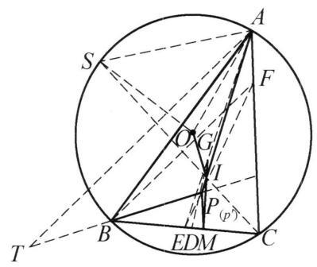

::: {.problem-meta-bar}
第 3 讲 点共线与线共点
竞赛难度
点共线与线共点 中点 相似
:::

## 题目

设 $\triangle  {ABC}$ 的外心，内心，重心分别为 $O, I, G$ . 过点 $B$ 作 ${BP} \perp  {OI}$ 交 ${AI}$ 的延长线于点 $P$ . 过点 $P$ 作 ${PM}//{AC}$ 交 ${BC}$ 于点 $M$ . 证明: $I, G, M$ 三点共线.

图 3-8

## 参考解答

::: {.callout-important title="标准解答" collapse="false"}
如图 3-8,设 ${AI}$ 与 ${BC}$ 交于点 $D,{AG}$ 与 ${BC}$ 交于点 $E$ . 要证 $I, G, M$ 三点共线，对 $\triangle  {ADE}$ 和直线 ${IGM}$ ,由梅涅劳斯定理,只需证明:

$$
\frac{AI}{ID} \cdot  \frac{DM}{ME} \cdot  \frac{EG}{GA} = 1.
$$

①

由 $I$ 为 $\triangle {ABC}$ 的内心,知

$$
\frac{AI}{ID} = \frac{AC}{CD}.
$$

②

由 ${PM}//{AC}$ ,得

$$
\frac{AC}{CD} = \frac{PM}{MD}.
$$

③

由 $G$ 为 $\triangle {ABC}$ 的重心,知

$$
\frac{EG}{GA} = \frac{1}{2}.
$$

④

由②，③，④知要证①成立，只需证明 ${PM} = {2ME}$ . 设 ${PE}$ 与 ${AC}$ 交于点 $F$ ，故只需证明 ${FC} = {2CE} = {BC}$ .

下面用同一法. 作 ${CF} = {BC}$ ，设 ${FE}$ 交 ${AD}$ 于 ${P}^{\prime }$ . 下证明 $B{P}^{\prime }\perp {OI}$ ，从而此点 ${P}^{\prime }$ 即为题目中要求的 $P$ .

连接 ${CI}$ 并延长交 $\triangle {ABC}$ 的外接圆于 $S$ ，则 $S$ 为弧 ${AB}$ 的中点且 ${SO} \perp  {AB}$ . 由鸡爪定理，有 ${SI} = {SA}$ ，且

$$
\angle {SOA} = \frac{1}{2}\angle {BOA} = \angle {ACB},
$$

于是 $\triangle {AOS} \backsim  \triangle {FCB}$ ,因此,

$$
\frac{SO}{SI} = \frac{SO}{SA} = \frac{FC}{FB}.
$$

⑤

作 ${AT} \perp  {CI}$ 交 ${P}^{\prime }B$ 的延长线于 $T$ ,则 ${AT}//{FB}$ . 因为 ${SO} \perp  {AB},{SI} \perp  {AT}$ , 所以 $\angle {OSI} = \angle {BAT}$ . 延长 $B{P}^{\prime }$ 交 ${AC}$ 于点 $X$ . 对 $\triangle {XCB}$ 及直线 $E{P}^{\prime }F$ ,由梅涅劳斯定理, 得

$$
\frac{XF}{FC} \cdot  \frac{CE}{EB} \cdot  \frac{B{P}^{\prime }}{{P}^{\prime }X} = 1,
$$

而 ${CE} = {EB},\frac{B{P}^{\prime }}{{P}^{\prime }X} = \frac{BA}{AX}$ ,所以 $\frac{XF}{FC} \cdot  \frac{BA}{AX} = 1$ .

又由 ${AT}//{FB}$ ,得 $\frac{XF}{AX} = \frac{FB}{AT}$ ,故 $\frac{BA}{FC} \cdot  \frac{FB}{AT} = 1$ ,从而

$$
\frac{FC}{FB} = \frac{BA}{AT}.
$$

⑥

由⑤，⑥得 $\frac{SO}{SI} = \frac{BA}{AT}$ ，于是结合 $\angle {OSI} = \angle {BAT}$ ，得 $\triangle  {OSI} \backsim   \triangle  {BAT}$ . 所以 ${OI} \perp \; B{P}^{\prime }$ . 即 ${P}^{\prime }$ 与 $P$ 重合.

原问题得证.

注:本题分两步证明:先用梅涅劳斯定理简化欲证结论，再用同一法证明 $B{P}^{\prime } \perp  {OI}$ ，要综合利用相似与梅涅劳斯定理，有一定的难度.
:::

## 解题思路与分析

::: {.callout-note title="思路还原与分析" collapse="false"}
这个证明之所以让人觉得“费解”甚至有些“神来之笔”，是因为它隐去了作者在草稿纸上**逆向探索**的过程，并且把两个非常经典的**高联几何标准构型（套路）**无缝拼接在了一起。

如果我们顺着作者的呈现顺序看，会不断产生疑问：“为什么要连 $PE$ 交 $AC$ 于 $F$？”、“为什么突然去外接圆上找弧中点 $S$？”、“点 $T$ 又是从哪里冒出来的？”。

下面我们站在解题者的视角，把这份解答背后**真实的思维生成过程**还原出来。

---

### 第一阶段：顺藤摸瓜，把“三点共线”转化为“定长问题”

拿到题目，要证 $I, G, M$ 三点共线。
1. **选择工具**：点 $I$ 在角平分线 $AD$ 上，点 $G$ 在中线 $AE$ 上，点 $M$ 在底边 $BC$ 上。这三条线恰好构成了 $\triangle ADE$，而 $I, G, M$ 分别在 $\triangle ADE$ 的三边（或其延长线）上。**用梅涅劳斯定理（Menelaus's Theorem）是完全本能的反应**。
2. **代数化简**：列出梅氏定理后，利用角平分线性质（$\frac{AI}{ID} = \frac{AC}{CD}$）和重心的性质（$\frac{EG}{GA} = \frac{1}{2}$），再结合题目给的平行条件 $PM \parallel AC$（提供了相似比 $\frac{AC}{CD} = \frac{PM}{MD}$），式子极其顺畅地约分，最后只剩下一个核心等价条件：
$$PM = 2ME$$
3. **几何翻译（寻找点 $F$ 的动机）**：
看到 $PM \parallel AC$，同时又要求证明一个比例关系 $\frac{PM}{ME} = 2$。在初等几何中，遇到“平行线 + 线段比例”，最自然的操作就是**构造A字型或8字型相似（中心位似）**。
连接 $PE$ 并延长交 $AC$ 于点 $F$，由于 $PM \parallel FC$，立刻有 $\triangle PME \sim \triangle FCE$。
于是，怪异的内部线段关系 $PM = 2ME$，瞬间被投射到了大三角形的边上，变成了：
$$FC = 2CE$$
而 $E$ 是 $BC$ 的中点（因为 $G$ 是重心），$2CE$ 就是 $BC$！所以，结论等价于 **$FC = BC$**。

---

### 第二阶段：为什么要用“同一法”？

走到这一步，我们的任务变成了：
> **已知**：$BP \perp OI$，$P$ 在 $AI$ 上。
> **求证**：$PE$ 与 $AC$ 的交点 $F$ 满足 $FC = BC$。

**解题者在这里遇到了最大的思维阻力**：
条件“$BP \perp OI$”是一个非常难直接使用的条件。外心 $O$ 和内心 $I$ 的连线（欧拉线方向的变体）在纯几何中几乎没有直接的成比例线段性质；而结论 $FC = BC$ 却意味着 $\triangle FCB$ 是一个**顶角为 $C$ 的等腰三角形**！

- 如果**正着推**：从一条悬空的垂线 $BP \perp OI$ 出发，去证 $\triangle FCB$ 等腰，完全无从下手。
- 如果**倒着推（同一法）**：先假定 $\triangle FCB$ 就是等腰三角形（令 $CF = CB$），那么点 $F$ 就被锁死了，$EF$ 与 $AI$ 的交点 $P'$ 也就被唯一确定了。接下来只需要去验证 **$BP' \perp OI$**。

这就是使用“同一法”的真实动机：**“等腰三角形”包含的几何信息（对称、角度、边相等）远远比“一条不知所云的垂线”丰富得多，从信息量大的一端出发去推导信息量小的一端，难度会呈指数级下降。**

---

### 第三阶段：如何破译“$BP' \perp OI$”？（最核心的机关）

现在问题变成了：已知 $CF = CB$，由 $EF$ 交 $AI$ 定出点 $P'$，怎么证 $BP' \perp OI$？

#### 1. 怎么处理孤立的线段 $OI$？（引出点 $S$）
在竞赛几何中，只要题目里出现了连接外心 $O$ 和内心 $I$ 的线段 $OI$，并且要求处理与 $OI$ 相关的角度或垂直问题，有一个**几乎是唯一指定标准动作**的辅助线——**构造鸡爪定理（Incenter-Excenter Lemma）构型**。
也就是连接某条角平分线交外接圆于弧中点 $S$。为什么？
因为外心 $O$ 掌管外接圆半径（$OS$），内心 $I$ 掌管角平分线，而鸡爪定理给出了 $SA = SB = SI$。这样一来，原本毫无瓜葛的 $O$ 和 $I$，就被放进了同一个极为规整的三角形 **$\triangle OSI$** 中！

至于选哪个角的平分线？因为我们的核心等腰三角形 $\triangle FCB$ 顶角在 $C$，为了跟 $\angle C$ 扯上关系，自然选择延长 $CI$ 交外接圆于弧 $AB$ 的中点 $S$。
连接之后，解题者马上发现了一个惊喜：
- 在 $\triangle FCB$ 中，$CF = CB$，这是顶角为 $C$ 的等腰三角形。
- 在外接圆中，$S$ 是弧 $AB$ 中点，$OS \perp AB$，圆心角的一半 $\angle SOA = \angle C$，而鸡爪定理又保证了 $SI = SA$。
这说明，$\triangle AOS$ 的形状加上 $SI=SA$ 的条件，提供的核心比例 $\frac{SO}{SI} = \frac{SO}{SA}$ 完全由 $\angle C$ 决定，恰好等于等腰 $\triangle FCB$ 中的 $\frac{FC}{FB}$！这就是证明中第⑤式的来历。

#### 2. 怎么证明两条没有交点的线垂直？（引出“旋转相似”与点 $T$）
现在我们手头有了包含 $OI$ 的 $\triangle OSI$，目标是证 $BP' \perp OI$。
在平面几何中，证明两条位置很拧巴的线段垂直（比如这里的 $OI$ 和 $BP'$），最强大的武器是**旋转 $90^\circ$ 的相似三角形**：
> 如果能找到一个三角形 $\triangle BAT$（其中 $B, P', T$ 共线），使得 $\triangle BAT \sim \triangle OSI$，并且它们的两条对应边互相垂直（即 $OS \perp AB$ 且 $SI \perp AT$），那么第三条对应边就必然垂直（即 **$OI \perp BT$**）！

**这就是点 $T$ 诞生的真正过程——它是被“倒推设计”出来的！**
解题者在草稿纸上是这样想的：
1. 我已经有了 $\triangle OSI$。
2. 我想把 $\triangle OSI$ 旋转 $90^\circ$ 并放大，贴到线段 $AB$ 上去，让 $SO$ 对应 $AB$（因为已知 $SO \perp AB$，天然满足第一组边垂直！）。
3. 那么，$SI$ 应该对应从 $A$ 点出发的一条线段 $AT$。为了让它们也垂直（$SI \perp AT$），我必须**过点 $A$ 作 $AT \perp CI$**（因为 $S, I, C$ 共线，$SI$ 就是 $CI$）！
4. 同时，由于 $\triangle FCB$ 是以 $C$ 为顶角的等腰三角形，角平分线 $CI$ 必然垂直于底边 $BF$（三线合一）。既然 $AT \perp CI$ 且 $BF \perp CI$，那么 **$AT \parallel FB$** 就是顺带白送的性质！
5. 让这条垂线 $AT$ 与 $BP'$ 的延长线交于点 $T$，我们要找的目标三角形 $\triangle BAT$ 就搭好了。

---

### 第四阶段：最后的合龙（用梅氏定理算比例）

搭好了 $\triangle BAT$ 和 $\triangle OSI$，由于两组对应边已经互相垂直（$SO \perp AB$，$SI \perp AT$），它们的夹角必然相等：$\angle OSI = \angle BAT$。
现在，距离证明 $\triangle OSI \sim \triangle BAT$ 只差最后一步：**证明夹这个角的两边成比例**，即：
$$\frac{SO}{SI} = \frac{BA}{AT}$$

既然前面第⑤式已经知道 $\frac{SO}{SI} = \frac{FC}{FB}$，那就只需证明：
$$\frac{FC}{FB} = \frac{BA}{AT}$$

到了这一步，这纯粹是一个**已知点位置、求线段比例**的常规计算题了：
- 图中有什么？有中点 $E$（来自重心），有角平分线 $AI$（来自内心），有平行线 $AT \parallel FB$。
- 延长 $BP'$ 交 $AC$ 于 $X$，在 $\triangle XCB$ 中，直线 $F-P'-E$ 是一条天然的截线，直接上**梅涅劳斯定理**，把中点 $CE=EB$ 和角平分线性质 $\frac{BP'}{P'X} = \frac{BA}{AX}$ 代进去，三下五除二就把比例倒腾出来了。

---

### 总结：整道题的思维脉络图

如果你把解答倒过来读，就会发现它其实非常自然，没有任何一步是“瞎蒙”的：

$$\begin{aligned}
\text{欲证 } I,G,M \text{ 共线} &\xrightarrow{\triangle ADE \text{ 梅氏定理}} \text{等价于 } PM = 2ME \\
&\xrightarrow{\text{延长 } PE \text{ 构造八字相似}} \text{等价于 } FC = BC \text{（出现等腰 } \triangle FCB\text{）} \\
&\xrightarrow{\text{正面难算，改用同一法}} \text{固定 } FC=BC\text{，反证 } BP' \perp OI \\
&\xrightarrow{\text{处理 } OI \text{ 的标准套路}} \text{引出弧中点 } S\text{，将 } OI \text{ 放入 } \triangle OSI \\
&\xrightarrow{\text{证垂直的标准套路：旋转 } 90^\circ \text{ 相似}} \text{因为 } OS \perp AB\text{，故作 } AT \perp SI \text{ 构造 } \triangle BAT \\
&\xrightarrow{\text{验证相似比 } \frac{BA}{AT} = \frac{FC}{FB}} \text{利用平行线与 } \triangle XCB \text{ 的梅氏定理完成封顶}
\end{aligned}$$

很多竞赛几何题的官方解答为了追求篇幅精简，习惯采用“演绎法”（直接扔出辅助线然后往下推），把最精华的“分析法”（为什么要做这条辅助线）给抹掉了。一旦看穿了**“遇到 $OI$ 找弧中点用鸡爪”**和**“证怪异垂直找 $90^\circ$ 旋转相似”**这两个标准模块，这个证明就不再是天书，而是一篇严丝合缝的八股文了。
:::

## 分步证明

::: {.callout-tip title="分步推理与几何步骤" collapse="false"}
### 步骤 0：已知条件与图形构型

设 $\triangle ABC$ 的外心为 $O$、内心为 $I$、重心为 $G$。
过点 $B$ 作 $BP \perp OI$ 交 $AI$ 的延长线于点 $P$。
过点 $P$ 作 $PM \parallel AC$ 交 $BC$ 于点 $M$。
求证目标：证明 $I, G, M$ 三点共线。

### 步骤 1：梅涅劳斯定理：共线目标转化

连结 $AI$ 交 $BC$ 于点 $D$，$AG$ 延长线交 $BC$ 于中点 $E$。
在 $\triangle ADE$ 中，待证三点 $I, G, M$ 分别位于三边所在的直线上：
• $I$ 在边 $AD$ 上，内分比为 $\frac{AI}{ID}$；
• $G$ 在边 $AE$ 上，内分比为 $\frac{EG}{GA}$；
• $M$ 在边 $DE$ 延长线上，外分比为 $\frac{DM}{ME}$。
由梅涅劳斯定理，要证 $I, G, M$ 共线，充要条件是：
$\frac{AI}{ID} \cdot \frac{DM}{ME} \cdot \frac{EG}{GA} = 1$   ①

### 步骤 2：代数化简：目标归结为 FC = BC

由角平分线性质知 $\frac{AI}{ID} = \frac{AC}{CD}$ ②；
由平行线 $PM \parallel AC$ 得 $\frac{AC}{CD} = \frac{PM}{MD}$ ③；
由重心性质知 $\frac{EG}{GA} = \frac{1}{2}$ ④。
将②、③、④代入①式化简，只需证明：$PM = 2ME$。
延长 $PE$ 交 $AC$ 延长线于点 $F$。由于 $PM \parallel FC$，由相似三角形 $\triangle PME \sim \triangle FCE$ 得 $\frac{PM}{FC} = \frac{ME}{CE}$，故只需证明：
$FC = 2CE = BC$

### 步骤 3：同一法构造：辅助点 P' 与外接圆中点 S

采用同一法证明：在射线 $CA$ 上截取点 $F$，使得 $CF = BC$。
设 $FE$ 交角平分线 $AD$ 于点 $P'$。若能证明 $BP' \perp OI$，由垂线交点的唯一性，即得 $P' = P$！
作外接圆 $\odot O$。连结 $CI$ 并延长交外接圆于点 $S$。
因 $CI$ 平分 $\angle C$，$S$ 为弧 $AB$ 中点，故 $SO \perp AB$。
由鸡爪定理（圆幂内心性质），弧中点到内心及两顶点等距：
$SI = SA = SB$

### 步骤 4：等腰相似：导出 SO/SI = FC/FB

在等腰 $\triangle AOS$ 中，$OA = OS = R$，其顶角所对弧为弧 $AS = \frac{1}{2}\text{弧}AB$：
$\angle SOA = \frac{1}{2}\angle BOA = \angle ACB$
在等腰 $\triangle FCB$ 中，作法已知 $CF = CB$，顶角 $\angle FCB = \angle ACB$。
两等腰三角形顶角相等，故两三角形相似：$\triangle AOS \sim \triangle FCB$。
由对应边成比例：$\frac{SO}{SA} = \frac{FC}{FB}$，以 $SA = SI$ 替换底边得：
$\frac{SO}{SI} = \frac{FC}{FB}$   ⑤

### 步骤 5：平行线 AT 与梅氏定理：导出 FC/FB = BA/AT

作 $AT \perp CI$ 交 $P'B$ 延长线于 $T$。
因等腰 $\triangle FCB$ 顶角平分线 $CI \perp FB$，故 $AT \parallel FB$，且易得 $\angle OSI = \angle BAT$。
延长 $BP'$ 交直线 $AC$ 于点 $X$。对 $\triangle XCB$ 及截线 $F-P'-E$ 应用梅涅劳斯定理：
$\frac{XF}{FC} \cdot \frac{CE}{EB} \cdot \frac{BP'}{P'X} = 1$
由 $CE = EB$ 及角平分线性质 $\frac{BP'}{P'X} = \frac{BA}{AX}$，结合平行线 $\frac{XF}{AX} = \frac{FB}{AT}$，整理得：
$\frac{FC}{FB} = \frac{BA}{AT}$   ⑥

### 步骤 6：相似判定与垂直归宿：证明完成

综合⑤、⑥两式得：$\frac{SO}{SI} = \frac{BA}{AT}$。
结合夹角相等 $\angle OSI = \angle BAT$，两边成比例且夹角相等：
$\triangle OSI \sim \triangle BAT$
由两三角形对应边位置垂直关系：$SO \perp BA, SI \perp AT$，则第三边必互相垂直：
$OI \perp BT \implies BP' \perp OI$
从而辅助点 $P'$ 与题目中的点 $P$ 必然重合！
由此 $PM = 2ME$ 成立，逆推回①式，$I, G, M$ 严格三点共线，命题得证！
:::

## 动态演示

::: {.demo-link-container}
[在新窗口打开交互式分步演示](../demos/09.html){.demo-link target="_blank" rel="noopener"}
:::

  <iframe src="../demos/09.html" title="例 9：欧拉线与内心、重心、外心共线 分步演示" loading="lazy"></iframe>

