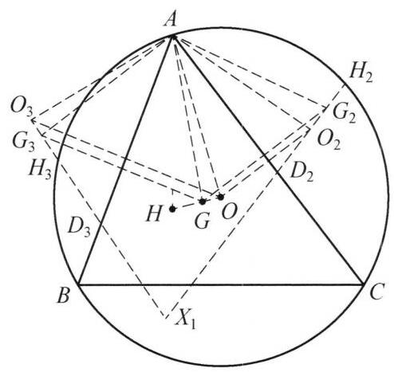

::: {.problem-meta-bar}
第 4 讲 平移、对称和旋转变换
竞赛难度
平移、对称和旋转变换 四点共圆
:::

## 题目

设 $O, G$ 分别是 $\triangle {ABC}$ 的外心和重心, $G, O$ 关于三边 ${BC},{CA},{AB}$ 的对称点分别为 ${G}_1,{G}_2,{G}_3$ 和 ${O}_1,{O}_2,{O}_3$ . 证明: 七个三角形: $\triangle {G}_2{G}_{3}A$ , $\triangle {G}_1{G}_{3}B,\triangle {G}_1{G}_{2}C,\triangle {O}_2{O}_{3}A,\triangle {O}_1{O}_{3}A,\triangle {O}_1{O}_{2}C,\triangle {ABC}$ 的外接圆共点.

图 4-4

## 参考解答

::: {.callout-important title="标准解答" collapse="false"}
如图 4-4,设 ${O}_2{G}_2$ 与 ${O}_3{G}_3$ 交于 ${X}_1$ ,类似的定义 ${X}_2,{X}_3$ .

下面证明圆 $A{O}_2{O}_3$ 与圆 $A{G}_2{G}_3$ 均经过 ${X}_1$ .

因为 ${O}_2,{G}_2$ 及 ${O}_3,{G}_3$ 分别是 $O\text{ 、 }G$ 关于 ${AC}$ 和 ${AB}$ 的对称点,所以 $\triangle A{O}_2{G}_2 \cong \; \triangle {AOG} \cong  \triangle A{O}_3{G}_3$ ,于是

$$
\angle A{G}_3{X}_1 = {180}^{ \circ  } - \angle A{G}_3{O}_3
$$

$$
= {180}^{ \circ  } - \angle A{G}_2{O}_2
$$

$$
= {180}^{ \circ  } - \angle A{G}_2{X}_1,
$$

故 ${A}_1,{G}_2,{G}_3,{X}_1$ 四点共圆.

同理由 $\angle A{O}_3{X}_1 = \angle A{O}_3{G}_3 = \angle A{O}_2{G}_2 = {180}^{ \circ  } - \angle A{O}_2{X}_1$ ,知 $A,{O}_2,{O}_3$ , ${X}_1$ 四点共圆. 故圆 $A{O}_2{O}_3$ 与圆 $A{G}_2{G}_3$ 均经过 ${X}_1$ .

设 $\triangle {ABC}$ 的垂心为 $H, H$ 关于三边 ${AB},{AC},{BC}$ 的对称点分别为 ${H}_3,{H}_2$ , ${H}_1$ ,则 ${H}_3,{H}_2,{H}_1$ 均在圆 $O$ 上且 ${H}_3$ 在 ${O}_3{G}_3$ 上, ${H}_2$ 在 ${O}_2{G}_2$ 上. 设 ${O}_3{X}_1$ 与 ${AB}$ 交于 ${D}_3,{O}_2{X}_1$ 与 ${AC}$ 交于 ${D}_2$ ,则 ${D}_3, H, G,{D}_2$ 共线,

$$
\angle {H}_3{X}_1{H}_2 = {180}^{ \circ  } - \left( {{180}^{ \circ  } - 2\angle A{D}_{3}G}\right)  - \left( {{180}^{ \circ  } - 2\angle A{D}_{2}G}\right)
$$

$$
= 2\left( {{180}^{ \circ  } - \angle {BAC}}\right)  - {180}^{ \circ  }
$$

$$
= {180}^{ \circ  } - 2\angle {BAC}
$$

$$
= \angle {H}_{3}B{H}_{2}\text{ . }
$$

故 ${X}_1$ 在圆 $O$ 上. 因此, ${O}_{2}{G}_{2}\text{ 、 }{O}_{3}{G}_{3}\text{ 、 }{O}_{1}{G}_{1}$ 交于圆 $O$ 上的同一点 ${X}_1 = {X}_2 = {X}_3 = \; X$ . 原问题得证.

注: 先定出交点 ${X}_1$ ,利用结论可知 ${X}_1$ 在圆 $A{G}_2{G}_3$ 与圆 $A{O}_2{O}_3$ 上,进而只需证明 ${X}_1$ 在圆 ${ABC}$ 上即可证明原结论,这利用点 $H$ 在欧拉线上并不难证.
:::

## 解题思路与分析

::: {.callout-note title="思路还原与分析" collapse="false"}
这份证明之所以读起来让人觉得“费解”，是因为竞赛教材采用了**综合法（由因导果）**的书写方式：它把探索过程中最后才找到的桥梁直接写在了第一句话里，并且用繁琐的局部导角掩盖了背后极其自然的**几何变换本质**。

如果我们按照**分析法（执果索因）**把解题者的真实思考过程还原出来，你会发现每一步的诞生都是顺理成章的。以下是还原这整个思维链条的四个阶段：

---

### 第一步：降维破题——为什么第一句话就想到定义 $X_1 = O_2G_2 \cap O_3G_3$？

题目要求证明 7 个圆共点：外接圆 $\odot(ABC)$、三个与 $G$ 相关的圆（如 $\odot(AG_2G_3)$）、三个与 $O$ 相关的圆（如 $\odot(AO_2O_3)$）。

面对 7 个圆，最自然的切入点是**利用对称性降维**，先只看围绕顶点 $A$ 的两个圆：**$\odot(AG_2G_3)$ 和 $\odot(AO_2O_3)$**。
这两个圆已经有一个公共点 $A$ 了。如果原题结论成立，它们的**第二个交点 $X_1$** 就必然是那 7 个圆的公共交点。因此，破题的第一步就是：**如何把 $\odot(AG_2G_3)$ 与 $\odot(AO_2O_3)$ 的第二交点 $X_1$ 显式地构造出来？**

这就引出了本题最核心的几何变换背景——**“两次轴对称 = 旋转”**：
1. 线段 $O_3G_3$ 是 $OG$ 关于 $AB$ 的轴对称图形，线段 $O_2G_2$ 是 $OG$ 关于 $AC$ 的轴对称图形。
2. 在平面几何中，**将一个图形先关于 $AB$ 作轴对称、再关于 $AC$ 作轴对称，复合变换等价于绕交点 $A$ 旋转 $2\angle BAC$**。
3. 因此，$\triangle AO_2G_2$ 实际上是由 $\triangle AO_3G_3$ **绕点 $A$ 旋转 $2\angle BAC$** 得到的同向全等三角形！

在“共顶点旋转全等（手拉手模型）”中，有一个极其经典的基本结论：
> 若 $\triangle AO_3G_3$ 绕点 $A$ 旋转得到 $\triangle AO_2G_2$，则对应边所在直线 $O_3G_3$ 与 $O_2G_2$ 的交点 $X_1$，必然同时落在 $\odot(AO_2O_3)$ 和 $\odot(AG_2G_3)$ 上（因为直线 $O_3X_1$ 旋转到 $O_2X_1$ 的旋转角，恰好等于圆周角对应的 $\angle O_3AO_2$ 和 $\angle G_3AG_2$）。

所以，原书第一句“设 $O_2G_2$ 与 $O_3G_3$ 交于 $X_1$”绝不是凭空猜出来的，而是**利用旋转全等求两圆第二交点的标准动作**。

---

### 第二步：视角升华——从“孤立的点 $O, G$”看到“整条欧拉线”

审视完第一步，你会发现一个惊人的事实：**第一步证明 $X_1$ 在 $\odot(AO_2O_3)$ 和 $\odot(AG_2G_3)$ 上，完全没有用到 $O$ 是外心、$G$ 是重心！**

哪怕 $O, G$ 是平面上任意两个点，设直线 $\ell = OG$，将直线 $\ell$ 关于 $AB, AC$ 对称得到直线 $\ell_3 (O_3G_3)$ 和 $\ell_2 (O_2G_2)$，它们的交点 $X_1 = \ell_2 \cap \ell_3$ 都满足一个通用性质：
* **通用性质**：对于直线 $\ell$ 上的**任意一点 $P$**，设其关于 $AC, AB$ 的对称点为 $P_2 \in \ell_2$ 和 $P_3 \in \ell_3$，则 $A, P_2, P_3, X_1$ 四点必共圆！

那么，本题中 $O$（外心）和 $G$（重心）的特殊性到底体现在哪？
* 连接外心 $O$ 与重心 $G$ 的直线，正是 $\triangle ABC$ 的**欧拉线（Euler Line）**！
* 直线 $O_1G_1, O_2G_2, O_3G_3$，本质上就是**欧拉线关于三边 $BC, CA, AB$ 的三条对称直线 $\ell_1, \ell_2, \ell_3$**。

---

### 第三步：神来之笔——为什么要突然引入垂心 $H$？

现在我们已经知道 $X_1 = \ell_2 \cap \ell_3$ 是前两个圆的交点，接下来要证明 **$X_1$ 落在外接圆 $\odot(ABC)$ 上**。

如果只盯着 $O_2, O_3, G_2, G_3$，这四个点都悬在外接圆 $\odot(ABC)$ 之外，很难直接与 $\odot(ABC)$ 建立联系。此时解题者自然会顺着“欧拉线”往下想：
1. **欧拉线上还有哪个著名的特殊点？** —— **垂心 $H$** 在欧拉线 $OG$ 上！
2. **垂心 $H$ 关于三边的对称点 $H_1, H_2, H_3$ 有什么性质？** —— 平面几何最经典的基本定理：**垂心关于三边的对称点 $H_1, H_2, H_3$ 恰好全部落在外接圆 $\odot(ABC)$ 上**！

把这两条性质结合起来，桥梁瞬间搭好：
* 因为 $H$ 在直线 $OG$ 上，所以 $H$ 关于 $AC, AB$ 的对称点 $H_2, H_3$ 必然分别落在对称直线 $O_2G_2 (\ell_2)$ 和 $O_3G_3 (\ell_3)$ 上。
* 这样一来，原本悬空的直线 $\ell_2, \ell_3$，立刻在外接圆 $\odot(ABC)$ 上有了两个固定的“锚点” $H_2$ 和 $H_3$！

#### 💡 比原书更直观的“零计算”证明（揭秘原书为何绕远路）
在这里，如果你直接套用我们在**第二步**总结的“通用性质”：
* 因为 $H$ 在直线 $OG$ 上，和证明 $A, O_2, O_3, X_1$ 共圆**完全同理**（由 $\triangle AH_2G_2 \cong \triangle AHG \cong \triangle AH_3G_3$），可以直接得出 **$A, H_2, H_3, X_1$ 四点共圆**！
* 而 $A, H_2, H_3$ 三点都在外接圆 $\odot(ABC)$ 上（不共线的三点确定唯一一个圆），所以 $\odot(AH_2H_3)$ **就是**外接圆 $\odot(ABC)$！由此无需任何计算，立刻证出 $X_1$ 在圆 $O$ 上！

**那原书为什么还要设 $D_2, D_3$ 去算角呢？**
原书作者没有直接调用 $A, H_2, H_3, X_1$ 共圆，而是想通过证明 $\angle H_3X_1H_2 = \angle H_3BH_2$ 来证 $H_2, H_3, B, X_1$ 共圆。为了算直线 $\ell_2$ 与 $\ell_3$ 的夹角 $\angle H_3X_1H_2$，作者取了欧拉线与 $AB, AC$ 的交点 $D_3, D_2$，在 $\triangle X_1D_2D_3$ 中导角算出：
$$\angle H_3X_1H_2 = 180^\circ - 2\angle BAC$$
其实，从我们第一步讲的“两次轴对称 = 旋转 $2\angle BAC$”来看，直线 $\ell_3$ 绕点 $A$ 旋转 $2\angle BAC$ 得到直线 $\ell_2$，**两条直线的夹角天然就是 $180^\circ - 2\angle BAC$**，这也是为什么那个看似复杂的导角式最后能把 $\angle AD_3G$ 和 $\angle AD_2G$ 全部消掉、只剩下 $180^\circ - 2\angle BAC$ 的根本原因。

---

### 第四步：填补最后的逻辑跳步——为什么 $X_1$ 在圆 $O$ 上就能推出 $X_1 = X_2 = X_3$？

原书最后写道：“故 $X_1$ 在圆 $O$ 上。因此 $O_2G_2, O_3G_3, O_1G_1$ 交于圆 $O$ 上的同一点 $X_1 = X_2 = X_3 = X$。” 这一步跨度很大，很多读者会疑惑：**我只证了 $X_1, X_2, X_3$ 都在圆 $O$ 上，凭什么说它们是同一个点？**

这里的严格逻辑是**“直线与圆至多有两个交点”的唯一性**：
1. 固定观察直线 $\ell_3$（即直线 $O_3G_3H_3$）。
2. 已知直线 $\ell_3$ 经过圆 $O$ 上的点 $H_3$。因此，直线 $\ell_3$ 与圆 $O$ 除 $H_3$ 以外，**有且仅有唯一一个第二交点**。
3. 根据我们对顶点 $A$ 的证明，直线 $\ell_3$ 与 $\ell_2$ 的交点 $X_1$ 既在直线 $\ell_3$ 上，又在圆 $O$ 上，所以 **$X_1$ 就是直线 $\ell_3$ 与圆 $O$ 的第二交点**。
4. 完全同理，对顶点 $B$ 重复上述证明，直线 $\ell_3$ 与 $\ell_1 (O_1G_1)$ 的交点 $X_2$ 也既在直线 $\ell_3$ 上，又在圆 $O$ 上，所以 **$X_2$ 也是直线 $\ell_3$ 与圆 $O$ 的第二交点**。
5. 由于同一条直线 $\ell_3$ 与圆 $O$ 的第二交点唯一，必然有 **$X_1 = X_2$**！同理可得 $X_1 = X_2 = X_3$。

---

### 拓展背景：反斯泰纳点（Anti-Steiner Point）

这道题背后其实隐藏着射影几何与三角形几何中一个非常著名的定理——**斯泰纳定理的逆定理（反斯泰纳点定理）**：
> **定理**：过三角形垂心 $H$ 的任意一条直线 $\ell$，关于 $\triangle ABC$ 三边 $BC, CA, AB$ 的三条对称直线 $\ell_1, \ell_2, \ell_3$ 必然交于外接圆 $\odot(ABC)$ 上的同一点 $X$（该点称为直线 $\ell$ 关于 $\triangle ABC$ 的**反斯泰纳点 Anti-Steiner Point**）。

在这道题中：
* 直线 $\ell$ 取为了经过垂心 $H$ 的**欧拉线 $OGH$**；
* 所得的七圆公共交点 $X$，正是欧拉线的反斯泰纳点（在 Kimberling 三角形中心百科 ETC 中被称为 **Euler reflection point，编号为 $X(110)$**）。

命题人正是以“欧拉线的反斯泰纳点性质”为内核，在其上叠加了旋转全等导出 $\odot(AG_2G_3)$ 与 $\odot(AO_2O_3)$ 过该点的性质，从而包装出了这道“七圆共点”的竞赛题。
:::

## 分步证明

::: {.callout-tip title="分步推理与几何步骤" collapse="false"}
### 步骤 0：已知条件与几何初始构型

在 △ABC 中，O 为外心，G 为重心。
点 G, O 关于三边 BC, CA, AB 的轴对称点分别记为 G1, G2, G3 与 O1, O2, O3。
核心目标：证明七个三角形 △G2G3A, △G1G3B, △G1G2C, △O2O3A, △O1O3B, △O1O2C, △ABC 的外接圆精确交于同一点。

### 步骤 1：边对称全等：△AO₂G₂ ≅ △AOG ≅ △AO₃G₃

因点 O2, G2 是点 O, G 关于经过顶点 A 的直线 AC 的对称点，轴对称变换保持线段距离与内角，故：
△AO2G2 ≅ △AOG
同理，关于经过点 A 的直线 AB 轴对称可得：
△AO3G3 ≅ △AOG
从而 △AO2G2 ≅ △AO3G3。因此对应线段相等：AG2 = AG3, AO2 = AO3，且对应角相等：
∠AG2O2 = ∠AG3O3 = ∠AGO，∠AO2G2 = ∠AO3G3。

### 步骤 2：对角互补 ⇒ 圆 AG₂G₃ 与圆 AO₂O₃ 均过交点 X

设反射直线 O2G2 与 O3G3 相交于点 X。
在四边形 AG2XG3 中，由于点 X 分别位于直线 O2G2 和 O3G3 上，根据平角与对应角性质：
∠AG3X = 180° - ∠AG3O3 = 180° - ∠AG2O2 = 180° - ∠AG2X
四边形对角互补，故四点 A, G2, X, G3 共圆，即 圆 AG2G3 经过点 X！
完全同理，由 ∠AO3X = 180° - ∠AO2X 知 圆 AO2O3 亦经过点 X。

### 步骤 3：垂心对称点落在外接圆与反射欧拉线上

设 △ABC 的垂心为 H，H 关于三边的对称点分别为 H1, H2, H3。
由经典几何性质：垂心关于三边的对称点 H1, H2, H3 均落在外接圆 ⊙(ABC) 上！
又因外心 O、重心 G、垂心 H 共线于欧拉线，故对称点 H2 必落在反射直线 O2G2 (即 XO2) 上，H3 必落在反射直线 O3G3 (即 XO3) 上。

### 步骤 4：倒角推导：∠H₃ X H₂ = ∠H₃ B H₂ ⇒ X 落在外接圆上

设欧拉线分别与边 AB, AC 相交于点 D3, D2。
在 △XD3D2 中，由轴对称反射角相等性：
∠H3XH2 = 180° - (180° - 2∠AD3G) - (180° - 2∠AD2G)
= 2(180° - ∠BAC) - 180° = 180° - 2∠BAC
而在外接圆 ⊙(ABC) 中，弧度计算可知圆周角：
∠H3BH2 = 180° - 2∠BAC
因此 ∠H3XH2 = ∠H3BH2，即四点 X, H3, B, H2 共圆！
这意味着：交点 X 恰好落在外接圆 ⊙(ABC) 上！

### 步骤 5：轮换对称：三条反射欧拉线共点于 X (Collings 定理)

完全同理，若分别考察反射直线 O1G1 与 O3G3 的交点 X2，以及 O1G1 与 O2G2 的交点 X3：
由完全相同的倒角分析，可知它们均重合于外接圆上的同一个唯一点：
X1 = X2 = X3 = X ∈ ⊙(ABC)
三条反射欧拉线 O1G1, O2G2, O3G3 完美共点于外接圆上的点 X。

### 步骤 6：汇聚闭环：七个外接圆全部经过点 X

由三边轮换对称性：
• 圆 AG2G3 与圆 AO2O3 经过点 X；
• 圆 BG1G3 与圆 BO1O3 亦经过点 X；
• 圆 CG1G2 与圆 CO1O2 亦经过点 X；
• 且原三角形外接圆 ⊙(ABC) 本身经过点 X。
至此，全部七个三角形的外接圆精确共点于 X！原命题完整获证。
:::

## 动态演示

::: {.demo-link-container}
[在新窗口打开交互式分步演示](../demos/04.html){.demo-link target="_blank" rel="noopener"}
:::

  <iframe src="../demos/04.html" title="例 4：重心坐标与平行四边形中点对称 分步演示" loading="lazy"></iframe>

