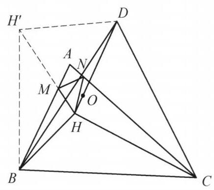

::: {.problem-meta-bar}
第 4 讲 平移、对称和旋转变换
竞赛难度
平移、对称和旋转变换
:::

## 题目

在锐角 $\triangle {ABC}$ 中, $\angle A > {60}^{ \circ  }, H$ 为 $\triangle {ABC}$ 的垂心, $M, N$ 分别在边 ${AB},{AC}$ 上,且满足 $\angle {HMB} = \angle {HNC} = {60}^{ \circ  }.O$ 为 $\triangle {HMN}$ 的外心, $D$ 使得 $\triangle {DBC}$ 为正三角形 (且 $A, D$ 在 ${BC}$ 同侧). 证明: $H, O, D$ 三点共线.

图 4-5

## 参考解答

::: {.callout-important title="标准解答" collapse="false"}
如图 4-5,由题设条件,知 $\angle {ABH} = \; \angle {ACH} = {90}^{ \circ  } - \angle A,\angle {HMB} = \angle {HNC} = {60}^{ \circ  }$ ，故 $\triangle {MHB} \backsim  \triangle {NHC}$ ，则 $\frac{MH}{NH} = \frac{BH}{HC}$ .

将 $H$ 以 $D$ 为中心顺时针旋转 ${60}^{ \circ  }$ 到 ${H}^{\prime }$ ，则 $\triangle D{H}^{\prime }H$ 为正三角形，且 $\triangle {DB}{H}^{\prime } \cong  \triangle {DCH}$ ，于是 ${H}^{\prime }B = {HC}$ ，所以

$$
\frac{MH}{NH} = \frac{BH}{B{H}^{\prime }}.
$$

①

注意到

$$
\angle {AHN} = \angle {CNH} - \angle {CAH}
$$

$$
= {60}^{ \circ  } - \left( {{90}^{ \circ  } - \angle C}\right)
$$

$$
= \angle {DBC} - \angle {CBH} = \angle {DBH}\text{ . }
$$

同理 $\angle {AHM} = \angle {DCH} = \angle {DB}{H}^{\prime }$ .

所以

$$
\angle {MHN} = \angle {AHM} + \angle {AHN} = \angle {DB}{H}^{\prime } + \angle {DBH} = \angle {HB}{H}^{\prime }.
$$

②

由①，②得 $\triangle  {H}^{\prime }{BH} \backsim   \triangle  {NHM}$ . 所以

$$
\angle {MNH} = \angle H{H}^{\prime }B = \angle D{H}^{\prime }B - \angle D{H}^{\prime }H = \angle {DHC} - {60}^{ \circ  }
$$

$$
\angle {MHO} = \frac{{180}^{ \circ  } - \angle {MOH}}{2} = {90}^{ \circ  } - \angle {MNH} = {150}^{ \circ  } - \angle {DHC}.
$$

由 ${AH} \perp  {BC}$ 得 $\angle {AHD} = \frac{1}{2}\angle {BDC} - \angle {BDH} = {30}^{ \circ  } - \angle {BDH}$ ,故

$$
\angle {HDC} = {60}^{ \circ  } - \angle {BDH} = {60}^{ \circ  } - \left( {{30}^{ \circ  } - \angle {AHD}}\right)  = \angle {AHD} + {30}^{ \circ  },
$$

$$
\angle {DHC} = {180}^{ \circ  } - \angle {HDC} - \angle {DCH} = {180}^{ \circ  } - \left( {\angle {AHD} + {30}^{ \circ  }}\right)  - \angle {AHM}.
$$

所以

$$
\angle {MHO} = {150}^{ \circ  } - \angle {DHC} = \angle {AHD} + \angle {AHM} = \angle {MHD},
$$

故 $H, O, D$ 三点共线. 原问题得证.

注:正三角形往往对应旋转 ${60}^{ \circ  }$ 的全等，结合条件中的 ${60}^{ \circ  }$ 角进一步提示要作出点 ${H}^{\prime }$ .
:::

## 解题思路与分析

::: {.callout-note title="思路还原与分析" collapse="false"}
之所以觉得这段证明“费解”，是因为教材采用的是**“从已知到未知”的公理化正向书写顺序**——一上来就做辅助线、导出一堆等角，最后突然水到渠成。这种写法抹去了思考的脚手架。

如果我们用**“逆向分析（从结论倒推需求）”**的视角把这道题拆解开，你会发现每一步构造和导角其实都是被逼出来的必然选择。我们可以将整个思维过程还原为以下四个阶段：

---

### 第一阶段：目标转化——如何破译“外心共线”？

题目要证 $H, O, D$ 三点共线，其中 $O$ 是 $\triangle HMN$ 的外心。
在平面几何中，直接处理外心 $O$ 往往很棘手，但有一个极其标准的转化工具（等角共轭的雏形）：**在 $\triangle HMN$ 中，连接顶点 $H$ 与外心 $O$ 的射线，其方向完全由内角 $\angle MNH$ 决定。**

具体来说，因为 $OM = OH$ 且圆心角 $\angle MOH = 2\angle MNH$，在等腰 $\triangle MOH$ 中必然有：
$$\angle MHO = \frac{180^\circ - \angle MOH}{2} = 90^\circ - \angle MNH$$

* **逆向思考的第一步**：要证 $H, O, D$ 共线，本质上就是要证射线 $HD$ 与射线 $HO$ 重合，也就是要证：
  $$\angle MHD = \angle MHO = 90^\circ - \angle MNH$$
* **核心痛点浮现**：$\angle MHD$ 是 $\triangle ABC$ 垂心与外部正三角形顶点构成的角，很容易用 $\triangle ABC$ 的角度来表示；但 **$\angle MNH$ 是悬在半空的 $\triangle HMN$ 的一个内角**（因为 $M, N$ 是满足 $60^\circ$ 角的浮动点，$MN$ 的位置并不直观）。

因此，破题的核心任务只有一个：**如何把 $\triangle HMN$ 的内角 $\angle MNH$，“翻译”成与 $A, B, C, H, D$ 直接相关的角？**

---

### 第二阶段：顺藤摸瓜——如何确定 $\triangle HMN$ 的形状？

既然要求 $\triangle HMN$ 的内角 $\angle MNH$，我们就必须搞清楚 $\triangle HMN$ 的**形状**（即找到一个和它相似的三角形）。

我们手里有什么关于 $\triangle HMN$ 的信息？
1. **两边之比**：题设给了 $\angle HMB = \angle HNC = 60^\circ$，而垂心天然自带 $\angle ABH = \angle ACH = 90^\circ - A$。两角对应相等，直接白送一对相似三角形：
$$\triangle MHB \sim \triangle NHC \implies \frac{MH}{NH} = \frac{BH}{HC}$$
2. **两边的夹角**：在四边形 $AMHN$ 中，$\angle AMH = \angle ANH = 120^\circ$，所以夹角是固定的：
$$\angle MHN = 360^\circ - 120^\circ - 120^\circ - A = 120^\circ - A$$

* **逆向思考的第二步（最关键的构造冲动）**：
  在 $\triangle HMN$ 中，我们知道了**两边之比**（等于 $BH : HC$），还知道了**夹角**（等于 $120^\circ - A$）。
  根据 **SAS（边角边）相似判定定理**，如果我们能把线段 $BH$ 和 $HC$ **搬到同一个顶点处**，并且让它们的夹角恰好等于 $120^\circ - A$，那么拼出来的新三角形就一定与 $\triangle HMN$ 相似！一旦相似，神秘的 $\angle MNH$ 就会被直接转移到由 $B, C, H$ 构成的图形中。

---

### 第三阶段：辅助线的诞生——为什么要把 $H$ 绕 $D$ 旋转 $60^\circ$？

现在目标非常明确：**把 $BH$ 和 $HC$ 拼到一起，让夹角为 $120^\circ - A$，同时必须把题设中孤立的正三角形 $\triangle DBC$ 用上。**

1. **为什么想到绕 $D$ 旋转 $60^\circ$？**
观察 $BH$ 和 $HC$，它们分别连着 $B$ 和 $C$。而 $\triangle DBC$ 是正三角形，意味着 $DC = DB$ 且 $\angle CDB = 60^\circ$。
在几何变换中，“共顶点的正三角形”是**旋转 $60^\circ$** 的标准信号：以 $D$ 为中心顺时针旋转 $60^\circ$，点 $C$ 就会完美地重合到点 $B$ 上！
既然如此，我们把整个 $\triangle DCH$ 绕点 $D$ 顺时针旋转 $60^\circ$，设 $H$ 落到 $H'$（即 $\triangle DBH' \cong \triangle DCH$）。这样一来，**线段 $HC$ 就被等长地搬运成了线段 $BH'$**，与 $BH$ 汇聚于同一个顶点 $B$！

2. **检验夹角是否真的等于 $120^\circ - A$：**
我们来看看搬过去之后，$BH$ 与 $BH'$ 的夹角 $\angle HBH'$ 是多少：
* $\angle DBH = \angle DBC - \angle HBC = 60^\circ - (90^\circ - C) = C - 30^\circ$
* $\angle DBH' = \angle DCH = \angle DCB - \angle HCB = 60^\circ - (90^\circ - B) = B - 30^\circ$
* 两角相加：$\angle HBH' = (C - 30^\circ) + (B - 30^\circ) = B + C - 60^\circ = 120^\circ - A = \angle MHN$！

*(注：教材证明中写 $\angle AHN = \angle DBH$ 和 $\angle AHM = \angle DBH'$，只是把 $120^\circ - A$ 拆成了左右两半分别验证：因为 $\angle AHN = 60^\circ - (90^\circ - C) = C - 30^\circ$，$\angle AHM = B - 30^\circ$。分拆写虽然严谨，但掩盖了整体夹角为 $120^\circ - A$ 的直观本质。)*

3. **顺水推舟拿到相似：**
两边之比 $\frac{BH}{BH'} = \frac{MH}{NH}$，夹角 $\angle HBH' = \angle MHN$，于是 **$\triangle H'BH \sim \triangle NHM$**。
这一下就把困在里面的 $\angle MNH$ 彻底解救出来了：
$$\angle MNH = \angle HH'B$$
而将 $H$ 绕 $D$ 旋转 $60^\circ$ 到 $H'$，顺带还附赠了一个正三角形 $\triangle DH'H$（$\angle DH'H = 60^\circ$），于是：
$$\angle MNH = \angle HH'B = \angle DH'B - \angle DH'H = \angle DHC - 60^\circ$$
代回第一阶段的目标式，就得到了：
$$\angle MHO = 90^\circ - \angle MNH = 150^\circ - \angle DHC$$

---

### 第四阶段：揭开结尾导角的伪装——最后几行在算什么？

证明的最后一段（引入 $\frac{1}{2}\angle BDC$ 和 $\angle BDH$）往往最让人摸不着头脑。为什么突然去算 $\angle AHD$ 和 $\angle HDC$？

其实，拿到 $\angle MHO = 150^\circ - \angle DHC$ 后，我们要证它等于 $\angle MHD$，也就是要证：
$$\angle MHD + \angle DHC = 150^\circ$$
把 $\angle MHD$ 拆成已知的 $\angle AHM$（即 $\angle DCH$）和 $\angle AHD$，我们要验证的等式其实就是：
$$\angle AHD + \angle DCH + \angle DHC = 150^\circ$$
而在 $\triangle DHC$ 中，由内角和定理知 $\angle DCH + \angle DHC = 180^\circ - \angle HDC$。代入上式，你会发现最后几行绕来绕去，**唯一的目的只是想证明一个极其简单的几何事实**：
$$\angle HDC - \angle AHD = 30^\circ \quad (\text{即 } \angle HDC = \angle AHD + 30^\circ)$$

**为什么这个事实是显然的？**
* 因为 $AH \perp BC$，且 $\triangle DBC$ 是正三角形（$\angle DCB = 60^\circ$），所以**直线 $AH$ 与直线 $CD$ 的夹角必然是固定的 $30^\circ$**！
* 如果你把 $AH$ 延长与 $CD$ 交于点 $P$，那么 $\angle APD = 30^\circ$。在 $\triangle PHD$ 中直接用外角定理，一秒钟就能得出：
  $$\angle HDC = \angle AHD + \angle APD = \angle AHD + 30^\circ$$
* **教材为什么不这么写？** 因为教材不想在图上多画一个交点 $P$，于是借助正三角形 $\triangle DBC$ 的对称轴（它与高线 $AH$ 平行，且平分 $\angle BDC$ 为两个 $30^\circ$），用内错角 $\angle AHD = 30^\circ - \angle BDH$ 把角度导了过去。这种“省掉交点”的写法虽然紧凑，却把原本一眼就能看穿的“两直线夹角为 $30^\circ$”变成了一串晦涩的代数消元。

---

### 总结：整道题的思维链条

把这四步串起来，这道题的诞生过程其实非常自然：

$$\begin{aligned}
\text{欲证 } H,O,D \text{ 共线} &\Longleftrightarrow \text{需证 } \angle MHD = \angle MHO = 90^\circ - \angle MNH \\
&\Longleftrightarrow \text{需计算 } \angle MNH \text{（即确定 } \triangle HMN \text{ 的形状）} \\
&\xLeftarrow{\text{已知}} \frac{MH}{NH} = \frac{BH}{HC} \text{ 且 } \angle MHN = 120^\circ - A \\
&\Longrightarrow \text{渴望将 } BH, HC \text{ 拼到一起构造 SAS 相似} \\
&\xLeftarrow{\triangle DBC \text{ 为正三角形}} \text{绕 } D \text{ 旋转 } 60^\circ \text{ 将 } HC \text{ 搬到 } BH'，\text{得 } \triangle H'BH \sim \triangle NHM \\
&\Longrightarrow \text{成功将 } \angle MNH \text{ 转化为 } \angle DHC - 60^\circ \\
&\xLeftarrow{AH \text{ 与 } CD \text{ 夹角为 } 30^\circ} \text{利用 } \triangle DHC \text{ 内角和消去角度，得出 } \angle MHO = \angle MHD.
\end{aligned}$$
:::

## 分步证明

::: {.callout-tip title="分步推理与几何步骤" collapse="false"}
### 步骤 0：已知条件与几何构型

在锐角 ΔABC 中，∠A > 60°，H 为垂心。
点 M, N 分别在边 AB, AC 上，满足 ∠HMB = ∠HNC = 60°。
O 为 ΔHMN 的外心。
以 BC 为边在 A 同侧作正三角形 ΔDBC。
目标：证明 H, O, D 三点共线。

### 步骤 1：① 垂心角与第一对相似 △MHB ∼ △NHC

因为 H 为 ΔABC 的垂心，所以高线与对边垂直：
∠ABH = ∠ACH = 90° - ∠A。
又由题设已知：∠HMB = ∠HNC = 60°。
两组对应角分别相等，故两三角形相似：
ΔMHB ∼ ΔNHC &implies; MH / NH = BH / HC

### 步骤 2：② 绕点 D 旋转 60° 构造全等 △DBH' ≅ △DCH

将点 H 绕正三角形顶点 D 顺时针旋转 60° 得到点 H'。
• 由旋转定义，ΔDH'H 为正三角形。
• 由于 ΔDBC 是正三角形，边 DC 绕 D 顺时针旋转 60° 恰与边 DB 重合。
因此整个三角形旋转对应：
ΔDBH' ≅ ΔDCH &implies; H'B = HC 且 ∠DBH' = ∠DCH
将 HC = H'B 代入前式比例，得到：
MH / NH = BH / BH'   (式 ∞)

### 步骤 3：③ 角度外角分解与夹角相等 ∠MHN = ∠HBH'

在 ΔAHN 中利用外角定理展开：
∠AHN = ∠CNH - ∠CAH = 60° - (90° - ∠C) = ∠C - 30°。
而在正三角形 ΔDBC 中：
∠DBH = ∠DBC - ∠CBH = 60° - (90° - ∠C) = ∠C - 30°。
因此：∠AHN = ∠DBH。
同理可证：∠AHM = ∠DCH = ∠DBH'。
两式相加合成大角：
∠MHN = ∠AHM + ∠AHN = ∠DBH' + ∠DBH = ∠HBH'   (式 §)

### 步骤 4：④ 第二对相似 △H'BH ∼ △NHM

由式 ∞ 与式 §：
对应边成比例：NH / MH = BH' / BH，且夹角相等：∠MHN = ∠HBH'。
根据边角边判定定理，两三角形相似：
ΔH'BH ∼ ΔNHM
从而对应角相等：
∠MNH = ∠HH'B = ∠DH'B - ∠DH'H = ∠DHC - 60°

### 步骤 5：⑤ 外心 O 的圆心角-圆周角转化

因为 O 是 ΔHMN 的外心，故 OM = OH = ON。
由圆周角与圆心角定理，顶角 ∠MOH = 2∠MNH。
在等腰 ΔMOH 中，两底角相等：
∠MHO = (180° - ∠MOH) / 2 = 90° - ∠MNH
代入前一步结论 ∠MNH = ∠DHC - 60°：
∠MHO = 90° - (∠DHC - 60°) = 150° - ∠DHC

### 步骤 6：⑥ 角度等量代换得出 H, O, D 三点共线

因为 AH ⊥ BC，而正三角形 ΔDBC 的对称轴为 BC 垂直平分线，故 AH 平行于中垂线。
由角度关系推得：
∠AHD = 30° - ∠BDH &implies; ∠HDC = 30° + ∠AHD。
在 ΔDHC 中：
∠DHC = 180° - ∠HDC - ∠DCH = 180° - (∠AHD + 30°) - ∠AHM
∠DHC = 150° - (∠AHD + ∠AHM) = 150° - ∠MHD
整理得到：∠MHD = 150° - ∠DHC。
与上一步 ∠MHO = 150° - ∠DHC 对比，立即得出：
∠MHO = ∠MHD
由于射线 HO 与射线 HD 在 HM 同侧且夹角相等，射线重合，故 H, O, D 三点共线！
✓ 命题获证 (Q.E.D.)
:::

## 动态演示

::: {.demo-link-container}
[在新窗口打开交互式分步演示](../demos/05.html){.demo-link target="_blank" rel="noopener"}
:::

  <iframe src="../demos/05.html" title="例 5：正三角形旋转与角相等证明 分步演示" loading="lazy"></iframe>

