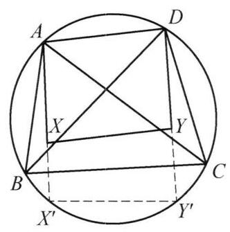

::: {.problem-meta-bar}
第 4 讲 平移、对称和旋转变换
竞赛难度
平移、对称和旋转变换
:::

## 题目

在圆内接四边形 ${ABCD}$ 中, $X, Y$ 分别为 $\triangle {ABC},\triangle {BCD}$ 的垂心. 证明: 四边形 ${AXYD}$ 是平行四边形.

## 参考解答

::: {.callout-important title="标准解答" collapse="false"}
如图 4-6,设 $X, Y$ 关于 ${BC}$ 的对称点为 ${X}^{\prime }$ , ${Y}^{\prime }$ ,则 ${X}^{\prime },{Y}^{\prime }$ 在圆 ${ABCD}$ 上,于是 ${X}^{\prime }{Y}^{\prime } = {XY}$ 且由 $X, Y$ 分别是 $\triangle {ABC},\triangle {BCD}$ 的垂心,知 $A{X}^{\prime }//D{Y}^{\prime }$ ,所以四边形 $A{X}^{\prime }{Y}^{\prime }D$ 是圆内接等腰梯形,于是 ${AD} = {XY}$ . 这表明四边形 ${AXYD}$ 要么是平行四边形要么是梯形. 注意到 ${AD}$ 和 ${X}^{\prime }{Y}^{\prime }$ 关于圆 ${ABCD}$ 的某条直径对称,而 ${XY}$ 和 ${X}^{\prime }{Y}^{\prime }$ 关于 ${BC}$ 对称,故四边形 ${AXYD}$ 不是梯形,即四边形 ${AXYD}$ 是平行四边形.

图 4-6

注: 易知有 ${AX}//{DY}$ ,再通过两次对称证明 ${XY}//{AD}$ 即可.

图 4-7
:::

## 解题思路与分析

::: {.callout-note title="思路还原与分析" collapse="false"}
你的直觉非常敏锐——这段证明之所以读起来让人觉得“别扭、费解”，是因为**教材把一个原本非常漂亮的“几何变换（平移）”思想，用一种半生不熟的“传统全等/等腰梯形”语言写了出来**，不仅绕了弯路，还把最关键的几何洞察给藏在了字里行间。

我们可以从**“第一步是怎么想到的”**、**“原作者真正隐藏的底牌是什么”**以及**“正常人做这道题会怎么想”**三个层面，把这个证明彻底扒开。

---

### 一、 破局的动机：为什么要把 $X, Y$ 关于 $BC$ 对称？

在做几何题时，任何辅助线都不是凭空捏造的，而是由条件触发的“条件反射”：

1. **痛点分析**：题目给出了 $\triangle ABC$ 和 $\triangle BCD$ 的两个垂心 $X, Y$。因为 $AX \perp BC$ 且 $DY \perp BC$，我们一眼就能看出 **$AX \parallel DY$**。但接下来就卡住了：垂心 $X, Y$ 悬空在圆的内部，各自属于不同的三角形，它们和顶部的边 $AD$ 之间没有任何直接的桥梁。
2. **核心条件反射（垂心 + 外接圆）**：在竞赛和高等平面几何中，有一个极其经典的“肌肉记忆”定理——**三角形的垂心关于底边的对称点，一定落在该三角形的外接圆上**。
3. **化“内部”为“共圆”**：$\triangle ABC$ 和 $\triangle BCD$ 共享了两样东西：**公共底边 $BC$** 和 **同一个外接圆**。一旦把 $X, Y$ 关于 $BC$ 对称出去得到 $X', Y'$，原本孤立在圆内的两个垂心，瞬间就全部跳到了同一个圆周上！此时，$A, D, X', Y'$ 四点共圆，问题就从“复杂的垂心问题”降维成了“圆内平行弦问题”。

---

### 二、 揭秘教材隐藏的底牌：为什么“两次对称”能搞定一切？

教材正文最让人抓狂的地方在于：它先用圆内接等腰梯形证出了 $AD = XY$，然后抛出了一句让人摸不着头脑的话——*“这表明 $AXYD$ 要么是平行四边形要么是梯形……注意到两次对称，故不是梯形”*。

**教材在这里藏起了最核心的一句话：那两条对称轴其实是平行的！**

我们顺着教材末尾那句简短的**“注”**，还原一下这个解法真正丝滑的本来面目：

1. **寻找第一条对称轴（那条神秘的“直径”是谁？）**：
因为 $AX \perp BC$，$X'$ 又是对称点，所以弦 $AX' \perp BC$；同理，弦 $DY' \perp BC$。
在圆中，**垂直于弦的直径必平分这条弦**。我们作一条**平行于 $BC$ 的直径 $l$**：
* 因为直径 $l \parallel BC$，所以 $l \perp AX'$ 且 $l \perp DY'$。
* 这意味着，直径 $l$ 同时是弦 $AX'$ 和弦 $DY'$ 的垂直平分线！
* 因此，关于**直径 $l$** 作轴对称时，点 $A$ 精准地映到 $X'$，点 $D$ 精准地映到 $Y'$——也就是说，**线段 $AD$ 关于直径 $l$ 对称过去，就是线段 $X'Y'$**。

2. **寻找第二条对称轴（公共边 $BC$）**：
根据辅助线的作法，点 $X', Y'$ 关于直线 $BC$ 对称回去就是 $X, Y$——也就是说，**线段 $X'Y'$ 关于直线 $BC$ 对称过去，就是线段 $XY$**。

3. **终极揭秘（两次平行轴对称 = 平移）**：
现在你看，$AD \xrightarrow{\text{关于直径 } l \text{ 对称}} X'Y' \xrightarrow{\text{关于直线 } BC \text{ 对称}} XY$。
在几何变换中有一个基本常识：**如果把一个图形先后关于两条平行的直线（$l \parallel BC$）作两次轴对称，合在一起的效果就是一个纯粹的“平移变换”！**
* 既然线段 $XY$ 是由线段 $AD$ **直接向下平移**得到的，那么 $XY$ 和 $AD$ 必然**既平行又相等**（而且方向一致，绝不可能是交错的梯形）！

> **为什么教材正文写得那么拧巴？**
> 很可能是因为这本书的这一章主题就是**“对称变换”**。作者想展示对称的威力，但在写正文时，又怕读者不熟悉“两次平行反射等于平移”的严格表述，于是试图退回到初中的“等腰梯形对角线/底边相等（$AD = XY$）”去拼凑证明；结果发现只靠 $AX \parallel DY$ 和 $AD = XY$ 排除不了等腰梯形的可能，最后还是不得不搬出“两次对称”来打补丁。而后来的审稿人（或作者自己）意识到了这个绕远路的问题，才在下面加了一行**“注”**——直接用两次对称得 $XY \parallel AD$，配上一眼可见的 $AX \parallel DY$，一步到位证出平行四边形！

---

### 三、 补充视角：如果不搞对称，“正常人”会怎么证？

如果你在考场上遇到这道题，没有往“圆上对称变换”去想，最自然的思路其实是**直接证 $AX \parallel DY$ 且 $AX = DY$**：

1. **证平行**：因为 $X, Y$ 是垂心，所以 $AX \perp BC$，$DY \perp BC$，立刻得到 $AX \parallel DY$。
2. **证相等**：利用高中/竞赛里另一个关于垂心的常用结论——**三角形顶点到垂心的距离，等于外心 $O$ 到对边距离的 $2$ 倍**（即 $AX = 2 d(O, BC)$）。
* 对于 $\triangle ABC$，它的外心是圆心 $O$，对边是 $BC$，因此 $AX = 2 d(O, BC)$。
* 对于 $\triangle BCD$，它的外心**也是同一个圆心 $O$**，对边**也是同一个 $BC$**，因此 $DY = 2 d(O, BC)$。
* 于是瞬间得出 $AX = DY$！

一组对边平行且相等（$AX \parallel DY$ 且 $AX = DY$），四边形 $AXYD$ 直接就是平行四边形。对比这两种思路，你会发现教材的方法纯粹是为了训练“轴对称变换”而设计的专项体操。

你现在看的那本教材，这一章是不是正好在讲“几何变换”或“反射与对称”？如果是的话，图 4-7 应该还有一道类似的对称题，需要一起拆解看看吗？
:::

## 分步证明

::: {.callout-tip title="分步推理与几何步骤" collapse="false"}
### 步骤 0：已知条件与图形构型

四边形 ABCD 内接于圆 ⊙O。点 X 是 △ABC 的垂心，点 Y 是 △BCD 的垂心。求证：四边形 AXYD 是平行四边形。

### 步骤 1：① 垂心反射性质 ⇒ 对称点 X', Y' 落在外接圆上

设 X, Y 关于边 BC 的轴对称点分别为 X', Y'。由垂心经典性质：三角形垂心关于任何边的对称点必落在其外接圆上。在 △ABC 中，∠BXC = 180° - ∠A；轴对称后 ∠BX'C = ∠BXC = 180° - ∠A，故 ABX'C 四点共圆，即 X' ∈ ⊙O。同理，△BCD 之外接圆亦为 ⊙O，故 Y' ∈ ⊙O。由轴对称保距性：X'Y' = XY，且线段 XY 与 X'Y' 关于直线 BC 轴对称。

### 步骤 2：② 高线共线与垂直判定 ⇒ 两对平行线

由垂心定义，高线 AX ⊥ BC；由对称定义，XX' ⊥ BC。因为过点 X 垂直于 BC 的直线唯一，所以 A, X, X' 三点共线，且割线 AX' ⊥ BC。同理，D, Y, Y' 三点共线，且割线 DY' ⊥ BC。由此立得两组垂直于同一直线的平行关系：1. 弦平行：AX' // DY'（均垂直于 BC）；2. 对边平行：AX // DY。

### 步骤 3：③ 圆内平行弦夹等腰梯形 ⇒ 边长等长 AD = XY

在外接圆 ⊙O 中，两平行弦 AX' // DY' 所夹的圆内接四边形 AX'Y'D 必然是等腰梯形。因此两腰相等：AD = X'Y'。结合步骤 ① 中轴对称得到的 X'Y' = XY，立即得出：AD = XY至此，四边形 AXYD 已满足：一组对边平行 AX // DY，另一组对边等长 AD = XY。

### 步骤 4：④ 两次平行轴反射复合 ⇒ 向量平移

等腰梯形 AX'Y'D 垂直平分底边的对称轴是圆的直径，记为 Lsym。由于底边 AX' ⊥ BC，故直径 Lsym // BC！观察两次对称变换：1. 线段 XY 关于直线 BC 反射得到线段 X'Y'；2. 线段 X'Y' 关于平行直径 Lsym 反射得到线段 AD。几何变换复合定理：关于两条平行直线先后作两次轴反射，等价于纯平移变换！

### 步骤 5：⑤ 得出最终结论 ⇒ AXYD 为平行四边形

由于线段 AD 由线段 XY 经平移变换生成，因此对应向量严格相等：向量 XY = 向量 AD（同向且等长）这保证了线段 XY // AD 且方向同向。结合步骤 ② 已证的 AX // DY，四边形 AXYD 两组对边分别平行！结论：四边形 AXYD 是平行四边形。证毕！
:::

## 动态演示

::: {.demo-link-container}
[在新窗口打开交互式分步演示](../demos/06.html){.demo-link target="_blank" rel="noopener"}
:::

  <iframe src="../demos/06.html" title="例 6：翻折对称与平行四边形判定 分步演示" loading="lazy"></iframe>

