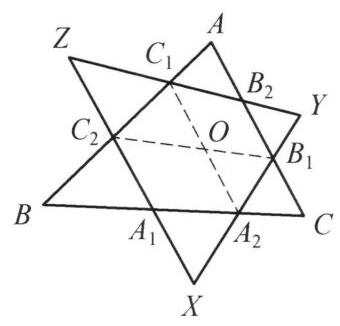

::: {.problem-meta-bar}
第 4 讲 平移、对称和旋转变换
竞赛难度
平移、对称和旋转变换 相似
:::

## 题目

设 $\triangle {ABC}$ 和 $\triangle {XYZ}$ 的交点 ${A}_1,{A}_2,{B}_1,{B}_2,{C}_1,{C}_2$ 满足 $\frac{{A}_1{A}_2}{BC} = \; \frac{{B}_1{B}_2}{AC} = \frac{{C}_1{C}_2}{AB}$ . 证明: $\frac{{A}_2{B}_1}{XY} = \frac{{B}_2{C}_1}{YZ} = \frac{{C}_2{A}_1}{ZX}$ .

## 参考解答

::: {.callout-important title="标准解答" collapse="false"}
如图 4-8,将 ${B}_2{B}_1$ 平移至 ${C}_{1}O$ ,则四边形 ${C}_{1}O{B}_1{B}_2$ 为平行四边形. 令 $\frac{{A}_1{A}_2}{BC} = \frac{{B}_1{B}_2}{AC} = \frac{{C}_1{C}_2}{AB} = \lambda$ ,在 $\triangle {C}_2{C}_{1}O$ 及 $\triangle {BAC}$ 中,由余弦定理并结合 $\angle {C}_2{C}_{1}O = \; \angle {BAC}$ ,得

$$
{C}_2{O}^2 = {C}_1{C}_2^2 + {C}_1{O}^2 - 2{C}_1{C}_2 \cdot  {C}_{1}O \cdot  \cos \angle {C}_2{C}_{1}O
$$

$$
= {C}_1{C}_2^2 + {B}_1{B}_2^2 - 2{C}_1{C}_2 \cdot  {B}_1{B}_2 \cdot  \cos \angle {C}_2{C}_{1}O
$$

$$
= {\lambda }^2\left( {A{B}^2 + A{C}^2 - {2AB} \cdot  {AC} \cdot  \cos \angle {BAC}}\right)
$$

$$
= {\lambda }^{2}B{C}^2 = {A}_1{A}_2^2,
$$

图 4-8

即 ${C}_{2}O = {A}_1{A}_2$ .

又 $\triangle {C}_2{C}_{1}O \backsim  \triangle {ABC}$ ,故 $\angle {C}_1{C}_{2}O = \angle {ABC}$ ,于是 ${C}_{2}O//{BC}$ . 即 ${C}_{2}O \perp  {BC}$ , 从而四边形 ${C}_{2}O{A}_2{A}_1$ 为平行四边形. 则 $O{A}_2//{ZX}$ ,故 $\angle O{A}_2{B}_1 = \angle {ZXY}$ . 由 $O{B}_1//{ZY}$ ,知 $\angle O{B}_1{A}_2 = \angle {ZYX}$ ,从而 $\triangle O{A}_2{B}_1 \backsim  \triangle {ZXY}$ ,所以

$$
\frac{O{A}_2}{ZX} = \frac{O{B}_1}{ZY} = \frac{{A}_2{B}_1}{XY},
$$

结合 $O{A}_2 = {C}_2{A}_1, O{B}_1 = {C}_1{B}_2$ ,得

$$
\frac{{A}_2{B}_1}{XY} = \frac{{B}_2{C}_1}{YZ} = \frac{{C}_2{A}_1}{ZX}.
$$

原问题得证.

注:通过平移，将 ${A}_1{A}_2$ ， ${B}_1{B}_2$ ， ${C}_1{C}_2$ 联系在一起，同时得到一个由 ${A}_2{B}_1$ ， ${B}_2{C}_1$ ， ${C}_2{A}_1$ 组成的三角形，再通过相似证明原问题.
:::

## 解题思路与分析

::: {.callout-note title="思路还原与分析" collapse="false"}
这个证明确实非常精妙，初看时往往会感叹“怎么能想到平移出这样一个点 $O$”。要理解这个证明的“源动力”，我们可以从**几何直观、向量思想以及逆向分析**的角度来剖析它是如何被自然“想出来”的。

---

### 一、 核心动机：如何处理“散落各处”的线段？

在题目中，我们手头有三个比例关系：
$$\frac{A_1A_2}{BC} = \frac{B_1B_2}{AC} = \frac{C_1C_2}{AB} = \lambda$$
但这三条线段 $A_1A_2$、$B_1B_2$、$C_1C_2$ 分别躺在 $\triangle ABC$ 的三条不同边上，彼此风马牛不相及。在几何中，如果要比较或运用几条分散的线段，最经典的想法就是**通过平移把它们汇聚到同一个顶点或同一个三角形中**，从而利用三角形的边角关系（如余弦定理）将它们统一处理。

这就是引入平移和辅助点 $O$ 的第一层动机：**集中兵力**。

---

### 二、 拼图游戏的构思：构造“影子三角形”

作者的目标是想把 $A_1A_2$、$B_1B_2$、$C_1C_2$ 这三条已知比例的线段组合成一个几何对象。

1. **选择基准点**：作者在 $C_1$ 处下手。将 $B_2B_1$ 平移到以 $C_1$ 为起点的向量 $C_1O$（即 $C_1O = B_2B_1$）。
2. **审视 $\triangle C_2C_1O$**：
- 这时候，$\triangle C_2C_1O$ 的一条边是 $C_1C_2$（对应原三角形的边 $AB$），另一条边是 $C_1O$（大小等于 $B_1B_2$，对应原三角形的边 $AC$）。
- 它们的夹角 $\angle C_2C_1O$ 刚好等于 $\angle BAC$（因为平移了方向）。
3. **惊艳的闭环（余弦定理）**：
- 当你在纸上写下 $\triangle C_2C_1O$ 的余弦定理时，你会发现它的第三边平方 $C_2O^2$ 的展开式，竟然和 $\triangle ABC$ 的余弦定理形式完全同构，仅差一个因子 $\lambda^2$：
$$C_2O^2 = \lambda^2 (AB^2 + AC^2 - 2AB \cdot AC \cos A) = \lambda^2 BC^2 = A_1A_2^2$$
- 也就是说，**第三边 $C_2O$ 的长度，不多不少，正好等于第三条截线段 $A_1A_2$**！
- 这一步是整个证明的点睛之笔：它通过巧妙的平移，把原本分散在三条边上的比例关系，完美地融合进了一个全新的三角形 $\triangle C_2C_1O$ 中，并且这个新三角形的三边分别对应着 $\lambda BC, \lambda CA, \lambda AB$（或者说通过平移转化成了 $A_1A_2$ 等）。

---

### 三、 顺藤摸瓜：连接 $\triangle ABC$ 与 $\triangle XYZ$

既然通过平移造出了线段 $C_2O = A_1A_2$，下一步自然是要让它和 $\triangle XYZ$ 产生联系。

1. **平行关系的涌现**：
- 因为 $\triangle C_2C_1O$ 的边长比例与 $\triangle ABC$ 对应成比例（且相似），推导出了 $C_2O \parallel BC$。
- 结合 $C_2O = A_1A_2$ 且 $C_2O \parallel A_1A_2$（因为它们都平行于 $BC$），立刻可以断定四边形 $C_2OA_2A_1$ 是平行四边形。
2. **方向的传递（架起通往 $XY, YZ, ZX$ 的桥梁）**：
- 平行四边形带来了平行线：$OA_2 \parallel ZX$，$OB_1 \parallel ZY$。
- 这样一来，点 $O$ 就像是一个“中转站”，它通过平移把 $\triangle XYZ$ 的边向内收缩或平移到了点 $O$ 周围，形成了 $\triangle OA_2B_1$。
- 证明 $\triangle OA_2B_1 \sim \triangle ZXY$ 变成了一件水到渠成的事情（因为对应边分别平行，角度相等）。

---

### 四、 总结：这种辅助线是怎么想出来的？

如果你想在以后自己也能做出这样的辅助线，其背后的思维链条其实是：

1. **“分散化”向“集中化”的转化**：看到多条散落在各边的平行或相似线段，立刻想到**向量平移**，把它们首尾相接拼成一个三角形或多边形。
2. **代数结构的敏锐度**：注意到题目给出的比例 $\lambda$ 和余弦定理中各项的二次齐次性高度吻合。构造 $\triangle C_2C_1O$ 时，故意让它包含 $AB$ 和 $AC$ 的组合，从而在代数上自然消去余弦项，化出 $BC^2$。
3. **桥梁思维**：中间变量 $O$ 的引入，本质上是找一个“坐标原点”或“载体”，把 $\triangle ABC$ 的内部交点几何（$A_1, A_2, B_1, B_2, C_1, C_2$）和外部三角形（$\triangle XYZ$）通过平行四边形平移黏合在一起。
:::

## 分步证明

::: {.callout-tip title="分步推理与几何步骤" collapse="false"}
### 步骤 0：已知条件与图形结构

如图，△ABC 与 △XYZ 的边相互交织，截点分别为 
A1, A2（在 BC 上）、
B1, B2（在 AC 上）、
C1, C2（在 AB 上）。
已知条件给出三组截线与边长成恒定比例：

A1A2⁄BC = B1B2⁄AC = C1C2⁄AB = λ

求证：△XYZ 边上的截线亦满足对应等比关系：

A2B1⁄XY = B2C1⁄YZ = C2A1⁄ZX

### 步骤 1：平移辅助线：构造平行四边形 C₁OB₁B₂

将线段 B2B1 平移至以 C1 为起点的向量 C1O，即令：

C1O // B2B1  且  C1O = B2B1

则四边形 C1OB1B2 为平行四边形。
由此导出关键等量关系：

C1O = B1B2 = λ · AC；
OB1 // C1B2（即 OB1 // YZ）且 OB1 = B2C1。

### 步骤 2：余弦定理与相似：证明 ΔC₂C₁O ~ ΔBAC

在 △C2C1O 与 △BAC 中：
1. C1C2 = λ · AB；
2. C1O = B1B2 = λ · AC；
3. 由于 C1C2 在边 AB 上，且 C1O // AC，故方向夹角 ∠C2C1O = ∠BAC。
由余弦定理计算对边 C2O 的长度：

C2O2 = C1C22 + C1O2 - 2 C1C2 · C1O · cos∠C2C1O
= λ2 (AB2 + AC2 - 2 AB · AC · cos∠BAC) = λ2 BC2 = A1A22

因此 C2O = A1A2 = λ · BC，且由 SAS 判定得：

△C2C1O ∼ △BAC

### 步骤 3：平行四边形传递：证明 C₂OA₂A₁ 为平行四边形

由 △C2C1O ∼ △BAC 可得对应角相等：

∠C1C2O = ∠ABC

因为点 C1, C2 均在直线 AB 上，由同位角相等知：

C2O // BC  （即 C2O // A1A2）

又因已证 C2O = A1A2，一组对边平行且相等，故：
四边形 C2OA2A1 为平行四边形！
由此立即获得另一组对边的平行与等长性质：

OA2 // C2A1  （即 OA2 // ZX）  且  OA2 = C2A1

### 步骤 4：核心相似三角形：证明 ΔOA₂B₁ ~ ΔZXY

考察图形中心的关键小三角形 △OA2B1 的三边位置关系：

OA2 // ZX（由平行四边形 C2OA2A1 对边）；
OB1 // ZY（由平行四边形 C1OB1B2 对边）；
边 A2B1 本身恰好落在直线 XY 上。

由两组平行线与直线 XY 的夹角关系，对应角分别相等：

∠OA2B1 = ∠ZXY  （对应 ∠X）
∠OB1A2 = ∠ZYX  （对应 ∠Y）

由两角对应相等（AAA 判定），两三角形相似：

△OA2B1 ∼ △ZXY

### 步骤 5：边长比代换：得出最终结论

根据相似三角形 △OA2B1 ∼ △ZXY 的对应边成比例：

OA2⁄ZX = OB1⁄ZY = A2B1⁄XY

将前文证明的平行四边形等长对边代入：

OA2 = C2A1
OB1 = B2C1

直接代换得到目标比例恒等式：

A2B1⁄XY = B2C1⁄YZ = C2A1⁄ZX

原命题得证！
注：通过向量平移将分散的截线统一成相似三角形，充分体现了平行四边形在几何比值传递中的转化枢纽作用。
:::

## 动态演示

::: {.demo-link-container}
[在新窗口打开交互式分步演示](../demos/08.html){.demo-link target="_blank" rel="noopener"}
:::

  <iframe src="../demos/08.html" title="例 8：两三角形同向旋转相似中心 分步演示" loading="lazy"></iframe>

