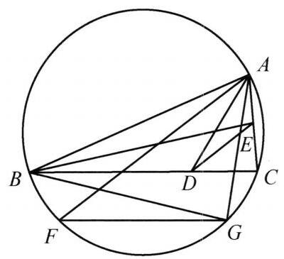

::: {.problem-meta-bar}
练习一（综合习题）
竞赛难度
练习一（综合习题）
:::

## 题目

在 $\triangle {ABC}$ 的边 ${BC},{CA}$ 上取点 $D\text{ 、 }E$ ,使得 ${AD}$ 平分 $\angle {BAC},{BE}$ 平分 $\angle {ABC}$ . 点 $F, G$ 在 $\triangle {ABC}$ 的外接圆上,满足 ${AF}//{DE},{FG}//{BC}$ . 证明: $\frac{AG}{BG} = \; \frac{{AB} + {AC}}{{AB} + {BC}}$ .

## 参考解答

::: {.callout-important title="标准解答" collapse="false"}
如图，因为 ${AF}//{DE}$ ， ${FG}//{BC}$ ，所以 $\angle {AFG} = \angle {EDC}$ . 故 $\angle {ABG} = \angle {AFG} = \; \angle {EDC}$ . 又 $\angle {AGB} = \angle {ACB} = \angle {ECD}$ ，所以， $\triangle  {ABG} \backsim   \triangle  {EDC}$ ，因此 $\frac{AG}{BG} = \frac{EC}{DC}$ . 又

$$
\frac{CE}{CD} = \frac{{AC} \times  \frac{BC}{{AB} + {BC}}}{{BC} \times  \frac{AC}{{AB} + {AC}}} = \frac{{AB} + {AC}}{{AB} + {BC}}.
$$

所以原问题得证.

:::

