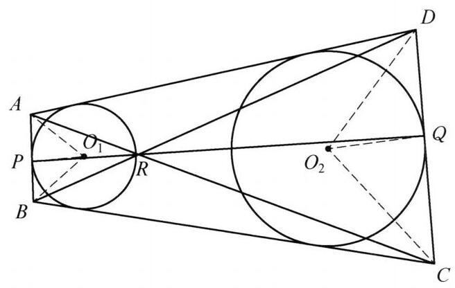

::: {.problem-meta-bar}
练习一（综合习题）
竞赛难度
练习一（综合习题） 切线
:::

## 题目

已知梯形 ${ABCD}$ 中, ${AB}//{CD}$ ,圆 ${O}_1$ 与 ${DA},{AB},{BC}$ 三边相切. 圆 ${O}_2$ 与 ${BC},{CD},{DA}$ 三边相切. 设 $P$ 是圆 ${O}_1$ 与边 ${AB}$ 的切点, $Q$ 是圆 ${O}_2$ 与边 ${CD}$ 的切点. 证明: ${AC},{BD},{PQ}$ 三线共点.

## 参考解答

::: {.callout-important title="标准解答" collapse="false"}
如图,设直线 ${AC}$ 与 ${BD}$ 交于点 $R$ ,连接 ${O}_{1}A,{O}_{1}B,{O}_{1}P,{O}_{2}C,{O}_{2}D,{O}_{2}Q$ , ${PR},{QR}$ ,由 ${BA},{BC}$ 是圆 ${O}_1$ 的切线,知 $\angle {PB}{O}_1 = \angle {CB}{O}_1 = \frac{1}{2}\angle {ABC}$ . 同理有 $\angle {QC}{O}_2 = \frac{1}{2}\angle {BCD}.$

由 ${AB}//{CD}$ ,知 $\angle {ABC} + \angle {BCD} = {180}^{ \circ  }$ ,则 $\angle {PB}{O}_1 + \angle {QC}{O}_2 = {90}^{ \circ  }$ ,故 $\mathrm{Rt}\triangle {O}_1{BP} \backsim  \mathrm{Rt}\triangle C{O}_{2}Q$ ,于是 $\frac{{O}_{1}P}{BP} = \frac{CQ}{{O}_{2}Q}$ . 同理 $\frac{AP}{{O}_{1}P} = \frac{{O}_{2}Q}{DQ}$ . 两式相乘得 $\frac{AP}{BP} = \; \frac{CQ}{DQ}$ ,由等比定理,有 $\frac{AP}{{AP} + {BP}} = \frac{CQ}{{CQ} + {DQ}}$ ,即 $\frac{AP}{AB} = \frac{CQ}{CD}$ . 由 ${AB}//{CD}$ ,知 $\triangle {ABR} \backsim$

$\triangle {CDR}$ ，则 $\frac{AR}{AB} = \frac{CR}{CD}$ 与 $\frac{AP}{AB} = \frac{CQ}{CD}$ 比较得 $\frac{AR}{AP} = \frac{CR}{CQ}$ . 又 $\angle {PAR} = \angle {QCR}$ ，则 $\triangle {PAR} \backsim  \triangle {QCR}$ ,于是 $\angle {PRA} = \angle {QRC}$ ,所以 $P, Q, R$ 三点共线，即 ${AC},{BD}$ , ${PQ}$ 三线共点. 原问题得证.

:::

