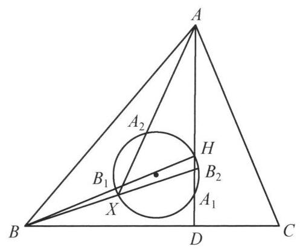

::: {.problem-meta-bar}
练习一（综合习题）
竞赛难度
练习一（综合习题） 四点共圆
:::

## 题目

设锐角 $\triangle {ABC}$ 的垂心为 $H$ ,点 $X$ 为 $\triangle {ABC}$ 所在平面上任意一点,以 ${HX}$ 为直径的圆与直线 ${AH},{AX}$ 分别交于点 ${A}_1,{A}_2$ . 类似地定义 ${B}_1,{B}_2,{C}_1,{C}_2$ . 证明: ${A}_1{A}_2,{B}_1{B}_2,{C}_1{C}_2$ 三线共点.

## 参考解答

::: {.callout-important title="标准解答" collapse="false"}
如图，因为点 ${A}_1,{A}_2,{B}_1,{B}_2,{C}_1,{C}_2$ 均在以 ${HX}$ 为直径的圆上，故由角元塞瓦定理，得

${A}_1{A}_2,{B}_1{B}_2,{C}_2{C}_2$ 三线共点

$$
\Leftrightarrow  \frac{\sin \angle {A}_{1}H{B}_2}{\sin \angle {B}_{2}H{C}_1} \cdot  \frac{\sin \angle {C}_{1}H{A}_2}{\sin \angle {A}_{2}H{B}_1} \cdot  \frac{\sin \angle {B}_{1}H{C}_2}{\sin \angle {C}_{2}H{A}_1} = 1.
$$

①

设 ${AH}$ 与 ${BC}$ 交于点 $D$ ，则 ${AD}\perp {BC}$ ，结合 $H{B}_2\perp X{B}_2$ ，知 $B, D,{B}_2, H$ 四点共圆，于是 $\angle {A}_{1}H{B}_2 = \angle {XBD}$ . 而 ${180}^{ \circ  } - \angle {B}_{2}H{C}_1 = \angle {DHC} - \angle {A}_{1}H{B}_2 = \; \angle {ABC} - \angle {XBD} = \angle {ABX}$ . 所以

$$
\frac{\sin \angle {A}_{1}H{B}_2}{\sin \angle {B}_{2}H{C}_1} = \frac{\sin \angle {XBD}}{\sin \angle {ABX}}.
$$

②

同理可得

$$
\frac{\sin \angle {C}_{1}H{A}_2}{\sin \angle {A}_{2}H{B}_1} = \frac{\sin \angle {XAB}}{\sin \angle {CAX}},\frac{\sin \angle {B}_{1}H{C}_2}{\sin \angle {C}_{2}H{A}_1} = \frac{\sin \angle {XCA}}{\sin \angle {BCX}}.
$$

③

注意到 ${AX},{BX},{CX}$ 共点于点 $X$ ,由角元塞瓦定理,得

$$
\frac{\sin \angle {XBC}}{\sin \angle {ABX}} \cdot  \frac{\sin \angle {XAB}}{\sin \angle {CAX}} \cdot  \frac{\sin \angle {XCA}}{\sin \angle {BCX}} = 1.
$$

④

由②③④三式，知①成立，所以原问题得证.

:::

