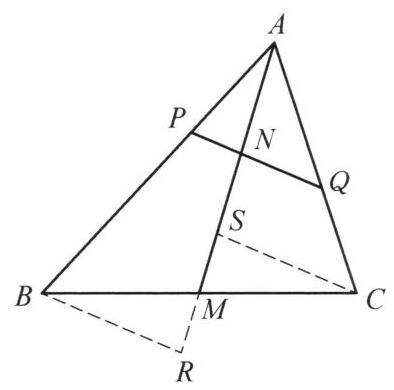

::: {.problem-meta-bar}
练习一（综合习题）
竞赛难度
练习一（综合习题）
:::

## 题目

在 $\triangle {ABC}$ 中, ${AM}$ 是 ${BC}$ 边上的中线,任作一条直线分别交 ${AB},{AC}$ , ${AM}$ 于点 $P, Q, N$ . 证明: $\frac{AB}{AP} + \frac{AC}{AQ} = \frac{2AM}{AN}$ .

## 参考解答

::: {.callout-important title="标准解答" collapse="false"}
如图，过 $C$ ， $B$ 作 ${PQ}$ 的平行线分别交 ${AM}$ 及其延长线于 $S$ ， $R$ ，则 $\triangle  {RBM} \cong$

$\triangle {SCM}$ ,于是 ${RM} = {SM}$ .

因为 ${PN}//{BR}$ ,所以 $\frac{AB}{AP} = \frac{AR}{AN}$ . 同理,有 $\frac{AC}{AQ} = \frac{AS}{AN}$ . 两式相加,得

$$
\frac{AB}{AP} + \frac{AC}{AQ} = \frac{AR}{AN} + \frac{AS}{AN}
$$

$$
= \frac{\left( {{AM} + {MR}}\right)  + \left( {{AM} - {SM}}\right) }{AN}
$$

$$
= \frac{2AM}{AN}\text{ . }
$$

原问题得证.

:::

