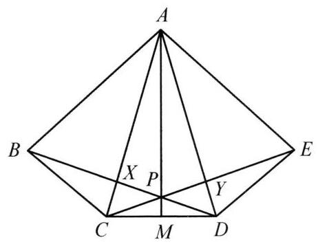

::: {.problem-meta-bar}
练习一（综合习题）
竞赛难度
练习一（综合习题） 相似
:::

## 题目

设 ${ABCDE}$ 是凸五边形且满足 $\angle {BAC} = \angle {CAD} = \angle {DAE},\angle {ABC} = \; \angle {ACD} = \angle {ADE}$ . 对角线 ${BD}$ 和 ${CE}$ 交于点 $P$ . 证明: 射线 ${AP}$ 平分 ${CD}$ .

## 参考解答

::: {.callout-important title="标准解答" collapse="false"}
如图,设 ${AC}$ 与 ${BD}$ 交于点 $X,{AD}$ 与 ${CE}$ 交于点 $Y$ . 由条件,知 $\triangle {ABC} \backsim  \triangle {ACD} \backsim \; \triangle {ADE}$ ,故四边形 ${ABCD}$ 和四边形 ${ACDE}$ 也相似,则

$$
\frac{AX}{XC} = \frac{AY}{YD}
$$

①

设射线 ${AP}$ 与 ${CD}$ 交于点 $M$ . 对 $\triangle {ACD}$ 及点 $P$ ,由塞瓦定理,有

$$
\frac{AX}{XC} \cdot  \frac{CM}{MD} \cdot  \frac{DY}{YA} = 1.
$$

②

由①,②,知 ${CM} = {MD}$ ，即 ${AP}$ 平分 ${CD}$ . 原问题得证.

:::

