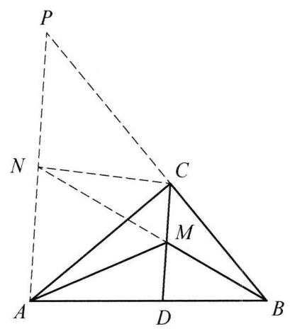

::: {.problem-meta-bar}
练习一（综合习题）
竞赛难度
练习一（综合习题） 中点
:::

## 题目

在 $\triangle {ABC}$ 中, $\angle C = {90}^{ \circ  }, D$ 为斜边 ${AB}$ 上一点, $M$ 为 ${CD}$ 的中点. 证明: 若 $\angle {AMD} = \angle {BMD}$ ,则 $\angle {ADC} = 2\angle {ACD}$ .

## 参考解答

::: {.callout-important title="标准解答" collapse="false"}
如图，过 $A$ 作 ${AP}//{CD}$ 与 ${BC}$ 的延长线交于点 $P$ ，延长 ${BM}$ 与 ${AP}$ 交于点 $N$ ，连接 ${CN}$ ，则 ${PN} = {NA} = {CN}$ ，于是 $\angle {ACM} = \angle {CAN} = \angle {NCA}$ .

又因为

$$
\angle {MNA} = \angle {NMC} = \angle {BMD} = \angle {AMD} = \angle {MAN}.
$$

于是 ${MA} = {MN}$ ，所以 $\triangle  {NMC} \cong   \triangle  {AMD}$ ，从而 $\angle {ADC} = \angle {NCM} = 2\angle {ACM} = \; 2\angle {ACD}$ . 原问题得证.

:::

