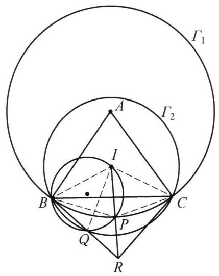

::: {.problem-meta-bar}
练习一（综合习题）
竞赛难度
练习一（综合习题） 四点共圆
:::

## 题目

在 $\triangle  {ABC}$ 中， ${AB} = {AC}$ ， $I$ 为 $\triangle  {ABC}$ 的内心，以 $A$ 为圆心， ${AB}$ 为半径作圆 ${\Gamma }_1$ ，以 $I$ 为圆心， ${IB}$ 为半径作圆 ${\Gamma }_2$ ，过点 $B$ ， $I$ 的圆 ${\Gamma }_3$ 与 ${\Gamma }_1$ ， ${\Gamma }_2$ 分别交于点 $P$ ， $Q$ (异与 $P$ ). 设 ${IP}$ 与 ${BQ}$ 交于点 $R$ . 证明: ${BR}\perp {CR}$ .

## 参考解答

::: {.callout-important title="标准解答" collapse="false"}
如图,连接 ${IB}\text{ 、 }{IC}\text{ 、 }{IQ}\text{ 、 }{PB}\text{ 、 }{PC}$ . 由于点 $Q$ 在圆 ${\Gamma }_2$ 上,故 ${IB} = {IQ}$ ,所以 $\angle {IBQ} = \; \angle {IQB}$ . 由 $B\text{ 、 }I\text{ 、 }P\text{ 、 }Q$ 四点共圆,知 $\angle {IQB} = \angle {IPB}$ ,于是 $\angle {IBQ} = \angle {IPB}$ ,因此 $\triangle {IBP} \backsim  \triangle {IRB}$ ,从而 $\angle {IRB} = \angle {IBP}$ 且 $\frac{IB}{IR} = \frac{IP}{IB}$ . 由条件知 ${IB} = {IC}$ ,故 $\frac{IC}{IR} = \; \frac{IP}{IC}$ . 于是 $\triangle {ICP} \backsim  \triangle {IRC}$ ,故 $\angle {IRC} = \angle {ICP}$ . 注意到 $\angle {BPC} = {180}^{ \circ  } - \frac{1}{2}\angle A$ , 因此

$$
\angle {BRC} = \angle {IRB} + \angle {IRC} = \angle {IBP} + \angle {ICP}
$$

$$
= {360}^{ \circ  } - \angle {BIC} - \angle {BPC}
$$

$$
= {360}^{ \circ  } - \left( {{90}^{ \circ  } + \frac{1}{2}\angle A}\right)  - \left( {{180}^{ \circ  } - \frac{1}{2}\angle A}\right)
$$

$$
= {90}^{ \circ  }\text{ . }
$$

原问题得证.

:::

