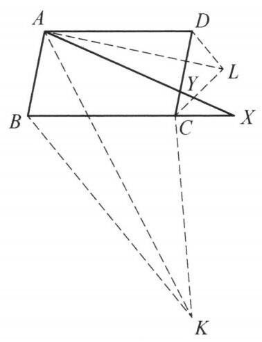

::: {.problem-meta-bar}
练习一（综合习题）
竞赛难度
练习一（综合习题）
:::

## 题目

设 ${ABCD}$ 是一个平行四边形,一条过点 $A$ 的动直线 $l$ 分别与射线 ${BC}$ 和 ${DC}$ 交于点 $X, Y$ . 设 $K, L$ 分别是 $\triangle {ABX}$ 和 $\triangle {ADY}$ 相应于顶点 $A$ 的旁切圆圆心. 证明: $\angle {KCL}$ 的大小不依赖于直线 $l$ 的选择.

## 参考解答

::: {.callout-important title="标准解答" collapse="false"}
如图,连接 ${KA},{KB},{LA},{LD},{CK},{LC}$ ,则

$$
\angle {LAD} + \angle {BAK} = \frac{1}{2}\left( {\angle {DAY} + \angle {XAB}}\right)  = \frac{1}{2}\angle {BAD},
$$

而 $\angle {LAD} + \angle {ALD} = {180}^{ \circ  } - \angle {ADL} = \frac{1}{2}\angle {BAD}$ ，于是 $\angle {BAK} = \angle {ALD}$ . 同理有 $\angle {BKA} = \angle {DAL}$ ，所以 $\triangle  {ABK} \backsim   \triangle  {LDA}$ ，则 $\frac{BA}{BK} = \frac{DL}{DA}$ . 注意到 ${AB} = {CD}$ ， ${AD} = \; {BC}$ ，从而上述比例式可写为 $\frac{BK}{BC} = \frac{DC}{DL}$ . 又 $\angle {KBC} = \frac{1}{2}\angle {BAD} = \angle {CDL}$ ，所以 $\triangle {KBC} \backsim  \triangle {CDL}$ ，故

$$
\angle {BCK} + \angle {DCL} = \angle {BCK} + \angle {BKC} = {180}^{ \circ  } - \frac{1}{2}\angle {BAD},
$$

所以

$$
\angle {KCL} = {360}^{ \circ  } - \left( {\angle {DCL} + \angle {BCD} + \angle {BCK}}\right)
$$

$$
= \frac{1}{2}\angle {BAD} + {180}^{ \circ  } - \angle {BCD}
$$

$$
= {180}^{ \circ  } - \frac{1}{2}\angle {BAD}\text{ . }
$$

即 $\angle {KCL}$ 为定值. 原问题得证.

:::

