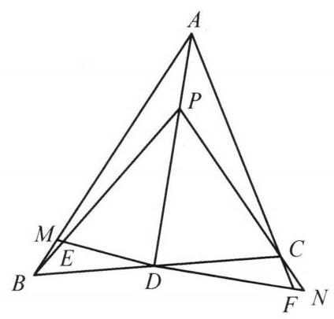

::: {.problem-meta-bar}
练习一（综合习题）
竞赛难度
练习一（综合习题）
:::

## 题目

设 $D$ 是 $\triangle {ABC}$ 的边 ${BC}$ 上的一点,点 $P$ 在线段 ${AD}$ 上,过点 $D$ 作直线, 与线段 ${AB},{PB}$ 分别交于点 $M, E$ ,与 ${AC},{PC}$ 的延长线分别交于点 $F, N$ ,已知 ${DE} = {DF}$ . 证明: ${DM} = {DN}$ .

## 参考解答

::: {.callout-important title="标准解答" collapse="false"}
如图,对 $\triangle {AMD}$ 及直线 ${PEB},\triangle {ADF}$ 及直线 ${PCN},\triangle {AMF}$ 及直线 ${BDC}$ ,由梅涅劳斯定理, 得

$$
\frac{AP}{PD} \cdot  \frac{DE}{EM} \cdot  \frac{MB}{BA} = 1,
$$

①

$$
\frac{AP}{PD} \cdot  \frac{DN}{NF} \cdot  \frac{FC}{CA} = 1,
$$

②

$$
\frac{MD}{DF} \cdot  \frac{FC}{CA} \cdot  \frac{AB}{BM} = 1.
$$

③

由①，②得， $\frac{DE}{EM}$ ， $\frac{MB}{BA} = \frac{DN}{NF}$ 。 $\frac{FC}{CA}$ ，由 ③ 得 $\frac{BM}{AB} = \frac{MD}{DF}$ 。 $\frac{FC}{CA}$ . 所以 $\frac{DE}{EM}$ . $\frac{MD}{DF} = \frac{DN}{NF}$ ， $\frac{MD}{EM} = \frac{DN}{NF}$ ，即 ${DM} = {DN}$ . 原问题得证.

:::

