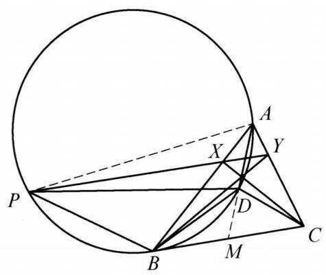

::: {.problem-meta-bar}
练习一（综合习题）
竞赛难度
练习一（综合习题） 四点共圆
:::

## 题目

已知 $\triangle {ABC}$ 内的一点 $D$ 满足 $\angle {BAD} = \angle {DBC},\angle {DAC} = \angle {BCD}.P$ 为 $\triangle {ABD}$ 的外接圆上的点,且在 $\triangle {ABC}$ 外部. 过点 $P$ 的一条直线分别与 ${AB},{AC}$ 交于点 $X, Y,\angle {XPB} = \angle {PDB}$ . 证明: ${BY}$ 与 ${CX}$ 的交点在 ${AD}$ 上.

## 参考解答

::: {.callout-important title="标准解答" collapse="false"}
如图，连接 ${AP}$ . 设 ${AD}$ 与 ${BC}$ 交于点 $M$ ，由 $\angle {DBC} = \angle {BAM}$ 及 $\angle {BMD} = \angle {BMA}$ 知 $\triangle {MBD} \backsim  \triangle {MAB}$ ，于是 $M{B}^2 = {MD} \cdot  {MA}$ . 同理有 $M{C}^2 = {MD} \cdot  {MA}$ . 从而 ${MB} = \; {MC}$ .

由 $A, D, B, P$ 四点共圆知 $\angle {BDP} = \angle {BAP}$ ，所以 $\angle {BPX} = \angle {BAP}$ 结合 $\angle {PBX} = \angle {PBA}$ ，知 $\triangle  {BPX} \backsim   \triangle  {BAP}$ ，于是 $\angle {BXP} = \angle {BPA} = \angle {BDM} = \; \angle {ABD} + \angle {BAD} = \angle {ABM}$ ，所以 ${BC}//{PX}$ ，即 ${BC}//{XY}$ ，则 $\frac{AX}{XB} = \frac{AY}{YC}$ ，故 $\frac{AX}{XB} \cdot  \frac{BM}{MC} \cdot  \frac{CY}{YA} = 1$ ，由塞瓦定理的逆定理，知 ${AM},{CX},{BY}$ 三线共点，原问题得证.

:::

