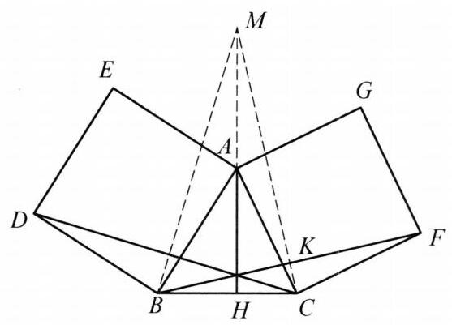

::: {.problem-meta-bar}
练习一（综合习题）
竞赛难度
练习一（综合习题）
:::

## 题目

以 $\triangle {ABC}$ 的两边 ${AB},{AC}$ 为边向外作正方形 ${ABDE},{ACFG}$ ,设 $\triangle {ABC}$ 的高为 ${AH}$ . 证明: ${AH},{BF},{CD}$ 交于一点.

## 参考解答

::: {.callout-important title="标准解答" collapse="false"}
如图,延长 ${HA}$ 至 $M$ ,使得 ${AM} = {BC}$ . 连接 ${CM},{BM}$ . 设 ${CM}$ 与 ${BF}$ 交于点 $K$ .

在 $\triangle {ACM}$ 和 $\triangle {BCF}$ 中, ${AC} = {CF},{AM} = {BC},\angle {MAC} + \angle {HAC} = {180}^{ \circ  }$ , $\angle {HAC} + \angle {HCA} = {90}^{ \circ  }$ 且 $\angle {BCF} = {90}^{ \circ  } + \angle {HCA}$ ,因此, $\angle {BCF} + \angle {HAC} = {180}^{ \circ  }$ , $\angle {MAC} = \angle {BCF}$ ，从而 $\triangle  {MAC} \cong   \triangle  {BCF}$ ， $\angle {ACM} = \angle {CFB}$ . 因此

$$
\angle {MKF} = \angle {KCF} + \angle {KFC} = \angle {KCF} + \angle {MCA} = {90}^{ \circ  },
$$

即 ${BF} \perp  {MC}$ .

同理, ${CD} \perp  {MB}$ .

这表明 ${AH},{BF},{CD}$ 为 $\triangle {MBC}$ 的三条高,故 ${AH},{BF},{CD}$ 三线交于一点. 原问题得证.

:::

