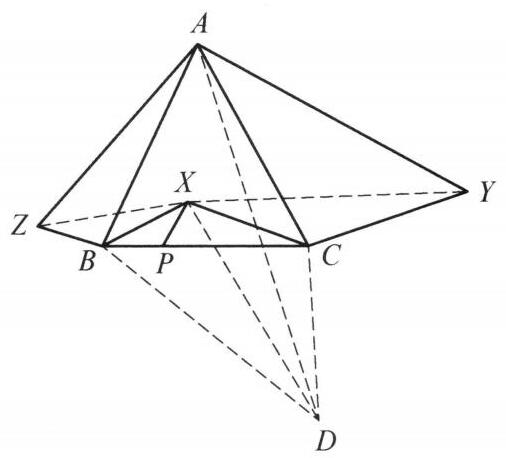

::: {.problem-meta-bar}
练习一（综合习题）
竞赛难度
练习一（综合习题）
:::

## 题目

设 $X$ 为 $\triangle {ABC}$ 内一点, $P$ 为 ${BC}$ 边上一点,点 $Y, Z$ 满足 $\triangle {ZAB} \backsim \; \triangle {XCP},\triangle {YAC} \backsim  \triangle {XBP}$ . 证明: $X, Y, Z$ 三点共线.

## 参考解答

::: {.callout-important title="标准解答" collapse="false"}
如图,过点 $X$ 作 ${XD}$ 交 $\triangle {BXC}$ 的外接圆于另一点 $D$ ,使得 $\angle {BXD} = \angle {CXP}$ ,连接 ${AD},{BD},{CD},{ZX},{XY}$ . 由条件

$$
\angle {BXD} = \angle {CXP} = \angle {AZB},
$$

$$
\angle {BDX} = \angle {PCX} = \angle {ZAB},
$$

于是 $\triangle {ZAB} \backsim  \triangle {XDB}$ ,故 $\frac{BZ}{BX} = \frac{AB}{DB},\angle {XBD} = \angle {ZBA}$ ,从而 $\triangle {BXZ} \backsim  \triangle {BAD}$ , 则 $\angle {ZXB} = \angle {ADB}$ .

同理可得 $\angle {YXC} = \angle {ADC}$ . 结合 $\angle {BDC} + \angle {BXC} = {180}^{ \circ  }$ ，知 $\angle {ZXB} + \angle {BXC} + \; \angle {YXC} = {180}^{ \circ  }$ ，即 $X, Y, Z$ 三点共线. 原问题得证.

:::

