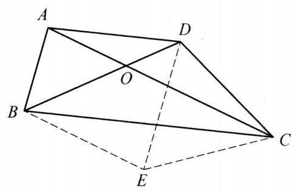

::: {.problem-meta-bar}
练习一（综合习题）
竞赛难度
练习一（综合习题）
:::

## 题目

在凸四边形 ${ABCD}$ 中, ${AD}//{BC},{AC}$ 与 ${BD}$ 交于点 $O,{AC} = {BC},{AD} = \; {CD},{AO} = {AB}$ . 求 $\angle {ABC}$ 的度数.

## 参考解答

::: {.callout-important title="标准解答" collapse="false"}
如图,作 ${BE}//{AC},{DE}//{AB}$ ,设 ${BE}$ 与 ${DE}$ 交于点 $E$ ,连接 ${CE}$ ,则 $\angle {EBD} = \; \angle {AOB} = \angle {ABO} = \angle {EDB}$ ,于是 ${BE} = {DE}$ . 又 $\angle {EBC} = \angle {ACB} = \angle {DAC}$ ,由 ${AC} = \; {BC}$ ,知 $\angle {CBA} = \angle {CAB}$ ,则 $\angle {EBA} = \angle {DAB}$ ,所以四边形 ${ABED}$ 是等腰梯形, ${BE} = {AD}$ ，则 $\triangle  {BEC} \cong   \triangle  {ADC}$ . 于是 ${CE} = {CD} = {AD} = {BE} = {DE}$ ，即 $\triangle  {CDE}$ 为正三角形，则 $\angle {DCE} = {60}^{ \circ  }$ . 故 $\angle {ABC} = {80}^{ \circ  }$ .

:::

