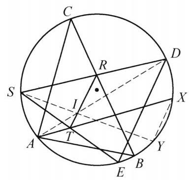

::: {.problem-meta-bar}
练习一（综合习题）
竞赛难度
练习一（综合习题） 中点
:::

## 题目

已知锐角 $\triangle {ABC}$ 的外接圆上, $D$ 为弧 $\overset{\text{ ⏜ }}{BC}$ 的中点, $X$ 在弧 $\overset{\text{ ⏜ }}{BD}$ 上, $E$ 为弧 $\overset{\text{ ⏜ }}{AX}$ 的中点, $S$ 在弧 $\overset{\text{ ⏜ }}{AC}$ 上, ${SD},{BC}$ 交于点 $R,{SE},{AX}$ 交于点 $T$ . 证明: 若 ${RT}//{DE}$ ,则 $\triangle {ABC}$ 的内心在 ${RT}$ 上.

## 参考解答

::: {.callout-important title="标准解答" collapse="false"}
如图,过 $X$ 作 ${XY}//{DE}$ 与 $\triangle {ABC}$ 的外接圆交于点 $Y$ ,连接 ${SY}$ ,设 ${SY}$ 与 ${AD}$ 交于

I. 对圆内接六边形 ${YXADES}$ 用帕斯卡定理,有 ${SY}$ 与 ${AD}$ 的交点 $I,{SE}$ 与 ${AX}$ 的交点 $T,{XY}$ 与 ${DE}$ 的交点无穷远点 $Z$ ,三点共线,又 ${RT}//{DE}$ ,故 $I$ 在 ${RT}$ 上. 因为 $\overset{\text{ ⏜ }}{DC} = \overset{\text{ ⏜ }}{DB}$ ,所以 $\angle {CSD} = \angle {DCB}$ ,故 $D{C}^2 = {DR} \cdot  {DS}$ . 由 ${XY}//{DE}$ ,知 $\overset{\text{ ⏜ }}{DY} = \overset{\text{ ⏜ }}{XE} = \; \overset{\text{ ⏜ }}{EA}$ ,于是 $\angle {DSY} = \angle {ADE} = \angle {RID}$ ,故 $D{I}^2 = {DR} \cdot  {DS}$ . 所以 ${DC} = {DI} = {DB}$ ,由鸡爪定理,得 $I$ 为 $\triangle {ABC}$ 的内心.

:::

