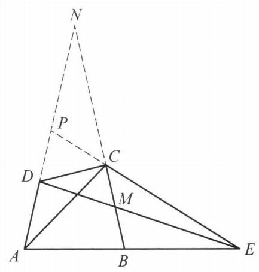

::: {.problem-meta-bar}
练习一（综合习题）
竞赛难度
练习一（综合习题） 中点 角平分线
:::

## 题目

设凸四边形 ${ABCD}$ 满足 ${AD} = {CD},\angle {DAB} = \angle {ABC} < {90}^{ \circ  }$ ,过点 $D$ 和边 ${BC}$ 中点的直线交 ${AB}$ 于点 $E$ . 证明: $\angle {BEC} = \angle {DAC}$ .

## 参考解答

::: {.callout-important title="标准解答" collapse="false"}
如图,设 ${BC}$ 的中点为 $M,{AD}$ 与 ${BC}$ 的延长线交于点 $N,{AN}$ 与 ${EC}$ 的延长线交于点 $P$ . 对 $\triangle {NDM}$ 及直线 ${PCE}$ 和 ${ABE}$ 分别应用梅涅劳斯定理,得

$$
\frac{DP}{PN} \cdot  \frac{NC}{CM} \cdot  \frac{ME}{ED} = 1,
$$

①

$$
\frac{DA}{AN} \cdot  \frac{NB}{BM} \cdot  \frac{ME}{ED} = 1.
$$

②

注意到, $\angle {NAB} = \angle {NBA}$ ,故 ${NA} = {NB}$ ,而 ${AD} = {CD},{CM} = {BM}$ . 利用①,②得

$$
\frac{DP}{PN} = \frac{AD}{NC} = \frac{DC}{CN},
$$

这表明 ${CP}$ 是 $\angle {DCN}$ 的角平分线. 于是

$$
\angle {ACP} = \angle {ACD} + \angle {DCP}
$$

$$
= \frac{1}{2}\left( {\angle {NDC} + \angle {NCD}}\right)
$$

$$
= {90}^{ \circ  } - \frac{1}{2}\angle {DNC}
$$

$$
= \angle {NAB}\text{ . }
$$

所以, $\angle {DCP} = \angle {CAB}$ ,故 $\angle {NCP} = \angle {CAB}$ ,从而 $\angle {BEC} = \angle {ABC} - \angle {BCE} = \; \angle {DAB} - \angle {NCP} = \angle {DAB} - \angle {CAB} = \angle {DAC}$ .

原问题得证.

:::

