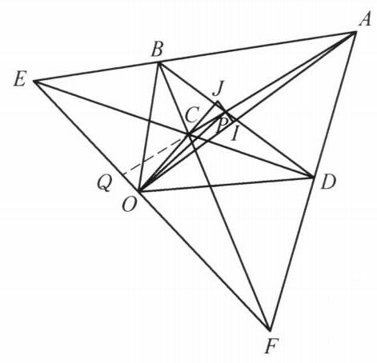

::: {.problem-meta-bar}
练习一（综合习题）
竞赛难度
练习一（综合习题）
:::

## 题目

设凸四边形 ${ABCD}$ 的两组对边所在直线交于 $E, F$ 两点,两条对角线交于点 $P$ ,过 $P$ 作 ${PO} \perp  {EF}$ 于点 $O$ . 证明: $\angle {BOC} = \angle {AOD}$ .

## 参考解答

::: {.callout-important title="标准解答" collapse="false"}
如图,延长 ${AC}$ 与 ${EF}$ 交于点 $Q$ . 对 $\triangle {AEC}$ 和点 $F$ ,由塞瓦定理,得

$$
\frac{EB}{BA} \cdot  \frac{AQ}{QC} \cdot  \frac{CD}{DE} = 1.
$$

①

对 $\triangle {AEC}$ 及直线 ${BPD}$ ,由梅涅劳斯定理,得

$$
\frac{AB}{BE} \cdot  \frac{ED}{DC} \cdot  \frac{CP}{PA} = 1.
$$

②

由①，②两式可得

$$
\frac{AP}{AQ} = \frac{PC}{QC}.
$$

③

过 $P$ 作 ${EF}$ 的平行线分别与 ${OA},{OC}$ 交于点 $I, J$ ,则

$$
\frac{PI}{QO} = \frac{AP}{AQ},\frac{JP}{QO} = \frac{PC}{QC}.
$$

④

由③,④两式,得 $\frac{PI}{QO} = \frac{JP}{QO}$ ,即 ${PI} = {PJ}$ .

又 ${OP} \perp  {IJ}$ ,则 ${OP}$ 平分 $\angle {IOJ}$ ,即 ${OP}$ 平分 $\angle {AOC}$ .

同理可证, ${OP}$ 平分 $\angle {DOB}$ .

所以 $\angle {BOC} = \angle {AOD}$ . 原问题得证.

:::

