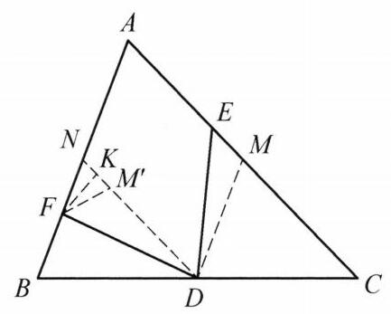

::: {.problem-meta-bar}
练习一（综合习题）
竞赛难度
练习一（综合习题） 中点
:::

## 题目

已知 $D$ 为 $\triangle {ABC}$ 的边 ${BC}$ 的中点,点 $E, F$ 分别在边 ${AC},{AB}$ 上,满足 ${DE} = {DF},\angle {EDF} = \angle {BAC}$ . 证明: ${DE} \geq  \frac{{AB} + {AC}}{4}$ .

## 参考解答

::: {.callout-important title="标准解答" collapse="false"}
如图，不妨设 ${AB} \leq  {AC}, M, N$ 分别为边 ${AC},{AB}$ 的中点，在线段 ${DN}$ 上取点 ${M}^{\prime }$ ， 满足 $D{M}^{\prime } = {DM}$ .

因为 $\angle {M}^{\prime }{DF} = \angle {MDE}$ ,所以 $\triangle {DME} \cong  \triangle D{M}^{\prime }F$ ,则 $\angle F{M}^{\prime }N = {180}^{ \circ  } - \; \angle D{M}^{\prime }F = {180}^{ \circ  } - \angle {DME} = \angle {BAC} = \angle {FN}{M}^{\prime }$ ,于是 $\triangle F{M}^{\prime }N$ 为等腰三角形. 取边 ${M}^{\prime }N$ 的中点 $K$ ,则 ${FK} \perp  {M}^{\prime }N$ ,故 ${DF} \geq  {DK} = \frac{D{M}^{\prime } + {DN}}{2} = \frac{{AB} + {AC}}{4}$ . 原问题得证.

:::

