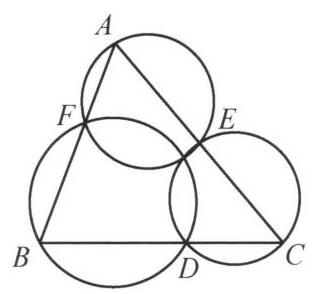
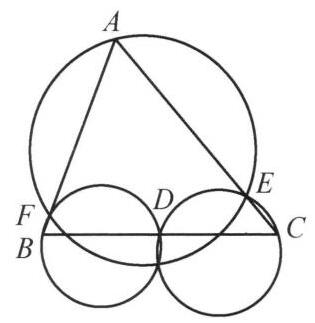
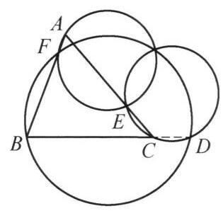

圆是平面几何中最优美的图形，与圆有关的平面几何问题占据了平面几何问题的大部分.

一、关于四点共圆，有如下结论.

图 5-1

设 ${ABCD}$ 是一个凸四边形，则下面三个结论等价:

(1) $A$ ， $B$ ， $C$ ， $D$ 四点共圆；

(2) $\angle {ABC} + \angle {CDA} = {180}^{ \circ  }$ ；

(3) $\angle {ABD} = \angle {ACD}$ .

二、设 $A, C, B, D$ 四点共线，且 $C, D$ 分别内分与外分 ${AB}$ 成同一比值，即 $\frac{AC}{CB} = \frac{AD}{DB}$ ，则称 $C$ ， $D$ 调和分割线段 ${AB}, A, C, B, D$ 称为调和点列.

三、设 $P$ 为平面上的点， $P$ 到线段 ${AB}$ 的端点的距离的比为常数，即 $\frac{AP}{BP}$ 为常数，则点 $P$ 的轨迹为一个圆，这个圆称为阿波罗尼斯圆. 该圆与直线 ${AB}$ 的交点调和分割线段 ${AB}$ ，其圆心为这两个交点的中点.

图 5-2

事实上,延长 ${AB}$ 至点 $D$ ,使得

$$
\frac{AC}{CB} = \frac{AP}{PB} = \frac{AD}{DB} = k.
$$

由角平分线定理,知 ${PC}$ 平分 $\angle {APB},{PD}$ 平分 $\angle {APB}$ 的外角. 故 $\angle {CPD} = {90}^{ \circ  }$ . 又 $C, D$ 两点确定,取 ${CD}$ 的中点 $O$ ,则点 $P$ 的轨迹是以 $O$ 为圆心, ${OC}$ 为半径的圆.

由上面的说明可知如下四个结论中, 若有两个成立, 可推出另外两个成立:

(1) ${PC}$ 平分 $\angle {APB}$ ；

(2) ${PD}$ 平分 $\angle {APB}$ 的外角；

(3) $\angle {CPD} = {90}^{ \circ  }$ ；

(4) $A, B, C, D$ 成调和点列.

四、设 $D, E, F$ 分别 $\triangle {ABC}$ 的三边 ${BC},{CA},{AB}$ 上的三点,则平面上存在一个点在三个圆 ${AEF}$ 、圆 ${BFD}$ 及圆 ${CDE}$ 上,这个点称为 $\triangle {ABC}$ 的密克点.

图 5-3

图 5-4

图 5-5
