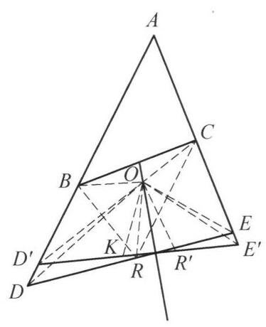

::: {.problem-meta-bar}
第 5 讲 圆的基本性质
竞赛难度
圆的基本性质 四点共圆
:::

## 题目

设直线 $l$ 与 $\triangle {ABC}$ 的边 ${AB},{AC}$ 的延长线交于点 $D, E$ . 直线 $l$ 关于 ${BC}$ 的垂直平分线的对称直线 ${l}^{\prime }$ 交 ${AB},{AC}$ 的延长线于 ${D}^{\prime },{E}^{\prime }$ . 若 ${BD} + {CE} = \; {DE}$ . 证明: $B{D}^{\prime } + C{E}^{\prime } = {D}^{\prime }{E}^{\prime }$ .

图 5-7

## 参考解答

::: {.callout-important title="标准解答" collapse="false"}
如图 5-7,在 ${DE}$ 上取点 $R$ ,使得 ${BD} = {DR}$ , 则由题设条件得 ${CE} = {ER}$ . 设 $\triangle {RBC}$ 的外心为 $O$ ,则 ${OD},{OE}$ 分别垂直平分 ${BR},{CR}$ ,即 $O$ 是 $\triangle {ADE}$ 的内心.

由于

$$
\angle A + \angle {BOC} = \angle A + 2\angle {BRC}
$$

$$
= \angle A + {360}^{ \circ  } - 2\angle {BRD} - 2\angle {CRE}
$$

$$
= \angle A + \angle {ADE} + \angle {AED}
$$

$$
= {180}^{ \circ  }\text{ . }
$$

因此, $A, B, O, C$ 四点共圆.

设 $R$ 关于 ${BC}$ 的垂直平分线的对称点为 ${R}^{\prime }$ ,则 ${R}^{\prime }$ 在 ${l}^{\prime }$ 上,因为 $\angle O{R}^{\prime }{D}^{\prime } = \; \angle {ORE} = {180}^{ \circ  } - \angle {OB}{D}^{\prime }$ ,所以, $O, B,{D}^{\prime },{R}^{\prime }$ 四点共圆,又 ${OB} = {OR} = O{R}^{\prime }$ ,故 $O{D}^{\prime }$ 平分 $\angle A{D}^{\prime }{E}^{\prime }$ ,同理 $O{E}^{\prime }$ 平分 $\angle A{E}^{\prime }{D}^{\prime }$ ,即 $O$ 是 $\triangle A{D}^{\prime }{E}^{\prime }$ 的内心.

在 ${D}^{\prime }{E}^{\prime }$ 上取点 $K$ ,使得 $K{D}^{\prime } = B{D}^{\prime }$ ,则 $\triangle {OB}{D}^{\prime } \cong  \triangle {OK}{D}^{\prime }$ ,于是 $\angle {BO}{D}^{\prime } = \; \angle {KO}{D}^{\prime }$ . 因为 $\angle {D}^{\prime }O{E}^{\prime } = \frac{1}{2}\angle A + {90}^{ \circ  }$ 及 $\angle {BOC} = {180}^{ \circ  } - \angle A$ ,所以 $\angle {BO}{D}^{\prime } + \; \angle {CO}{E}^{\prime } = {90}^{ \circ  } + \frac{1}{2}\angle A$ ,故 $\angle {CO}{E}^{\prime } = \angle {KO}{E}^{\prime }$ ,所以 $\triangle {OC}{E}^{\prime } \cong  \triangle {OK}{E}^{\prime }$ ,则 $C{E}^{\prime } = \; K{E}^{\prime }$ ,结合 $K{D}^{\prime } = B{D}^{\prime }$ ,知 $B{D}^{\prime } + C{E}^{\prime } = {D}^{\prime }{E}^{\prime }$ . 原问题得证.

注: 通过截长补短处理条件,利用 $\triangle {ADE}$ 与 $\triangle A{D}^{\prime }{E}^{\prime }$ 重合的内心 $O$ 构建两个三角形性质的关联.
:::

## 解题思路与分析

::: {.callout-note title="思路还原与分析" collapse="false"}
这份证明之所以让人觉得“费解”、像变魔术一样，是因为教材采用了数学竞赛书常见的**“擦掉脚手架”式写法**——它只保留了逻辑上最简短的推导链条，却隐藏了背后的几何直观；更雪上加霜的是，**书上的配图（图 5-7）画错了一个极其关键的几何位置关系**，直接掩盖了整道题的核心抓手。

为了帮你彻底看透这道题，我们先揭开被隐藏的两个“机关”，然后再一步步还原作者是怎么顺藤摸瓜想出这个证明的。

---

## 一、 破除迷雾：看懂这个证明的两个“隐藏机关”

### 1. 结构机关：这是一个“过桥式”（正推 + 对称 + 逆推）证明
题目给了一个关于直线 $l$ 的条件（$BD+CE=DE$），让你证对称直线 $l'$ 也有同样的性质（$BD'+CE'=D'E'$）。
直接把 $BD+CE=DE$ 对称过去是没法用的，因为 $AB, AC$ 关于 $BC$ 的垂直平分线并不对称。因此，解题者的核心策略是**寻找一个在对称变换下保持不变的“桥梁”（不变量）**。整篇证明的真实骨架其实是这样的：

$$\text{已知条件 } (BD+CE=DE) \xrightarrow{\text{第一步：正推}} \mathbf{核心中介（点\,O\,的性质）} \xrightarrow{\text{第二步：对称传递}} \mathbf{O\,对\,l'\,有相同性质} \xrightarrow{\text{第三步：逆推}} \text{结论 } (BD'+CE'=D'E')$$

你会发现，证明的**最后一段（取点 $K$）其实就是第一段（取点 $R$）的逆过程**！

### 2. 配图机关：图 5-7 画偏了对称轴，$O$ 其实就在对称轴上！
请仔细看证明的第一段：作者设 $O$ 是 $\triangle RBC$ 的外心。既然是外心，必然有 **$OB = OC$**。
到 $B, C$ 两点距离相等的点在哪里？**必然在 $BC$ 的垂直平分线上！**

然而，在图 5-7 中，绘图的老师把 $BC$ 的垂直平分线（那条穿过 $BC$ 中点的竖直实线）画在了点 $O$ 的左侧，没有穿过点 $O$！这个画图失误极具误导性：
* **真实情况是：** 对称轴（$BC$ 的垂直平分线）**死死地穿过点 $O$**。
* 这意味着：在做关于 $BC$ 垂直平分线的对称变换时，**点 $O$ 的对称点就是它自己（$O$ 是不动点）**，$B$ 和 $C$ 互相对称！

看清这一点，证明中间那段关于 $R'$ 的复杂倒角瞬间就不再神秘了。

---

## 二、 顺藤摸瓜：还原作者每一步的真实思考过程

现在我们代入解题者的视角，看看从拿到题目到写出证明，脑子里是怎么一步步触发这些辅助线的：

### 第一步：看到“$BD + CE = DE$”，条件反射用“截长补短”
在几何题中，遇到“两条线段之和等于第三条线段”（$BD + CE = DE$），最自然的条件反射就是在长线段 $DE$ 上切一刀（取点 $R$），让 $DR = BD$，剩下的 $ER$ 自然就等于 $CE$。

这一刀切下去，立刻白送了两个**等腰三角形**：$\triangle BDR$ 和 $\triangle CER$。

### 第二步：利用等腰三角形“三线合一”，挖出点 $O$ 的“双重身份”
有了等腰三角形 $\triangle BDR$（$BD=DR$）和 $\triangle CER$（$CE=ER$），怎么把它们联系起来？
在等腰三角形中，**底边的垂直平分线**和**顶角的角平分线**是同一条线（三线合一）！
于是解题者作出 $\angle BDR$（即 $\angle ADE$）的角平分线和 $\angle CER$（即 $\angle AED$）的角平分线，设它们交于点 $O$。此时奇妙的事情发生了——点 $O$ 同时拥有**双重身份**：

1. **从角平分线看：** $OD, OE$ 平分 $\triangle ADE$ 的两个内角 $\implies$ **$O$ 是 $\triangle ADE$ 的内心**（所以 $AO$ 也平分 $\angle BAC$）。
2. **从垂直平分线看：** $OD, OE$ 垂直平分 $BR, CR$ $\implies$ **$O$ 是 $\triangle RBC$ 的外心**（所以 $OB = OC = OR$）。

> **💡 破题的关键顿悟：**
> 既然 $O$ 是 $\triangle ADE$ 的内心，它就在 $\angle BAC$ 的平分线上；既然 $OB = OC$，它又在 $BC$ 的垂直平分线上！
> 这两条线都只由 $\triangle ABC$ 决定，跟直线 $l$ 在哪儿毫无关系！也就是说，**不管直线 $l$ 怎么满足条件，造出来的点 $O$ 其实是一个固定不变的点！**

### 第三步：为什么要算 $\angle A + \angle BOC = 180^\circ$？
既然发现了点 $O$ 其实是 $\triangle ABC$ 里的一个定点，我们就需要搞清楚点 $O$ 和 $\triangle ABC$ 的角度关系，留着后面逆推时用。
熟悉几何竞赛的同学一眼就能看出：“$\angle A$ 的平分线”与“$BC$ 的垂直平分线”的交点，必然落在 $\triangle ABC$ 的外接圆上（即 $A, B, O, C$ 四点共圆，$\angle A + \angle BOC = 180^\circ$）。
书上的证明为了不直接引用这个定理，顺手利用刚才的外心性质（圆心角 $\angle BOC = 2\angle BRC$）和等腰三角形底角做了一个简单的角度代换，算出了 $\angle A + \angle BOC = 180^\circ$。

### 第四步：过桥——利用对称性证明 $O$ 也是 $\triangle AD'E'$ 的内心
现在要把性质从直线 $l$ 传递到对称直线 $l'$ 上。
记住我们在第一部分揭开的秘密：**点 $O$ 就在对称轴（$BC$ 的垂直平分线）上！**
所以沿着 $BC$ 的垂直平分线折叠过去：
* 点 $O$ 不动（$O \leftrightarrow O$）；
* 点 $B$ 和点 $C$ 互换（$B \leftrightarrow C$）；
* 直线 $l$ 变成直线 $l'$（$l \leftrightarrow l'$）；
* $l$ 上的点 $R$ 变成 $l'$ 上的对称点 $R'$（$R \leftrightarrow R'$）。

因为在折叠前，$\triangle OEC \cong \triangle OER$，所以 $\angle ORE = \angle OCE$；
折叠后，$\angle OR'D'$ 就是 $\angle ORE$ 对称过去的角，而 $\angle OBD'$ 与 $\angle OCE$ 互补（因为 $A,B,O,C$ 四点共圆，$\angle OBC$ 等角关系导出 $\angle OBD' + \angle OCE = 180^\circ$），从而书上写出了 $\angle OR'D' = \angle ORE = 180^\circ - \angle OBD'$，证明了 $O, B, D', R'$ 四点共圆。
再由弦相等（$OB = OR'$）推出圆周角相等（$OD'$ 平分 $\angle AD'E'$），同理 $OE'$ 平分 $\angle AE'D'$，成功证明 **$O$ 也是 $\triangle AD'E'$ 的内心**！

*(注：这一步其实有极其简单的看法，见文末第三部分。)*

### 第五步：过河拆桥的逆推——从“$O$ 是内心”证回“$BD'+CE'=D'E'$”
现在我们已经知道 $O$ 是 $\triangle AD'E'$ 的内心，且满足 $OB = OC$ 和 $\angle BOC = 180^\circ - \angle A$。怎么证 $BD' + CE' = D'E'$？
完全模仿第一步！我们在 $D'E'$ 上截取 $D'K = D'B$，连接 $OK$。
1. 因为 $OD'$ 是角平分线，由 $\text{SAS}$ 立刻得到 $\triangle OBD' \cong \triangle OKD'$，从而 **$OB = OK$**，且 **$\angle BOD' = \angle KOD'$**。
2. 接下来只要能证明 $\triangle OCE' \cong \triangle OKE'$，就能得出 $CE' = KE'$，大功告成！
3. 对比 $\triangle OCE'$ 和 $\triangle OKE'$：我们已经有了 $OC = OB = OK$（一对边相等），$OE' = OE'$（公共边），只差夹角 **$\angle COE' = \angle KOE'$**！
4. 怎么算这个夹角？围绕点 $O$ 一周的周角是 $360^\circ$（看图 5-7 中点 $O$ 周围的四个角）：
$$\angle BOD' + \angle COE' = 360^\circ - \angle BOC - \angle D'OE'$$
代入已知的 $\angle BOC = 180^\circ - \angle A$ 和三角形内心经典公式 $\angle D'OE' = 90^\circ + \frac{1}{2}\angle A$：
$$\angle BOD' + \angle COE' = 360^\circ - (180^\circ - \angle A) - \left(90^\circ + \frac{1}{2}\angle A\right) = 90^\circ + \frac{1}{2}\angle A = \angle D'OE'$$
而 $\angle D'OE'$ 正好被 $OK$ 分成 $\angle KOD' + \angle KOE'$！
既然 $\angle BOD' + \angle COE' = \angle KOD' + \angle KOE'$，两边消去相等的 $\angle BOD'$ 和 $\angle KOD'$，立刻得到 **$\angle COE' = \angle KOE'$**！

至此，$\triangle OCE' \cong \triangle OKE'$（$\text{SAS}$）得证，$CE' = KE'$，从而 $BD' + CE' = D'K + KE' = D'E'$。

---

## 三、 降维打击：站在更高视角看本质（为什么不用 $R'$ 也能秒证）

如果你理解了上面说的**“点 $O$ 在对称轴（$BC$ 垂直平分线）上”**，你会发现书上证明中间那段引入对称点 $R'$、证四点共圆的过程其实绕了远路，完全可以用**“距离对称”**一眼看穿：

1. 在证明前半段，我们已经知道 $O$ 是 $\triangle ADE$ 的内心，且 $OB = OC$。
2. 既然 $O$ 是 $\triangle ADE$ 的内心，说明**点 $O$ 到三边 $AB, AC, DE$（即直线 $l$）的距离都相等**（设这个距离为内切圆半径 $r$）。
3. 既然 $OB = OC$，说明**点 $O$ 在 $BC$ 的垂直平分线上**。
4. 现在把直线 $l$ 沿着 $BC$ 的垂直平分线对称翻折得到 $l'$。因为点 $O$ 就在对称轴上（翻折后原地不动），所以**点 $O$ 到对称直线 $l'$ 的距离，必然等于点 $O$ 到原直线 $l$ 的距离 $r$**！
5. 于是，点 $O$ 到 $AB, AC, D'E'$（即直线 $l'$）三边的距离也全都等于 $r$！这直接说明**点 $O$ 也是 $\triangle AD'E'$ 的内心**（两个三角形共用同一个内切圆）！

用这个视角来看，这道题的几何本质其实非常优美：**条件 $BD+CE=DE$ 等价于直线 $l$ 与一个以定点 $O$ 为圆心的定圆相切；由于圆心 $O$ 恰好在对称轴上，直线 $l$ 对称变成 $l'$ 后依然与该定圆相切，因此逆推必然同样满足 $BD'+CE'=D'E'$。**

这样拆解之后，是不是觉得原本生硬的辅助线变得顺理成章了？如果对其中某一步的角平分线或全等细节还有疑问，我们可以随时针对那一步继续展开。
:::

## 分步证明

::: {.callout-tip title="分步推理与几何步骤" collapse="false"}
### 步骤 0：题设条件与几何构型

在 △ABC 中，延长边 AB 至 D、延长边 AC 至 E 得到截线 l(DE)。
直线 l 关于 BC 垂直平分线的轴对称直线为 l'，分别交 AB, AC 延长线于 D', E'。
已知条件：BD + CE = DE。
求证目标：BD' + CE' = D'E'。

### 步骤 1：① 截长构造点 R 与内心 O

在 DE 上取点 R，使得 DR = BD。由已知 BD + CE = DE = DR + ER，立得 ER = CE。
设 △RBC 的外心为 O（即 OB = OR = OC）。
在等腰 △DBR 中，D 与 O 均在线段 BR 的垂直平分线上，故直线 OD ⊥ BR 且平分顶角 ∠ADE；
同理在等腰 △CER 中，OE ⊥ CR 且平分顶角 ∠AED。
两条内角平分线交于 O，因此 O 是 △ADE 的内心！

### 步骤 2：② 角度推导与四点共圆

由于 O 为 △RBC 的外心，圆心角 ∠BOC = 2∠BRC。
在平角 R 处：∠BRC = 180° - ∠BRD - ∠CRE。
在等腰 △DBR 与 △CER 中，两底角满足：
2∠BRD = 180° - ∠ADE, 2∠CRE = 180° - ∠AED。
从而 2∠BRC = ∠ADE + ∠AED。
代入三角形内角和得：∠A + ∠BOC = ∠A + ∠ADE + ∠AED = 180°！
对角互补，故 A, B, O, C 四点共圆！
又因 OB = OC，O 恰好落在 BC 的垂直平分线上。

### 步骤 3：③ 轴反射对称与 △AD'E' 的内心

以 BC 的垂直平分线为对称轴作轴反射。
因 OB = OC，O 位于对称轴上，故对称点为其自身！
直线 l 对称至 l'，点 R 对称至 R' ∈ l'，因此 OR' = OR = OB = OC。
由对称性与共圆角关系，∠OR'D' = ∠ORE = 180° - ∠OBD'，故 O, B, D', R' 四点共圆。
结合 OB = OR = OR'，可知直线 OD' 平分 ∠AD'E'，同理 OE' 平分 ∠AE'D'。
即 O 亦为 △AD'E' 的内心！

### 步骤 4：④ 截长构造点 K 与 △OBD' ≅ △OKD'

在 D'E' 上截取点 K，使得 KD' = BD'。
考虑 △OBD' 与 △OKD'：
① D'B = D'K（截长构造）；
② ∠BD'O = ∠KD'O（OD' 为内角平分线）；
③ OD' = OD'（公共边）。
由边角边（SAS）判定：△OBD' ≅ △OKD'！
由此得对应边 OK = OB = OC，且对应角 ∠BOD' = ∠KOD'。

### 步骤 5：⑤ 导角计算与 △OCE' ≅ △OKE'

在 △AD'E' 中，O 为内心，故 ∠D'OE' = 90° + ½∠A。
由 A, B, O, C 共圆，有 ∠BOC = 180° - ∠A。
由此得两翼角之和：∠BOD' + ∠COE' = 360° - ∠BOC - ∠D'OE' = 90° + ½∠A。
结合上一式 ∠BOD' = ∠KOD'，代入得：
∠KOD' + ∠COE' = ∠D'OE' = ∠KOD' + ∠KOE'，两边消去 ∠KOD'，即得：
∠COE' = ∠KOE'！
在 △OCE' 与 △OKE' 中：OC = OK，OE' 为公共边，夹角 ∠COE' = ∠KOE'。
由 SAS 判定：△OCE' ≅ △OKE'！

### 步骤 6：⑥ 对应边相等，原命题得证

由 △OCE' ≅ △OKE' 全等，立得对应边相等：
CE' = KE'。
结合步骤 ④ 截长构造的 BD' = KD'，将两段相加：
D'E' = KD' + KE' = BD' + CE'
即 BD' + CE' = D'E'。
原命题完全得证！
:::

## 动态演示

::: {.demo-link-container}
[在新窗口打开交互式分步演示](../demos/03.html){.demo-link target="_blank" rel="noopener"}
:::

  <iframe src="../demos/03.html" title="例 3：割线定理与圆内接四边形导角 分步演示" loading="lazy"></iframe>

