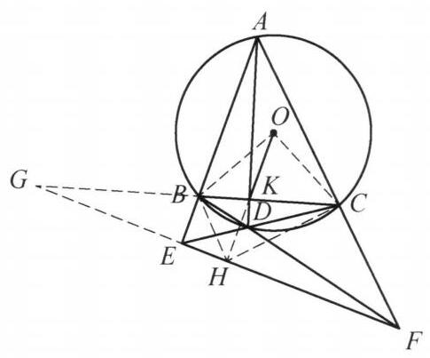

::: {.problem-meta-bar}
第 5 讲 圆的基本性质
竞赛难度
圆的基本性质 中点 四点共圆
:::

## 题目

设圆 $O$ 为 $\triangle {ABC}$ 的外接圆,点 $K$ 在边 ${BC}$ 上且不为 ${BC}$ 的中点, $D$ 为 ${AK}$ 延长线上一点, ${AB}$ 与 ${CD}$ 的延长线交于点 $E,{AC}$ 与 ${BD}$ 的延长线交于点 $F$ , 且 ${OK} \perp  {EF}$ . 证明: $D$ 在圆 $O$ 上.

## 参考解答

::: {.callout-important title="标准解答" collapse="false"}
如图 5-9,设 ${OK}$ 的延长线与 ${EF}$ 交于点 $H,{CB}$ 与 ${FE}$ 的延长线交于点 $G$ . 在完全四边形 ${ABEDCF}$ 中,对角线 ${BC}$ 被对角线 ${AD}$ , ${EF}$ 调和分割,即 $G, B, K, C$ 为调和点列,又 $\angle {GHK} = {90}^{ \circ  }$ ,故 ${HK}$ 平分 $\angle {BHC}$ . 结合 ${OB} = \; {OC}$ ,知 $O, B, H, C$ 四点共圆. 于是

$$
\angle {EHB} = {90}^{ \circ  } - \angle {BHO} = {90}^{ \circ  } - \angle {BCO}
$$

$$
= \frac{1}{2}\angle {BOC} = \angle {BAC},
$$

图 5-9

则 $A, B, H, F$ 四点共圆.

同理可得, $A, E, H, C$ 四点共圆.

所以, $H$ 为完全四边形 ${ABCDEF}$ 的密克点,因此, $C, D, H, F;B, D, H$ , $E$ 分别四点共圆,故

$$
\angle {ABD} = \angle {EHD} = \angle {DCF},
$$

即 $A, B, C, D$ 四点共圆. 原问题得证.

注: 由于 $A, B, D, C$ 共圆等价于完全四边形 ${ABEDFC}$ 的密克点在 ${EF}$ 上, 因此只需证明 $H$ 为密克点,即可得到四点共圆.
:::

## 解题思路与分析

::: {.callout-note title="思路还原与分析" collapse="false"}
这段证明之所以让人觉得“费解”、像变魔术一样，是因为教材把**逆向探索的脚手架**全部拆掉了，只留下了顺向推导的结果。在竞赛几何中，这段证明并不是凭空硬想出来的，而是由**一个著名的命题背景（逆向思维）**和**三个标准几何模块的“条件反射”（正向破题）**拼接而成的。

我们可以从“正向条件反射”和“逆向命题背景”两个维度，把想出这个证明的真实思维过程还原出来：

---

### 一、 正向破题：竞赛生看到条件时的三个“条件反射”

即便不知道这道题的背景，一个熟练的几何解题者在看到题目条件时，也会按以下三个固定模块一步步触发思路：

#### 1. 看到“完全四边形 + 垂直” $\implies$ 触发【调和点列与角平分线】
* **题目线索**：四边形 $ABDC$ 的两组对边延长交于 $E, F$，对角线 $AD, BC$ 交于 $K$，且出现了一条与 $EF$ 垂直的线 $OK \perp EF$。
* **思维触发**：
  在射影几何中，只要出现 $E = AB \cap CD$、$F = AC \cap BD$、$K = AD \cap BC$，**延长 $BC$ 交 $EF$ 于 $G$ 是绝对的标准动作**。因为这会自动生成一个调和点列 $(G, B; K, C) = -1$（即 $\frac{GB}{GC} = \frac{KB}{KC}$）。
* **关键定理**：调和点列如果配合一个**直角**，就会立刻转化为**角平分线**！
  > **常用引理**：若 $G, B, K, C$ 是调和点列，点 $H$ 满足 $\angle GHK = 90^\circ$，则 $HK$ 必平分 $\angle BHC$（且 $HG$ 是外角平分线）。
  
  因此，看到 $OK \perp EF$，自然就会设交点为 $H$，连结 $HB, HC$，把难以处理的“垂直条件”转化为极其好用的角度关系：**$HK$ 平分 $\angle BHC$**。

#### 2. 看到“角平分线 + $OB=OC$” $\implies$ 触发【弧中点定理（四点共圆）】
* **题目线索**：
  1. 刚刚证出 $HK$（即直线 $HO$）是 $\angle BHC$ 的角平分线；
  2. $O$ 是 $\triangle ABC$ 的外心，所以 $OB = OC$（即 $O$ 在 $BC$ 的垂直平分线上）；
  3. 题目特意强调了一个奇怪的条件：**“点 $K$ 不为 $BC$ 的中点”**。
* **思维触发**：为什么题目要强调 $K$ 不是 $BC$ 中点？
  因为在 $\triangle BHC$ 中，$\angle BHC$ 的**角平分线**（直线 $HK$）与底边 $BC$ 的**垂直平分线**相交于点 $O$！
  如果 $K$ 不是 $BC$ 中点，说明 $\triangle BHC$ 不是等腰三角形（$HB \neq HC$），这两条线不会重合，而是交于唯一一点 $O$。
  > **几何常识（弧中点定理）**：三角形顶角的平分线与底边的垂直平分线之交点，必然是该三角形外接圆上底边所对的**弧中点**！
  
  既然交点 $O$ 就是 $\triangle BHC$ 外接圆的弧 $BC$ 中点，那么 **$O, B, H, C$ 四点共圆** 就水到渠成地浮现了。

#### 3. 看到“外心 $O$ 共圆” $\implies$ 触发【圆心角转化与导角】
* **题目线索**：目前我们已经有了 $O, B, H, C$ 共圆，但还没有用到“点 $A$ 在圆 $O$ 上”这个条件。
* **思维触发**：怎么把圆 $O$ 上的点 $A$ 拉进战局？
  在圆 $O$ 中，点 $A$ 与圆心 $O$ 的唯一桥梁就是圆周角定理：$\angle BAC = \frac{1}{2}\angle BOC$。
  而在等腰 $\triangle OBC$ 中（且 $\angle GHK = 90^\circ$），通过 $O, B, H, C$ 四点共圆，正好可以把 $\angle EHB$ 转化为与 $\angle BOC$ 相关的角：
  $$\angle EHB = 90^\circ - \angle BHO = 90^\circ - \angle BCO = \frac{1}{2}\angle BOC = \angle BAC$$
  一旦发现 $\angle EHB = \angle BAC$（即 $\angle FHB = \angle FAB$），立刻得出 **$A, B, H, F$ 四点共圆**；同理对称地得出 **$A, E, H, C$ 四点共圆**。

---

### 二、 逆向溯源：出题人是怎么造出这道题的？（上帝视角）

如果从证明的后半段（以及文末的“注”）来看，你会发现作者突然抛出了“**密克点（Miquel Point）**”这个概念。其实，**这道题本来就是圆内接四边形“布罗卡尔定理（Brocard's Theorem）”经典构型的逆命题**！

我们可以把题目**倒过来**看——**假设 $D$ 已经在圆 $O$ 上了**（即 $A, B, D, C$ 四点共圆），在这个标准构图中会发生什么？

1. **密克点的定义**：
四条直线 $AB, CD, AC, BD$ 两两相交，会围成四个三角形：$\triangle EBC, \triangle EAD, \triangle FBA, \triangle FDC$。
平面几何著名的**密克定理**指出：这四个三角形的外接圆必然交于同一点 $M$，这个点 $M$ 就叫做完全四边形的**密克点**。

2. **圆内接四边形的密克点性质（本题的真相）**：
一个极其经典的定理是（即解答末尾“注”所写的内容）：
> **原四边形 $ABDC$ 内接于圆 $O \iff$ 其完全四边形的密克点 $M$ 恰好落在对角点连线 $EF$ 上，且满足 $O, K, M$ 三点共线、$OK \perp EF$ 于点 $M$！**

*（注：在射影几何的布罗卡尔定理中，$EF$ 是点 $K$ 关于圆 $O$ 的极线，因此圆心 $O$ 与 $K$ 的连线必然垂直于极线 $EF$，而垂足恰好就是密克点。）*

3. **还原解题者的“破案”逻辑**：
出题人把“$A, B, D, C$ 四点共圆”藏了起来，把它的性质“$OK \perp EF$”作为已知条件给了你。
熟练的竞赛者在读完题目的那一刻，心里就已经猜到了结局：
* “既然要求证 $D$ 在圆 $O$ 上，那么 $OK$ 与 $EF$ 的垂足 $H$ **必定就是这个完全四边形的密克点**！”
* “我怎样才能证明 $H$ 是密克点呢？根据定义，只要证明 $H$ 同时在其中两个三角形（$\triangle FBA$ 和 $\triangle EAC$）的外接圆上，即证 **$A, B, H, F$ 共圆** 和 **$A, E, H, C$ 共圆** 即可！”
* “一旦证出这两个共圆，$H$ 就是这四条直线的密克点，从而自动拥有密克点的所有共圆性质（即另外两个三角形的外接圆 $C, D, H, F$ 和 $B, D, H, E$ 也必然过点 $H$），最后导个角就能证出 $A, B, C, D$ 共圆了！”

---

### 总结：整条思维链是如何合拢的？

把“正向推导”和“逆向目标”拼在一起，就能看清这道题完整的思维蓝图：

$$\begin{aligned}
\text{【正向拆解条件】}\quad & \text{完全四边形} + OK \perp EF \text{ 于 } H \\
\xrightarrow{\text{构造调和点列 } G,B,K,C} \quad & HK \text{ 平分 } \angle BHC \\
\xrightarrow{\text{结合 } OB=OC \text{（弧中点）}} \quad & O, B, H, C \text{ 四点共圆} \\
\text{【衔接逆向目标】}\quad \xrightarrow{\text{利用圆心角 }\angle BOC = 2\angle BAC} \quad & \angle EHB = \angle BAC \implies A, B, H, F \text{ 与 } A, E, H, C \text{ 共圆} \\
\xrightarrow{\text{锁定密克点定义}} \quad & H \text{ 是密克点} \implies B, D, H, E \text{ 与 } C, D, H, F \text{ 共圆} \\
\xrightarrow{\text{最终导角}} \quad & \angle ABD = \angle EHD = \angle DCF \implies A, B, D, C \text{ 共圆}.
\end{aligned}$$

你对其中的哪一个具体模块（比如“为什么调和点列加直角能推出角平分线”，或者“密克点的四个共圆性质”）需要进一步的推导说明吗？
:::

## 分步证明

::: {.callout-tip title="分步推理与几何步骤" collapse="false"}
### 步骤 0：已知条件与几何图景

设圆 O 为 △ABC 的外接圆，K 为边 BC 上非中点的一点，D 为射线 AK 上一点。
直线 AB 与 CD 延长线交于 E，AC 与 BD 延长线交于 F。
过 OK 作垂线交 EF 于点 H，CB 与 FE 延长线交于点 G。
已知条件为 OK ⊥ EF（即 ∠GHK = 90°），求证：点 D 落在圆 O 上。

### 步骤 1：完全四边形调和分割 ⇒ HK 平分 ∠BHC

考察完全四边形 ABEDCF，其三条对角线分别为 BC, AD, EF。
对角线 BC 分别与另两条对角线 AD, EF 交于点 K 和点 G。
根据完全四边形的调和分割性质：
对角线 BC 被调和分割，即 (G, K; B, C) = -1，G, B, K, C 构成调和点列。
又已知 OK ⊥ EF，即点 H 对调和轭点张直角 ∠GHK = 90°。
由阿波罗尼斯圆及调和线丛性质：两射线必分别为夹角及其外角的平分线！
故 HK 平分 ∠BHC（即 ∠BHO = ∠CHO）。

### 步骤 2：外心等距性质 ⇒ O, B, H, C 四点共圆

因为点 O 是 △ABC 的外接圆圆心，所以有：
OB = OC，即点 O 落在底边 BC 的垂直平分线上。
另一方面，由步骤 1 知，射线 HO 是 △BHC 的顶角平分线。
在 △BHC 中，底边 BC 的垂直平分线与顶角平分线 HO 的交点，必定是 △BHC 外接圆上弧 BC 的中点。
而点 O 满足 OB = OC 且在 HO 上，故点 O 恰为此交点！
因此，O, B, H, C 四点共圆！

### 步骤 3：圆周角转移 ⇒ A, B, H, F 与 A, E, H, C 共圆

由 O, B, H, C 四点共圆，同弧圆周角相等可得 ∠BHO = ∠BCO。
结合 OK ⊥ EF（∠EHO = 90°），推导外角：

∠EHB = 90° - ∠BHO = 90° - ∠BCO
在外接圆中，∠BCO = 90° - ∠BAC，代入即得：
∠EHB = 90° - (90° - ∠BAC) = ∠BAC = ∠EAF

四边形 ABHF 外角等于内对角，故 A, B, H, F 四点共圆！
同理完全对称可得：A, E, H, C 四点共圆。

### 步骤 4：密克点定理 ⇒ C, D, H, F 与 B, D, H, E 共圆

考察完全四边形构型的四条边组成的四个三角形：△AEF, △ABC, △CDE, △BDF。
根据著名的密克定理（Miquel's Theorem）：完全四边形四个三角形的外接圆必共于一点，此点称为密克点。
前步已证明点 H 位于 △AEF 外接圆及 △ABC 相关圆的交汇处，因此：
H 恰为完全四边形的密克点！
由密克点性质，其余两圆亦必过点 H：
即 C, D, H, F 与 B, D, H, E 分别四点共圆！

### 步骤 5：同弧圆周角与外角相等 ⇒ D 在圆 O 上，命题得证

利用前面确立的密克共圆，进行角度归一：

在圆 ⊙(BDHE) 中，同弧 DE 所对圆周角：∠ABD = ∠EHD
在圆 ⊙(CDHF) 中，同弧 DF 所对圆周角：∠EHD = ∠DCF
因此：∠ABD = ∠EHD = ∠DCF

因为点 F 在 AC 的延长线上，四边形 ABDC 的外角 ∠DCF 等于内对角 ∠ABD（即对角互补 ∠ABD + ∠ACD = 180°），判定 A, B, C, D 四点共圆！
由于过不共线三点 A, B, C 的圆唯一（即外接圆 O），故点 D 必落在圆 O 上。
证毕！
:::

## 动态演示

::: {.demo-link-container}
[在新窗口打开交互式分步演示](../demos/05.html){.demo-link target="_blank" rel="noopener"}
:::

  <iframe src="../demos/05.html" title="例 5：两圆相交与四点共圆综合证明 分步演示" loading="lazy"></iframe>

