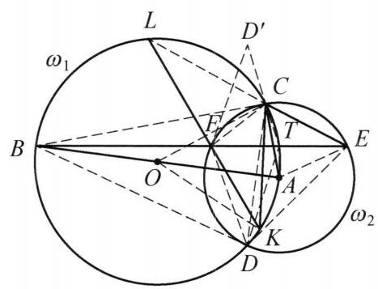

::: {.problem-meta-bar}
第 5 讲 圆的基本性质
竞赛难度
圆的基本性质 中点 四点共圆
:::

## 题目

如图,以 ${AB}$ 为直径的圆 ${\omega }_1$ 和以 $A$ 为圆心的圆 ${\omega }_2$ 相交于 $C, D$ 两点, 点 $E$ 在圆 ${\omega }_2$ 上( $E$ 在 ${\omega }_1$ 外且和点 $C$ 在直线 ${AB}$ 同侧). ${BE}$ 与 ${\omega }_2$ 交于另一点 $F$ ， 点 $K$ 在 ${\omega }_1$ 上且满足 ${2CK} \cdot  {AC} = {CE} \cdot  {AB}$ (点 $K$ 与点 $A$ 在过点 $C$ 的圆 ${\omega }_1$ 的直径的同一侧), ${KF}$ 与 ${\omega }_1$ 交于另一点 $L, D$ 关于 ${BE}$ 的对称点为 ${D}^{\prime }$ . 证明: $L, F, C$ , ${D}^{\prime }$ 四点共圆.

图 5-10

## 参考解答

::: {.callout-important title="标准解答" collapse="false"}
如图 5-10,由题设条件 ${2CK} \cdot  {AC} = \; {CE} \cdot  {AB}$ 得 $\frac{CK}{CE} = \frac{CO}{AC} = \frac{KO}{AE}$ ,所以 $\triangle {OCK} \backsim \; \triangle {ACE}$ ,于是

$$
\angle {CLF} = \frac{1}{2}\angle {COK} = \frac{1}{2}\angle {CAE} = \angle {CFE}.
$$

在 ${EF}$ 上取一点 $T$ ,使得

$$
\frac{FT}{FD} = \frac{CE}{CD}.
$$

①

因为 $\angle {DFT} = \angle {DCE}$ ，所以 $\triangle  {DFT} \backsim   \triangle  {DCE}$ ，则 $\angle {FDT} = \angle {CDE} = \; \angle {CFE}$ . 又因为 $\angle {DET} = \angle {DCF}$ ， $\angle {DTE} = {180}^{ \circ  } - \angle {DTF} = {180}^{ \circ  } - \angle {DEC} = \; \angle {DFC}$ ,故 $\triangle {DTE} \backsim  \triangle {DFC}$ ,于是

$$
\frac{ET}{DE} = \frac{CF}{CD}.
$$

②

因为 $\angle {BCA} = \angle {BDA} = {90}^{ \circ  }$ ，所以， ${BD},{BC}$ 是圆 ${\omega }_2$ 的切线，于是 $\triangle  {BFC} \backsim \; \triangle  {BCE}, \triangle  {BFD} \backsim   \triangle  {BDE}$ ，则

$$
\frac{CE}{CF} = \sqrt{\frac{BE}{BF}} = \frac{DE}{DF}.
$$

③

将①式除②式得 $\frac{FT}{ET} \cdot  \frac{DE}{DF} = \frac{CE}{CF}$ ，结合③得 ${FT} = {ET}$ ，因此， $\angle {ATB} = {90}^{ \circ  }$ ，则点 $T$ 在 ${\omega }_1$ 上.

由 $\overset{\text{ ⏜ }}{BC} = \overset{\text{ ⏜ }}{BD}$ 得 $\angle {CTB} = \angle {DTB} = \angle {D}^{\prime }{TB}$ ,因此 $T, C,{D}^{\prime }$ 三点共线，故 $\angle F{D}^{\prime }C = \angle F{D}^{\prime }T = \angle {FDT} = \angle {CFT} = \angle {CLF}$ ,所以, $L, F, C,{D}^{\prime }$ 四点共圆. 原问题得证.

注:由条件寻找相似三角形，通过四边形的性质联想到添出对角线的中点，进而通过分析性质，得出结论.
:::

## 解题思路与分析

::: {.callout-note title="思路还原与分析" collapse="false"}
这份解答之所以让人觉得“费解”、像凭空变魔术，是因为作者把一个非常自然的**“执果索因（逆向分析）”**过程，利用**“同一法”**完全**倒过来写**了，并且隐藏了题目背后最核心的几何背景——**调和四边形（Harmonic Quadrilateral）**与**托勒密定理（Ptolemy's Theorem）的构造技巧**。

整道题最让人摸不着头脑的地方在于：**点 $T$ 到底是怎么想出来的？** 解答中一上来就在 $EF$ 上按比例 $\frac{FT}{FD} = \frac{CE}{CD}$ 硬取了一个点 $T$，绕了一大圈相似三角形后，才突然发现 $FT = ET$（即 $T$ 是中点），进而发现 $\angle ATB = 90^\circ$（即 $T$ 在圆 $\omega_1$ 上），最后才导出 $T, C, D'$ 三点共线。

如果我们顺着自然的解题逻辑，把这个“倒着写”的证明还原成真实的探索过程，整道题的脉络会变得极其清晰：

---

### 第一步：剥离外围包装，消去点 $K$ 和 $L$

观察题设中关于点 $K$ 的条件：$2CK \cdot AC = CE \cdot AB$。
* 因为 $AB$ 是圆 $\omega_1$ 的直径（设圆心为 $O$），所以 $AB = 2OC = 2OK$；同时 $AC = AE$ 是圆 $\omega_2$ 的半径。
* 将 $AB = 2OC$ 代入条件，立即化简为 $\frac{CK}{OC} = \frac{CE}{AC}$。
* 这意味着两个等腰三角形 $\triangle OCK$（$OC=OK$）和 $\triangle ACE$（$AC=AE$）的“底边与腰之比”相等，因此必然相似：$\triangle OCK \sim \triangle ACE$。
* 等腰三角形相似，顶角必然相等，即 $\angle COK = \angle CAE$。在两个圆中分别利用圆周角定理取一半，就得到了证明的第一行结论：
  $$\angle CLF = \frac{1}{2}\angle COK = \frac{1}{2}\angle CAE = \angle CFE$$

**关键思维转折**：走到这一步后，**点 $K$ 和点 $L$ 的作用其实已经彻底结束了**！
因为我们要证 $L, F, C, D'$ 四点共圆，等价于证 $\angle FD'C = \angle CLF$。既然已经算出了 $\angle CLF = \angle CFE$，原问题就被剥去了外壳，转化为一个纯粹关于圆 $\omega_1, \omega_2$ 的核心几何问题：
> **核心目标**：已知 $D'$ 是 $D$ 关于 $BE$ 的对称点，求证 $\angle FD'C = \angle CFE$。

---

### 第二步：处理对称点 $D'$——顺藤摸瓜找到点 $T$ 的真实身份

在核心目标 $\angle FD'C = \angle CFE$ 中，最大的障碍是点 $D'$：它是通过轴对称生成的孤立点，线段 $CD'$ 看起来悬在空中，没有任何现成的圆或三角形依托。

处理轴对称（$D$ 与 $D'$ 关于 $BE$ 对称）最自然的第一性原理是：**在对称轴 $BE$ 上找一个点 $T$，利用对称性把关于 $D'$ 的角“折”回点 $D$ 这一侧。**

1. **什么样的点 $T$ 最理想？**
如果在对称轴 $BE$ 上存在一个点 $T$，能使得 **$T, C, D'$ 三点共线**，那就太完美了！因为一旦三点共线，射线 $D'C$ 就是射线 $D'T$，由对称性（$\triangle FTD' \cong \triangle FTD$）立刻可以把 $\angle FD'C$ 转移回 $D$ 处：
$$\angle FD'C = \angle FD'T = \angle FDT$$

2. **怎么在 $BE$ 上找到这个让 $T, C, D'$ 共线的点 $T$？**
把“$T, C, D'$ 共线”关于对称轴 $BE$ 折回来分析：
* 直线 $TD'$ 是直线 $TD$ 关于 $BE$ 的对称直线。
* 点 $C$ 落在直线 $TD'$ 上 $\Longleftrightarrow$ 直线 $TC$ 与直线 $TD$ 关于 $BE$ 对称 $\Longleftrightarrow$ **直线 $BE$（即 $TB$）平分 $\angle CTD$**（即 $\angle CTB = \angle DTB$）。
* 看到 $\angle CTB = \angle DTB$，再看一眼图中的圆 $\omega_1$：点 $B, C, D$ 都在圆 $\omega_1$ 上，且由两圆对称性知弧 $\overset{\frown}{BC} = \overset{\frown}{BD}$！
* 根据圆周角定理，**圆 $\omega_1$ 上任意一点对等弧 $\overset{\frown}{BC}$ 和 $\overset{\frown}{BD}$ 所张的圆周角都相等！**

**豁然开朗的瞬间**：原来点 $T$ 根本不是什么神秘的构造点，**点 $T$ 就是直线 $BE$ 与圆 $\omega_1$ 的另一个交点**！
只要取 $T$ 为 $BE$ 与 $\omega_1$ 的交点，就天然有 $\angle CTB = \angle DTB = \angle D'TB$，从而 $T, C, D'$ 自动三点共线，$\angle FD'C$ 就自动等于 $\angle FDT$！

---

### 第三步：识别“调和四边形”与弦中点性质

现在我们知道了点 $T$ 的真实身份（$BE$ 与 $\omega_1$ 的交点），继续挖掘它的几何性质：
* 因为 $AB$ 是 $\omega_1$ 的直径，$T$ 在 $\omega_1$ 上，所以 $\angle ATB = 90^\circ$，即 $AT \perp BE$。
* 又因为 $A$ 是圆 $\omega_2$ 的圆心，$FE$ 是 $\omega_2$ 的弦，由垂径定理立知：**点 $T$ 恰好是弦 $FE$ 的中点（$FT = ET$）**！

此时，我们的目标 $\angle FD'C = \angle CFE$（注意到在 $\omega_2$ 中同弧所对圆周角 $\angle CFE = \angle CDE$）已经完全转化为：
> **最终归结**：已知 $T$ 是弦 $FE$ 的中点，求证 $\angle FDT = \angle CDE$。

**为什么弦 $FE$ 的中点 $T$ 会满足 $\angle FDT = \angle CDE$？**
这就触及了本题真正的几何背景：
1. 因为 $AB$ 是 $\omega_1$ 的直径，所以 $\angle BCA = \angle BDA = 90^\circ$。由于 $AC, AD$ 是 $\omega_2$ 的半径，这意味着 **$BC, BD$ 是圆 $\omega_2$ 的两条切线**！
2. 过圆 $\omega_2$ 两条切线 $BC, BD$ 的交点 $B$ 作割线 $BFE$，所形成的圆内接四边形 $CFDE$ 是竞赛中极其经典的**调和四边形（Harmonic Quadrilateral）**。
3. 由切割线定理（或切线相似 $\triangle BFC \sim \triangle BCE$ 与 $\triangle BFD \sim \triangle BDE$）可以直接导出调和四边形的标志性性质——**对边乘积相等**：
$$\frac{CE}{CF} = \sqrt{\frac{BE}{BF}} = \frac{DE}{DF} \implies CE \cdot DF = CF \cdot DE$$
4. 在调和四边形 $CFDE$ 中，对角线 $FE$ 是 $\triangle CDE$ 的陪位中线（Symmedian，即中线的等角共轭线）。因此，对角线 $FE$ 的中点 $T$ 与顶点 $D$ 的连线 $DT$，必然与 $DC$ 关于 $\angle FDE$ 的角平分线对称，即满足 **$\angle FDT = \angle CDE$**！

---

### 第四步：破解解答中的“障眼法”（为什么作者要倒着写？）

既然自然的思路是：
$$\text{取 } T \text{ 为 } EF \text{ 中点（即 } BE \cap \omega_1\text{）} \xrightarrow{\text{调和四边形性质}} \angle FDT = \angle CDE$$
为什么书上的解答不直接取 $T$ 为 $EF$ 的中点，反而要定一个古怪的比例 $\frac{FT}{FD} = \frac{CE}{CD}$ 呢？

原因在于：**在初等几何考场上，“调和四边形对角线中点满足 $\angle FDT = \angle CDE$”不能作为教材定理直接引用，必须给出初等证明。**

而在证明这个基本性质时：
* **如果正向证**（已知 $FT = ET$ 和 $CE \cdot DF = CF \cdot DE$，去证 $\angle FDT = \angle CDE$）：手里只有线段比例和相等关系，没有现成的全等或相似三角形，直接导角非常别扭。
* **如果用“同一法”反过来证（借用托勒密定理的经典构造）**：
  回想一下**托勒密定理**是怎么证明的？在圆内接四边形 $CFDE$ 的对角线 $EF$ 上取一点 $T$，使得 $\angle FDT = \angle CDE$（或者像书上式 ① 那样按比例 $\frac{FT}{FD} = \frac{CE}{CD}$ 取点 $T$），结合圆周角 $\angle DFT = \angle DCE$，立刻构造出第一组相似：
  $$\triangle DFT \sim \triangle DCE \implies FT = \frac{FD \cdot CE}{CD}$$
  只要第一组相似成立，通过旋转相似（或倒角 $\angle DTE = 180^\circ - \angle DTF = 180^\circ - \angle DEC = \angle DFC$），**必然自动伴随产生第二组相似**：
  $$\triangle DTE \sim \triangle DFC \implies ET = \frac{DE \cdot CF}{CD}$$
  在托勒密定理中，我们将这两式相加得到 $FE \cdot CD = FD \cdot CE + DE \cdot CF$；而在本题的**调和四边形**中，因为 $FD \cdot CE = DE \cdot CF$（式 ③），将这两式相除，直接就得出了 **$FT = ET$**！

也就是说，书上的证明把两条原本独立的逻辑线硬生生缝合在了一起：
1. **探索线（执果索因）**：为了消去对称点 $D'$ $\implies$ 找 $BE$ 与 $\omega_1$ 的交点 $T$ $\implies$ 发现 $T$ 是弦 $EF$ 的中点 $\implies$ 需要证调和四边形中点性质 $\angle FDT = \angle CDE$。
2. **书写线（同一法包装）**：先假装不知道 $T$ 是中点，用托勒密定理的相似构造在 $EF$ 上取点 $T'$ 满足 $\triangle DFT' \sim \triangle DCE$ $\implies$ 算出 $FT' = ET'$（说明 $T'$ 就是弦中点 $T$）$\implies$ 推出 $\angle AT'B = 90^\circ$（说明 $T'$ 就在 $\omega_1$ 上）$\implies$ 推出 $T', C, D'$ 共线 $\implies$ 完成导角。

把“脚手架”拆掉之后倒着呈现，虽然让卷面书写缩短到了十几行，但也彻底掩盖了从**轴对称处理**到**调和四边形背景**的自然思维过程。看穿了这层“托勒密构造 + 同一法”的伪装，这道题的每一步就完全在情理之中了。
:::

## 分步证明

::: {.callout-tip title="分步推理与几何步骤" collapse="false"}
### 步骤 0：已知条件与初始构型

如图，圆 ω1 以线段 AB 为直径（圆心为 O），圆 ω2 以 A 为圆心，两圆相交于 C, D。
点 E 位于圆 ω2 上且在 ω1 外部，与 C 在 AB 同侧。割线 BE 交 ω2 于另一点 F。
点 K 满足条件 2CK · AC = CE · AB，割线 KF 交 ω1 于 L。
点 D' 为点 D 关于割线 BE 的对称点。
求证目标：L, F, C, D' 四点共圆。

### 步骤 1：① 相似三角形 △OCK ~ △ACE ⇒ ∠CLF = ∠CFE

由题设条件 2CK · AC = CE · AB，注意到 AB = 2 CO = 2 KO（均为圆 ω1 的直径与半径），且 AC = AE（圆 ω2 的半径）。
变形可得比值关系：

CK / CE = CO / AC = KO / AE

因为对应三边成比例，所以等腰三角形相似：△OCK ∼ △ACE。
由此顶角相等：∠COK = ∠CAE。
在圆 ω1 中，弧 CK 对应的圆周角 ∠CLF = ½ ∠COK；在圆 ω2 中，圆心角 ∠CAE 对应的圆周角为 ∠CFE = ½ ∠CAE。
从而得出核心张角关系：∠CLF = ∠CFE。

### 步骤 2：② 切线性质与调和比值 CE/CF = DE/DF

因为 AB 是圆 ω1 的直径，而点 C, D 位于圆周上，故：

∠BCA = ∠BDA = 90°

这表明半径 AC ⊥ BC, AD ⊥ BD，因此 BC 与 BD 是圆 ω2 的两条切线！
根据切线性质与相似三角形：△BFC ∼ △BCE，△BFD ∼ △BDE。
分别由边长比可得：

CE / CF = √(BE / BF) = DE / DF   (式 ③)

### 步骤 3：③ 引入分点 T ⇒ △DFT ~ △DCE

在割线 EF 上截取一点 T，使得满足比值：

FT / FD = CE / CD   (式 ①)

由于四边形 CFDE 内接于圆 ω2，圆周角有 ∠DFT = ∠DCE。
由两边对应成比例及夹角相等，立即得出相似：

△DFT ∼ △DCE  ⇒  ∠FDT = ∠CDE = ∠CFE

同理可证 △DTE ∼ △DFC，从而推出：

ET / DE = CF / CD   (式 ②)

### 步骤 4：④ T 为 EF 中点 ⇒ ∠ATB = 90° ⇒ T 在 ω₁ 上

将式 ① 除以式 ②，整理得到：

(FT / ET) · (DE / DF) = CE / CF

将步骤 ② 中得出的式 ③ CE / CF = DE / DF 代入，两边相消立即得出：

FT = ET

即 T 恰为弦 EF 的中点！由垂径定理知 AT ⊥ EF，即 ∠ATB = 90°。
因为 AB 为圆 ω1 的直径，直径所对圆周角为直角，故 点 T 必然落在圆 ω1 上！

### 步骤 5：⑤ 弧对称性与轴对称 ⇒ T, C, D' 三点共线

在圆 ω1 中，直径 AB ⊥ CD，垂直于弦的直径平分其所对的弧，即弧 BC =  弧 BD，故圆周角相等：

∠CTB = ∠DTB

又因为点 D' 是点 D 关于割线 BE（即直线 BT）的轴对称点，根据轴对称保角性：

∠D'TB = ∠DTB = ∠CTB

由于点 C 与点 D' 均位于直线 BE 的同侧，射线 TC 与射线 TD' 完全重合！
由此证得：T, C, D' 三点共线！

### 步骤 6：⑥ 张角对等 ⇒ L, F, C, D' 四点共圆

由轴对称性，△FD'T ≅ △FDT，且由于 T, C, D' 三点共线：

∠FD'C = ∠FD'T = ∠FDT

根据步骤 ③ 中的相似关系知 ∠FDT = ∠CFT = ∠CFE；
再根据步骤 ① 中的角关系知 ∠CFE = ∠CLF。
链式传递得出：

∠FD'C = ∠CLF  (即 ∠FLC)

观察线段 FC：点 D' 与点 L 位于公共弦 FC 的同侧，且所张圆周角相等！
由同侧张角相等的共圆判定定理，最终得出：

L, F, C, D' 四点共圆！证明完毕。
:::

## 动态演示

::: {.demo-link-container}
[在新窗口打开交互式分步演示](../demos/06.html){.demo-link target="_blank" rel="noopener"}
:::

  <iframe src="../demos/06.html" title="例 6：双圆交点与共圆四边形垂直证明 分步演示" loading="lazy"></iframe>

