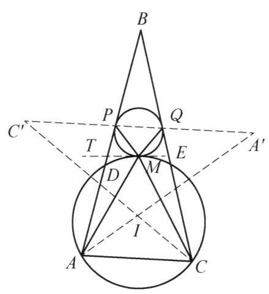

::: {.problem-meta-bar}
第 5 讲 圆的基本性质
竞赛难度
圆的基本性质 中点 角平分线
:::

## 题目

设 $\omega$ 是一个过 $\triangle {ABC}$ 的顶点 $A, C$ 的圆,分别与边 ${AB},{BC}$ 交于另一点 $D, E$ . 圆 $\Gamma$ 与圆 $\omega$ 外切于点 $M$ ,且 $\Gamma$ 同时与边 ${AB},{BC}$ 相切. 证明: $\angle {AMC}$ 的角平分线过 $\triangle {ABC}$ 的内心.

图 5-14

## 参考解答

::: {.callout-important title="标准解答" collapse="false"}
如图 5-14,设圆 $\Gamma$ 与 ${AB},{BC}$ 分别切于点 $P, Q.\triangle {APM}$ 的外接圆与 $\triangle {CQM}$ 的外接圆交于异于 $M$ 的一点 $I$ . 延长 ${CI}$ 交圆 ${AIMP}$ 于异于 $I$ 的点 ${C}^{\prime }$ ,延长 ${AI}$ 交圆 ${QMIC}$ 于异于点 $I$ 的点 ${A}^{\prime }$ ,则

$$
\angle {C}^{\prime }{PM} = \angle {MIC} = {180}^{ \circ  } - \angle {MQC}
$$

$$
= {180}^{ \circ  } - \angle {MPQ},
$$

$$
\angle {A}^{\prime }{QM} = \angle {MIA} = {180}^{ \circ  } - \angle {MPA}
$$

$$
= {180}^{ \circ  } - \angle {MQP},
$$

所以, ${C}^{\prime }, P, Q,{A}^{\prime }$ 共线.

过 $M$ 作圆 $\Gamma$ 和圆 $\omega$ 的公切线 ${MT}$ ,则

$$
{180}^{ \circ  } - \angle A{C}^{\prime }{A}^{\prime } = \angle {PMA} = \angle {PMT} + \angle {AMT}
$$

$$
= \angle {PQM} + \angle {MCA}
$$

$$
= \angle {MC}{A}^{\prime } + \angle {MCA}
$$

$$
= \angle {AC}{A}^{\prime },
$$

于是 $A, C,{A}^{\prime },{C}^{\prime }$ 四点共圆,故

$$
\angle {BAI} = \angle {PAI} = \angle C{C}^{\prime }{A}^{\prime } = \angle {CAI},
$$

$$
\angle {BCI} = \angle {QCI} = \angle A{A}^{\prime }{C}^{\prime } = \angle {ACI},
$$

所以, $I$ 是 $\triangle {ABC}$ 的内心.

又 $\angle {AMI} = \angle A{C}^{\prime }I = \angle A{C}^{\prime }C = \angle A{A}^{\prime }C = \angle {CMI}$ ,即 ${MI}$ 平分 $\angle {ABC}$ ,所以 $\angle {AMC}$ 的角平分线过 $\triangle {ABC}$ 的内心. 原问题得证.

注: 本题中点 $M$ 难以刻画,引入 ${A}^{\prime },{C}^{\prime }$ ,通过共圆来刻画 $M$ 的性质,剩下的问题就迎刃而解了.
:::

## 解题思路与分析

::: {.callout-note title="思路还原与分析" collapse="false"}
这个证明之所以让人觉得“像变魔术一样费解”，是因为作者在成文时**把“探索发现的真实顺序”完全倒了过来**，用正向推导包装了一个本质上的**“执果索因 + 同一法”**构造，同时隐藏了拆解“两圆相切”条件时的几何动机。

如果顺着以下三个层次把作者拆掉的“脚手架”还原回去，你会发现每一步辅助线其实都是被逼出来的唯一自然选择：

---

## 第一层破局：为什么非要画两个外接圆并引出 $A', C'$？
**——从“两圆相切”的唯一初等翻译手段说起**

正如书末“注”所言，全题最大的死穴在于：**点 $M$ 是由圆 $\Gamma$ 与圆 $\omega$ 相切这一隐式条件定义的，极难直接用角度刻画**。

在不使用反演变换的前提下，初等几何中要把“过 $P,Q$ 的圆 $\Gamma$ 与过 $A,C$ 的圆 $\omega$ 在点 $M$ 外切”转化为角度关系，**唯一通用的工具就是作公切线 $MT$ 并使用弦切角定理**：
$$\angle PMA = \angle PMT + \angle AMT = \angle PQM + \angle MCA$$

写下这个式子后，你会立刻遇到一个拼接障碍：
* 等式右边的 $\angle PQM$ 顶点在 $Q$，而 $\angle MCA$ 顶点在 $C$，两个角不共顶点，没法直接相加！
* **如何把 $\angle PQM$ “搬运”到顶点 $C$ 处，并且让它与 $\angle MCA$ 共享一条公共边 $CM$，从而合并成一个完整的角？**
  观察发现，$\angle PQM$ 的一条边在直线 $PQ$ 上，另一条边是 $QM$。只要作 **$\triangle CQM$ 的外接圆**，设它与直线 $PQ$ 的另一个交点为 $A'$，利用圆内接四边形 $MCQA'$ 的外角等于内对角，立刻有：
  $$\angle PQM = \angle MCA'$$
  这样一来，原本散落的两角之和瞬间在顶点 $C$ 处合并成了一个单角：
  $$\angle PQM + \angle MCA = \angle MCA' + \angle MCA = \angle ACA'$$
* **完全对称地处理等式左边的 $\angle PMA$：**
  作 **$\triangle APM$ 的外接圆**，设它与直线 $PQ$ 的另一个交点为 $C'$，则圆内接四边形 $AC'PM$ gives：
  $$\angle PMA = 180^\circ - \angle AC'A'$$

把左右两边拼合，原本棘手的“两圆在 $M$ 处相切”条件，瞬间被等价翻译为一个极其干净的共圆结论：
$$180^\circ - \angle AC'A' = \angle ACA' \iff \mathbf{A, C, A', C' \text{ 四点共圆！}}$$

> **关键洞察 1：** 在真实的探索过程中，$C'$ 和 $A'$ **原本就是直接定义为“直线 $PQ$ 与两圆 $\odot(APM)$、$\odot(CQM)$ 的交点”**，专门用来消去公切线导角产生的碎片角 $\angle PQM$ 和 $\angle PMA$ 的！

---

## 第二层破局：点 $I$ 和那串共线证明是怎么来的？
**——从内心 $I$ 出发的“执果索因”与“同一法”逆向包装**

既然 $C', A'$ 本来就在直线 $PQ$ 上，为什么书上的证明却偏要**反过来**：先取两圆交点 $I$，再连接 $CI, AI$ 交两圆于 $C', A'$，最后绕一大圈去证 $C', P, Q, A'$ 共线？

这源于我们从结论端（内心 $I$）倒推时的惊人发现：

**不妨先忘掉点 $M$ 和圆 $\omega$，只看 $\triangle ABC$ 的真实内心 $I$ 以及切点弦 $PQ$（满足 $BP = BQ$）**：
如果我们直接延长角平分线 $CI$ 交直线 $PQ$ 于 $C'$，延长角平分线 $AI$ 交直线 $PQ$ 于 $A'$，仅凭 $I$ 是内心和 $BP = BQ$，就能算出三个完全不依赖于 $M$ 的恒等角度：
1. 在等腰 $\triangle BPQ$ 中，底角 $\angle BPQ = 90^\circ - \frac{1}{2}\angle B$，故对顶角 $\angle C'PA = 90^\circ - \frac{1}{2}\angle B$。
2. 因为 $I$ 是内心，所以 $\angle AIC = 90^\circ + \frac{1}{2}\angle B$，其邻补角恰好也是 $\angle C'IA = 90^\circ - \frac{1}{2}\angle B$。
3. 于是 $\angle C'PA = \angle C'IA$，这意味着 **$A, P, I, C'$ 四点自动共圆**！
4. 完全对称地，**$C, Q, I, A'$ 四点也自动共圆**！
5. 不仅如此，在 $\odot(APIC')$ 中，$\angle AC'C = \angle PAI = \frac{1}{2}\angle A = \angle CAA'$，这意味着 **$A, C, A', C'$ 四点也自动共圆**！

停下来细想这意味着什么：
**如果点 $I$ 是 $\triangle ABC$ 的内心，那么根本不需要点 $M$ 出场，直线 $AI, CI$ 与直线 $PQ$ 的交点 $A', C'$ 就已经天然构成了三个圆 $\odot(APIC')$、$\odot(CQIA')$ 和 $\odot(ACA'C')$！**

如果顺着这个发现正面写证明，我们需要令 $M^*$ 为已知圆 $\odot(APIC')$ 与 $\odot(CQIA')$ 的第二交点，证明过 $A, C, M^*$ 的圆与 $\Gamma$ 相切，再用**同一法**断言 $M^*$ 与题设切点 $M$ 重合。

但在竞赛书写中，用同一法处理“过 $A,C$ 且与 $\Gamma$ 外切的圆的唯一性”往往显得啰嗦。于是，解答作者做了一个极其聪明的**逻辑倒置（把同一法改写为直接法）**：
* 不从“真实内心 $I$”出发去证“切点 $M$ 在圆 $\odot(API)$ 和 $\odot(CQI)$ 上”；
* 而是**反过来从“切点 $M$”出发**，先画出 $\odot(APM)$ 和 $\odot(CQM)$，把它们的交点记作 $I$，再顺着逆向光路证明这个交点 $I$ 恰好就是 $\triangle ABC$ 的内心！

---

## 第三层梳理：怎样把书上的每一步还原为自然推导？

一旦看穿了“从 $M$ 翻译相切”和“从内心 $I$ 倒推共圆”这两条线索的交汇，书上的整个证明链条就完全透明了：

| 思维阶段 | 探索者的真实动机（怎么想到的） | 书本证明的表述方式（怎么写出来的） |
| :--- | :--- | :--- |
| **1. 转化切线条件** | 圆 $\Gamma$ 与 $AB, BC$ 切于 $P, Q$，由弦切角定理得 $\angle MQC = \angle MPQ$ 及 $\angle MPA = \angle MQP$。为了让这两个角发挥作用，引入 $\odot(APM)$ 与 $\odot(CQM)$ 的交点 $I$（密克尔点标准构造）。 | 设 $\odot(APM)$ 与 $\odot(CQM)$ 交于 $I$，延长 $CI, AI$ 交两圆于 $C', A'$，利用 $\angle MQC = \angle MPQ$ 倒推出 $\angle C'PM + \angle MPQ = 180^\circ$，证明 $C', P, Q, A'$ 共线。 |
| **2. 翻译两圆外切** | 作公切线 $MT$ 得 $\angle PMA = \angle PQM + \angle MCA$；利用直线 $PQ$ 与两圆的交点 $C', A'$ 将散角合并，化归为 $A, C, A', C'$ 四点共圆。 | 计算 $180^\circ - \angle AC'A' = \angle PMA = \dots = \angle ACA'$，得出 $A, C, A', C'$ 四点共圆。 |
| **3. 锁定内心与平分线** | 一旦 $A, C, A', C'$ 共圆，三个圆 $\odot(APMC')$、$\odot(CQMA')$、$\odot(ACA'C')$ 形成完全对称的“三圆共轴/等角”结构，将 $M$ 处的角全部通过 $C', A'$ 中转到 $A, C$ 处。 | 由三组四点共圆传递圆周角：$\angle PAI = \angle CC'A' = \angle CAI$ 得 $AI$ 平分 $\angle A$（同理 $CI$ 平分 $\angle C$），最后由 $\angle AMI = \angle AC'C = \angle AA'C = \angle CMI$ 得证。 |

*(顺带一提：书本证明倒数第二行“即 $MI$ 平分 $\angle ABC$”是一处印刷笔误，根据前式 $\angle AMI = \angle CMI$，此处应为“即 $MI$ 平分 $\angle AMC$”。)*

---

## 补充视角：如果不想靠“凑辅助点”，有没有高观点通法？

如果你在考场上不想去猜 $A', C'$ 这种精巧的辅助点，这道题其实可以用**以点 $M$ 为反演中心的反演变换（配合成比例或位似）**直接秒杀：

1. **以 $M$ 为反演中心作反演（结合关于 $\angle AMC$ 角平分线的反射，即反演+反射变换）：**
因为圆 $\Gamma$ 与圆 $\omega$ 在点 $M$ 外切，反演后**圆 $\Gamma^*$ 与圆 $\omega^*$ 变成两条平行线**（且都平行于公切线 $MT$）！
2. 其中 $\omega^*$ 就是直线 $AC$，而 $\Gamma^*$ 是一条平行于 $AC$ 的直线；直线的切线 $AB, BC$ 反演后变成过点 $M$ 且与直线 $\Gamma^*$ 相切于 $P^*, Q^*$ 的两个圆。
3. 在反演后的图形中，平行线与相切关系会直接把原本复杂的圆周角加减法变成簡單的平行线内错角相等，不仅能一眼看出 $\angle AMC$ 的角平分线特征，甚至把反演后的共线/平行关系原样“反演回去”，得到的恰好就是书本证明里的 $\odot(APM)$ 与 $\odot(CQM)$！

你平时在讲授或研究这类圆系相切问题时，更倾向于引导学生从这种“纯角度拼接（构造外接圆转移角）”入手，还是用反演/根轴等结构化工具来破局？
:::

## 分步证明

::: {.callout-tip title="分步推理与几何步骤" collapse="false"}
### 步骤 0：已知条件与几何图形

给定 △ABC。
圆 ω 经过顶点 A, C，分别与边 AB, BC 交于另一点 D, E。
圆 Γ 与边 AB, BC 分别相切于点 P, Q。
圆 Γ 与圆 ω 外切于点 M。
核心目标：证明 ∠AMC 的角平分线必然经过 △ABC 的内心。

### 步骤 1：① 引入辅助圆构造交点 I

直接刻画外切点 M 往往缺乏代数与角度抓手，我们构造辅助圆建立关联：
作 △APM 的外接圆 ⊙(APM) 与 △CQM 的外接圆 ⊙(CQM)。
两圆相交于点 M，设其在异于 M 处的第二个交点为 I。
连接线段 MI。后文我们将证明：点 I 恰好是 △ABC 的内心，且射线 MI 恰为 ∠AMC 的角平分线！

### 步骤 2：② 射线 CI, AI 截出点 C', A'

延长线段 CI，与圆 AIMP 交于异于 I 的点 C'；
延长线段 AI，与圆 QMIC 交于异于 I 的点 A'。
连接切点弦 PQ 以及线段 C'P, PM, QM, A'Q。
通过构造圆上截点 C' 与 A'，将切点与外切点的角度转换统一到圆内接四边形中。

### 步骤 3：③ 弦切角与圆周角 ⇒ C', P, Q, A' 共线

在圆 QMIC 中，内接四边形对角互补：
∠MIC = 180° - ∠MQC。
在圆 AIMP 中，同弧 C'M 所对圆周角相等：
∠C'PM = ∠MIC = 180° - ∠MQC。
因为边 BC 切圆 Γ 于点 Q，由弦切角定理：
∠MQC = ∠MPQ。
代入得：∠C'PM = 180° - ∠MPQ &implies; ∠C'PM + ∠MPQ = 180°！
这说明 C', P, Q 三点共线！
同理可导：∠A'QM = ∠MIA = 180° - ∠MPA = 180° - ∠MQP，得 P, Q, A' 三点共线。
结论：四点 C', P, Q, A' 严格共线！

### 步骤 4：④ 公切线 MT 导角 ⇒ A, C, A', C' 四点共圆

过外切点 M 作两圆 Γ 与 ω 的内公切线 MT。
由弦切角定理：
∠PMT = ∠PQM（圆 Γ 切于 M），∠AMT = ∠MCA（圆 ω 切于 M）。
两式相加得：
∠PMA = ∠PMT + ∠AMT = ∠PQM + ∠MCA。
在圆 AIMP 中，圆内接四边形对角互补：
180° - ∠AC'A' = 180° - ∠AC'P = ∠PMA。
在圆 QMIC 中，外角等于内对角：∠PQM = ∠MCA'。
代入合并：
180° - ∠AC'A' = ∠MCA' + ∠MCA = ∠ACA'，
即 ∠AC'A' + ∠ACA' = 180°！
结论：四边形 AC A'C' 对角互补，顶点 A, C, A', C' 四点共圆！

### 步骤 5：⑤ 圆周角传递 ⇒ 点 I 为 △ABC 的内心

利用刚证得的共圆 ⊙(ACA'C') 进行圆周角传递：
在圆 ACA'C' 中，同弧 CA' 所对圆周角相等：
∠CC'A' = ∠CAA' = ∠CAI。
在圆 AIMP 中，同弧 IP 所对圆周角相等：
∠CC'A' = ∠IC'P = ∠IAP = ∠BAI。
因此：∠BAI = ∠CAI，即 AI 平分 ∠BAC！
完全同理，同弧所对圆周角传递可得：
∠BCI = ∠QCI = ∠AA'C' = ∠ACI，
因此：∠BCI = ∠ACI，即 CI 平分 ∠BCA！
结论：交点 I 同时位于角平分线 AI 与 CI 的交点上，I 确为 △ABC 的内心！

### 步骤 6：⑥ MI 平分 ∠AMC ⇒ 命题得证

最后考察 ∠AMC 的两条分角：
在圆 AIMP 中，同弧 AI 所对圆周角相等：
∠AMI = ∠AC'I = ∠AC'C。
在圆 QMIC 中，同弧 CI 所对圆周角相等：
∠CMI = ∠CA'I = ∠CA'A。
在共圆 ⊙(ACA'C') 中，同弦 AC 所对圆周角相等：
∠AC'C = ∠CA'A！
综合以上三式，立即得到：
∠AMI = ∠CMI！
即线段 MI 恰好是 ∠AMC 的角平分线！
由第 ⑤ 步已知点 I 是 △ABC 的内心，因此：
∠AMC 的角平分线过 △ABC 的内心。证毕！Q.E.D.
:::

## 动态演示

::: {.demo-link-container}
[在新窗口打开交互式分步演示](../demos/10.html){.demo-link target="_blank" rel="noopener"}
:::

  <iframe src="../demos/10.html" title="例 10：圆切线与角平分线交点共线 分步演示" loading="lazy"></iframe>

