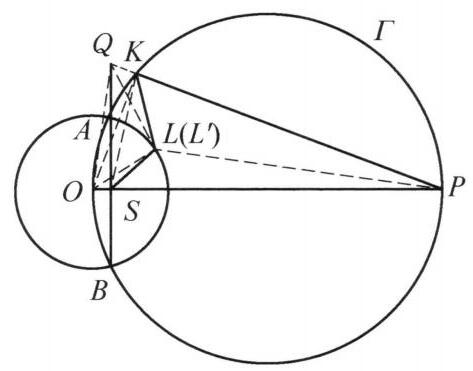

::: {.problem-meta-bar}
第 6 讲 圆幂与根轴
竞赛难度
圆幂与根轴 四点共圆 根轴
:::

## 题目

已知圆 $O$ 与圆 $\Gamma$ 交于 $A$ ， $B$ 两点，点 $O$ 在圆 $\Gamma$ 上，且在 ${AB}$ 上的投影为 $S$ ，直线 ${OS}$ 与圆 $\Gamma$ 交于点 $P$ ， $\angle {ASP}$ 的平分线与 $\odot  O$ 交于点 $L$ ，且 $A$ ， $L$ 在直线 ${OP}$ 的同侧， $K$ 为圆 $\Gamma$ 上的点，满足 ${PS} = {PK}$ ，且 $A, K$ 在直线 ${OP}$ 的同侧. 证明: ${SL} = {KL}$ .

图 6-5

## 参考解答

::: {.callout-important title="标准解答" collapse="false"}
如图 6-5，设 ${PK}$ 与 ${BA}$ 的延长线交于点 $Q$ ， $\triangle  {QSP}$ 的内心为 ${L}^{\prime }$ ，因为 ${OP}$ 为圆 $\Gamma$ 的直径,则 $\angle {QSP} = \angle {OKP} = {90}^{ \circ  }$ ,于是 $\angle {QSO} = \; \angle {QKO} = {90}^{ \circ  }$ ,即 $Q, K, S, O$ 四点共圆.

由 ${PS} = {PK}$ 得 ${PO} = {PQ}$ . 由

$$
\angle Q{L}^{\prime }S = {90}^{ \circ  } + \frac{1}{2}\angle {QPS}
$$

$$
= {90}^{ \circ  } + \frac{1}{2}\angle {QPO} = {180}^{ \circ  } - \angle {QOP}
$$

$$
= {180}^{ \circ  } - \angle {QOS}
$$

知 $Q,{L}^{\prime }, S, O$ 四点共圆,则 $Q, K,{L}^{\prime }, S, O$ 五点共圆于 ${\Gamma }^{\prime }$ ,且 ${OQ}$ 为 ${\Gamma }^{\prime }$ 的直径.

由 $\angle Q{L}^{\prime }K = \angle {QSK} = {90}^{ \circ  } - \angle {KSP} = \frac{1}{2}\angle {KPS} = \angle {KP}{L}^{\prime }$ ,知 $\triangle Q{L}^{\prime }K \backsim \; \triangle {QP}{L}^{\prime }$ ,则 $Q{L}^{\prime 2} = {QK} \cdot  {QP}$ .

由于 ${AB}$ 是圆 $O$ 与圆 $\Gamma$ 的根轴,于是

$$
Q{L}^{\prime 2} = {QK} \cdot  {QP} = {QA} \cdot  {QB}
$$

$$
= Q{O}^2 - O{A}^2
$$

$$
= Q{L}^{\prime 2} + O{L}^{\prime 2} - O{A}^2,
$$

所以 $O{L}^{\prime } = {OA}$ ,这表明点 ${L}^{\prime }$ 在圆 $O$ 上,从而 $L$ 与 ${L}^{\prime }$ 重合. 因为点 $L$ 在 $\angle {KPS}$ 的平分线上,所以 ${PL}$ 为 ${KS}$ 的中垂线,因此, ${SL} = {KL}$ .

注: 利用结论可反推 $L$ 为 $\triangle {PQS}$ 的内心,由同一法即得出结论.
:::

## 解题思路与分析

::: {.callout-note title="思路还原与分析" collapse="false"}
书本上的证明之所以让人觉得“费解”，是因为它采用了欧氏几何中典型的**“隐藏探索过程、只呈现倒推结果”**的写法（即文末提到的**同一法**）。

在实际解题时，没有人能凭空想到“延长 $PK$ 和 $BA$ 交于点 $Q$，并取 $\triangle QSP$ 的内心 $L'$”。这个证明的真实思维过程完全是**“执果索因”（从结论往回倒推）**想出来的。我们可以分四步还原作者在草稿纸上的思考全过程：

---

### 第一步：识破痛点——为什么顺着推走不通？

先看题目是如何定义点 $L$ 的：它是 $\angle ASP$ 的平分线与 $\odot O$ 的交点。
在平面几何中，**“过圆内一个非圆心的点 $S$ 作一条射线与圆相交”**，这种交点的几何性质是最难直接利用的。如果你顺着“$OL = OA$（点 $L$ 在圆 $O$ 上）”和“$\angle PSL = 45^\circ$”往下推，会发现点 $L$ 和大圆 $\Gamma$ 上的点 $K$ 之间缺乏直接的几何桥梁。

当一个点的初始定义极其别扭时，几何学家的本能反应就是**“弃用原定义，先假设结论成立，看看这个点在图形中到底扮演什么更自然的角色”**——这就是使用“同一法”的契机。

---

### 第二步：核心顿悟——点 $Q$ 和内心 $L'$ 是怎么冒出来的？

我们在草稿纸上**假设结论 $SL = KL$ 已经成立**，看看能推出什么特殊性质：

1. 题目已知 $PS = PK$，现在又有 $LS = LK$。
2. 到线段两端距离相等的点在中垂线上，这意味着 $PL$ 是线段 $SK$ 的垂直平分线，且 $\triangle PSL \cong \triangle PKL$（SSS）。
3. 由全等立刻得出一个关键角度关系：**$PL$ 平分 $\angle KPS$**！
4. 此时把目光拉回题目已知条件：**$SL$ 平分 $\angle ASP$**！

**高潮来了**：点 $L$ 居然同时位于 $\angle S$ 的平分线和 $\angle P$ 的平分线上！
在几何中，“两条角平分线的交点”是什么？**是三角形的内心！**

但是，光有 $\angle S$ 和 $\angle P$ 还不是一个封闭的三角形。为了让点 $L$ 成为一个名正言顺的“三角形内心”，我们必须把构成这两个角的边延长，让它们围成一个三角形：
* $\angle S$ 的两条边是直线 $OP$ 和直线 $AB$；
* $\angle P$ 的两条边是直线 $OP$ 和直线 $PK$。

这三条直线中，$OP$ 与 $AB$ 已交于 $S$，$OP$ 与 $PK$ 已交于 $P$，只差直线 $AB$ 和直线 $PK$ 还没相交。于是，**为了补全这个宿主三角形，我们极其自然地延长 $PK$ 和 $BA$，设交点为 $Q$**！

这样一来，点 $L$ 的真实身份就彻底暴露了：**它必定是直角三角形 $\triangle QSP$ 的内心**。这就是证明第一句话“设 $PK$ 与 $BA$ 延长线交于 $Q$，取 $\triangle QSP$ 的内心为 $L'$”的全部灵感来源。

---

### 第三步：搭建桥梁——怎么想到用根轴和勾股定理证 $OL' = OA$？

既然我们通过“内心”重新定义了替身点 $L'$，接下来的任务就是证明“替身 $L'$ 就是本尊 $L$”，也就是要证明**点 $L'$ 恰好落在 $\odot O$ 上（即证 $OL' = OA$）**。

怎么证明一条线段 $OL'$ 等于 $\odot O$ 的半径 $OA$ 呢？这就需要寻找图形中与 $\odot O$ 半径有关的定理。
注意到我们刚刚构造出来的点 $Q$ 恰好在两圆的公共弦（根轴）$AB$ 的延长线上！看到“公共弦延长线上的点 $Q$”，立刻触发**圆幂定理（割线定理）**：

1. **对 $\odot O$ 用圆幂定理**：点 $Q$ 到 $\odot O$ 的圆幂为
$$QA \cdot QB = QO^2 - OA^2$$
2. **对圆 $\Gamma$ 用割线定理**：因为 $A, B, K, P$ 四点共圆于 $\Gamma$，所以
$$QA \cdot QB = QK \cdot QP$$

把这两个式子一联立，无需任何技巧，天然就得到了一个包含半径 $OA$ 的等式：
$$QK \cdot QP = QO^2 - OA^2 \implies OA^2 = QO^2 - QK \cdot QP$$

看着草稿纸上的这个式子，我们的目标是证明 $OL'^2 = OA^2$，也就是希望证明：
$$OL'^2 = QO^2 - QK \cdot QP \implies QO^2 = OL'^2 + QK \cdot QP$$

观察这个目标式，解题者会产生两个非常强烈的直觉猜想：
* **猜想 1**：如果 $\triangle QL'O$ 是以 $QO$ 为斜边的直角三角形（即 $\angle OL'Q = 90^\circ$），那么根据勾股定理就有 $QO^2 = OL'^2 + QL'^2$！
* **猜想 2**：如果同时还能有 $QL'^2 = QK \cdot QP$，那么代进去就会完美消掉 $QL'^2$，直接得出 $OL' = OA$！

---

### 第四步：顺水推舟——验证两个猜想（导角与五点共圆）

有了第三步明确的目标，剩下的工作就只是检验那两个猜想是否成立了：

1. **为什么 $OP$ 是圆 $\Gamma$ 的直径？（隐藏细节）**
因为 $A, B$ 在 $\odot O$ 上，所以弦 $OA = OB$，即点 $O$ 是圆 $\Gamma$ 中弧 $AB$ 的中点。又因为 $OS \perp AB$，根据垂径定理，弦 $AB$ 的中垂线 $OP$ 必然经过圆 $\Gamma$ 的圆心，所以 $OP$ 是圆 $\Gamma$ 的直径。
2. **验证猜想 1（证 $\angle OL'Q = 90^\circ$）**：
既然 $OP$ 是直径，就有 $\angle OKP = 90^\circ = \angle QSO$，所以 $Q, K, S, O$ 四点共圆，且 **$OQ$ 是该圆的直径**。
要想让 $\angle OL'Q = 90^\circ$，只需要证明点 $L'$ 也在这个以 $OQ$ 为直径的圆上（即证 $Q, L', S, O$ 四点共圆）。
由于 $Rt\triangle PSQ \cong Rt\triangle PKO$（$\angle P$ 公共，$PS = PK$，直角相等），立刻得出 $PQ = PO$（等腰三角形）。利用等腰三角形底角公式和三角形内心张角公式（$\angle QL'S = 90^\circ + \frac{1}{2}\angle P$），一算发现对角之和正好是 $180^\circ$，四点共圆轻松得证！
3. **验证猜想 2（证 $QL'^2 = QK \cdot QP$）**：
在几何中，形如 $QL'^2 = QK \cdot QP$ 的乘积式，标准证法就是找**共角子母相似（$\triangle QL'K \sim \triangle QPL'$）**。既然已经有了 $Q, K, L', S, O$ 五点共圆，把角 $\angle QL'K$ 转化到圆周角 $\angle QSK$ 上，两步导角就能证出相似。

---

### 总结：如何阅读这类竞赛证明？

可以把这个证明的逻辑链条浓缩为一条**“逆向破案线”**：

$$\text{欲证 } SL=KL \xrightarrow{\text{结合 } PS=PK} PL \text{ 平分 } \angle P \xrightarrow{\text{结合 } SL \text{ 平分 } \angle S} L \text{ 是两条角平分线交点}$$
$$\xrightarrow{\text{延长 } BA, PK \text{ 交于 } Q} L \text{ 是 } \triangle QSP \text{ 的内心 } L' \xrightarrow{\text{同一法：只需证 } L' \in \odot O} \text{需证 } OL' = OA$$
$$\xrightarrow{\text{点 } Q \text{ 对两圆用圆幂定理}} OA^2 = QO^2 - QK \cdot QP \xrightarrow{\text{凑勾股定理与相似}} \text{证 } Q,K,L',S,O \text{ 五点共圆}$$

撰写教材的人为了篇幅精炼，把上面从左到右的**探索箭头**全部擦掉，直接从最右边的辅助线和五点共圆开始往左写，就变成了你看到的“天降神兵”式的证明。以后遇到使用“同一法”或突然构造诡异交点的几何题，直接从结论入手画图倒推，就能看穿出题人的底牌。
:::

## 分步证明

::: {.callout-tip title="分步推理与几何步骤" collapse="false"}
### 步骤 0：已知条件与几何构型

已知两圆 ⊙O 与 ⊙Γ 相交于 A, B 两点，点 O ∈ ⊙Γ 且在弦 AB 上的垂足投影为 S。直线 OS 与 ⊙Γ 交于点 P，因此线段 OP 恰为 ⊙Γ 的一条直径。∠ASP 的平分线与 ⊙O 交于点 L（A, L 在 OP 同侧）。点 K ∈ ⊙Γ 满足 PS = PK（A, K 在 OP 同侧）。求证：SL = KL。

### 步骤 1：① 延长割线相交，得出四点共圆 Q, K, S, O

设直线 PK 与 BA 的延长线交于点 Q。因为 OP 为圆 Γ 的直径，而点 K 在圆周上，所以直径所对圆周角 ∠OKP = 90°（即 OK ⊥ PQ）。又已知 OS ⊥ AB 于 S，故 ∠QSP = ∠QSO = 90°。由 ∠QSO = ∠QKO = 90° 知四边形 QSKO 拥有公共斜边直角，故 Q, K, S, O 四点共圆于 Γ'，且 OQ 为其直径。

### 步骤 2：② 利用直角三角比，导出等腰对称 PO = PQ

在直角 △PSQ 中（∠PSQ = 90°），由三角比：$$\cos\angle QPO = \frac{PS}{PQ}$$在直角 △PKO 中（∠PKO = 90°），同理有：$$\cos\angle QPO = \frac{PK}{PO}$$已知条件给定 PS = PK，分子相等则分母必相等：PO = PQ！这表明 △PQO 是以 P 为顶点的等腰三角形，两高线 QS 与 OK 呈对称结构。

### 步骤 3：③ 设内心 L'，证明 Q, K, L', S, O 五点共圆

设直角 △QSP 的内心为 L'。由内心经典角平分性质：$$\angle QL'S = 90° + \frac{1}{2}\angle QPS = 90° + \frac{1}{2}\angle QPO$$又在等腰 △PQO 中，底角 \angle QOP = 90° - \frac{1}{2}\angle QPO，从而：$$\angle QL'S = 180° - \angle QOP = 180° - \angle QOS$$因此四边形 QL'SO 对角互补，点 L' 必在过 Q, S, O 的外接圆上。综合前述，Q, K, L', S, O 五点共圆于 Γ'，且 OQ 为其直径。

### 步骤 4：④ 导角证明相似三角形 △QL'K ∽ △QPL'

在圆 Γ' 中，由同弧所对圆周角相等得 \angle QL'K = \angle QSK。显然 \angle QSK = 90° - \angle KSP。在等腰 △PSK（PS = PK）中，底角 \angle KSP = 90° - \frac{1}{2}\angle KPS，故 \angle QSK = \frac{1}{2}\angle KPS。而 PL' 是内心角平分线，\frac{1}{2}\angle KPS = \angle KPL'。于是得到 \angle QL'K = \angle QPL'。结合公共角 \angle L'QK，可得：△QL'K ∽ △QPL'，由此导出切割线式乘积：$$\frac{QL'}{QP} = \frac{QK}{QL'} \implies \mathbf{QL'^2 = QK \cdot QP}$$

### 步骤 5：⑤ 结合根轴圆幂与勾股定理，证明 L 与 L' 重合

因为直线 AB 是圆 O 与圆 Γ 的根轴，点 Q 在其延长线上，由割线圆幂定理：$$QK \cdot QP = QA \cdot QB = QO^2 - OA^2$$由前一步知 QL'^2 = QK \cdot QP，故 QL'^2 = QO^2 - OA^2。又因 OQ 是圆 Γ' 的直径且 L' ∈ Γ'，故 ∠QL'O = 90°。在直角 △QL'O 中由勾股定理：$$QO^2 = QL'^2 + OL'^2$$代入得：QL'^2 = (QL'^2 + OL'^2) - OA^2 \implies \mathbf{OL' = OA}！这说明内心 L' 落在圆 O 上。由于点 L' 在 ∠ASP 平分线上且在 OP 同侧，点 L' 与点 L 严格重合！

### 步骤 6：⑥ 等腰顶角平分线即中垂线，证得 SL = KL

既然点 L 就是 △QSP 的内心，射线 PL 即为 ∠KPS 的角平分线。在等腰三角形 △PSK 中（PS = PK），顶角平分线 PL 亦为底边 SK 的垂直平分线（三线合一）。因为点 L 落在底边 SK 的垂直平分线上，由中垂线性质直接得出：$$\mathbf{SL = KL}$$命题完整获证！∎
:::

## 动态演示

::: {.demo-link-container}
[在新窗口打开交互式分步演示](../demos/04.html){.demo-link target="_blank" rel="noopener"}
:::

  <iframe src="../demos/04.html" title="例 4：切线长定理与圆幂等长证明 分步演示" loading="lazy"></iframe>

