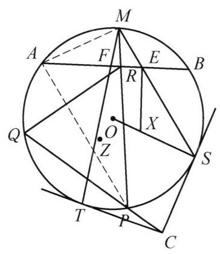

::: {.problem-meta-bar}
第 6 讲 圆幂与根轴
竞赛难度
圆幂与根轴 中点 切线
:::

## 题目

已知 ${AB}$ 是圆 $O$ 的弦, $M$ 是弧 $\overset{\text{ ⏜ }}{AB}$ 的中点. $C$ 是圆 $O$ 外任意一点,过点 $C$ 作圆 $O$ 的切线 ${CS},{CT}$ . 连接 ${MS},{MT}$ 分别交 ${AB}$ 于点 $E, F$ . 过 $E, F$ 作 ${AB}$ 的垂线,与 ${OS},{OT}$ 分别交于点 $X, Y$ . 再过点 $C$ 作圆 $O$ 的割线交圆 $O$ 于点 $P, Q$ , 连接 ${MP}$ 交 ${AB}$ 于 $R$ . 设 $Z$ 是 $\triangle {PQR}$ 的外心. 证明: $X, Y, Z$ 三点共线.

图 6-6

## 参考解答

::: {.callout-important title="标准解答" collapse="false"}
如图 6-6,设以 $X$ 为圆心, ${XE}$ 为半径的圆为圆 $X$ ,记 $\triangle {PQR}$ 的外接圆为圆 $Z$ .

由 $M$ 是弧 $\overset{\text{ ⏜ }}{AB}$ 的中点,知 $\angle {MAB} = \angle {MPB} = \; \angle {MPA}$ ,结合 $\angle {AMR} = \angle {AMP}$ 得 $\triangle {MAR} \backsim  \triangle {MPA}$ , 于是

$$
{MR} \cdot  {MP} = M{A}^2 = M{B}^{2}.
$$

①

由 $\angle {MAE} = \angle {MSA}$ 及 $\angle {AME} = \angle {AMS}$ 得 $\triangle {MAE} \backsim  \triangle {MSA}$ ,则

$$
{ME} \cdot  {MS} = M{A}^{2}.
$$

②

由①，②两式得

$$
{MR} \cdot  {MP} = {ME} \cdot  {MS}.
$$

③

注意到 ${MR} \cdot  {MP}$ 为 $M$ 关于圆 $Z$ 的幂， ${ME} \cdot  {MS}$ 为 $M$ 关于圆 $X$ 的幂，于是由③可知， $M$ 在圆 $Z$ 与圆 $X$ 的根轴上.

另一方面， $C$ 关于圆 $O$ 的幂为 ${CP} \cdot  {CQ} = C{S}^2$ ，而 ${CP} \cdot  {CQ}$ 为 $C$ 关于圆 $Z$ 的幂，因此 $C$ 在圆 $Z$ 和圆 $X$ 的根轴上.

所以， ${CM}$ 是圆 $Z$ 和圆 $X$ 的根轴，于是 ${CM}\perp {ZX}$ .

同理，由对称性( $X, Y$ 对称)，有 ${CM}\perp {ZY}$ .

所以, $X, Y, Z$ 三点共线. 原问题得证.

注:通过根轴，我们得到了垂直于 ${XYZ}$ 的直线 ${CM}$ ，利用 ${CM} \perp  {ZX},{CM} \perp \; {ZY}$ 推出结论.
:::

## 解题思路与分析

::: {.callout-note title="思路还原与分析" collapse="false"}
这是一个在几何竞赛题中非常经典且让人拍案叫绝的构形。初看这个证明，每一步代数或几何推导（如相似三角形、圆幂定理）都严丝合缝，但确实充满“神兵天降”之感——比如为什么要凭空构造一个以 $X$ 为圆心、$XE$ 为半径的辅助圆？ $Z$ 又是 $\triangle PQR$ 的外接圆圆心，为什么 $X, Y, Z$ 会和根轴扯上关系？

要理解这个证明的**动机与思维源头（Discovery / Motivation）**，我们可以从**逆向拆解**和**几何直觉**两个维度来剖析它是如何被“想出来的”。

---

### 一、 核心动机拆解：我们想证明什么？

我们要证明 $X, Y, Z$ 三点共线。
在几何中，证明三点共线最优雅、最强有力的工具之一就是**根轴（Radical Axis）定理**：
* 如果三个圆两两相交或外离，它们的三个根轴交于一点（根心）；
* 特别地，如果我们要证明三个点 $X, Y, Z$ 共线，如果这三个点分别是三个圆的圆心，或者它们与某些圆的根轴相关，我们通常会考虑：**能否说明这条直线就是某两个圆的根轴？**

在这道题中：
1. $Z$ 是 $\triangle PQR$ 的外接圆（记为圆 $Z$）的圆心。
2. $X$ 和 $Y$ 看起来是某种圆的圆心（证明中引入了以 $X$ 为圆心、$XE$ 为半径的圆 $X$）。
3. 如果 $X, Y, Z$ 共线，直觉上它应该垂直于某条关键的“底线”。题中这条底线就是从外部引出的切线交点与圆弧中点的连线——**$CM$**。

因此，整个证明的逆向路线图是：
$$\text{目标：} X, Y, Z \text{ 共线} \;\Longleftarrow\; CM \perp XZ \text{ 且 } CM \perp YZ \;\Longleftarrow\; CM \text{ 是圆 } X \text{ 与圆 } Z \text{ 的根轴} \;\dots$$

---

### 二、 关键线索的溯源：这些点和圆是怎么被“逼”出来的？

#### 1. 为什么会注意到点 $M$ 的幂？
* **背景：** $M$ 是优弧或劣弧的中点（这里 $M$ 是弧 $AB$ 的中点），这意味着 $MA = MB$，且 $MA$ 是连接弦与弧中点的经典点。
* **寻找等积式：** 在圆 $O$ 中，割线/交线构成了大量的相似三角形。证明中通过 $\triangle MAR \sim \triangle MPA$，轻而易举地得到了：
  $$MR \cdot MP = MA^2$$
* **同理：** $E$ 在 $AB$ 上，$MS$ 是过 $M$ 的另一条线，通过 $\triangle MAE \sim \triangle MSA$，又得到了：
  $$ME \cdot MS = MA^2$$
* **惊人的巧合（实质必然）：** 
  $$MR \cdot MP = ME \cdot MS (= MA^2)$$
  这个等式意味着：**以 $M$ 为起点，割线 $MP$ 上的点 $R$ 与 $P$，和割线 $MS$ 上的点 $E$ 和 $S$，四点共圆**（或者说点 $M$ 对过这四点的圆具有相同的幂）。

#### 2. 圆 $X$ 是哪里来的？为什么要作 $XE \perp AB$？
* 上一步我们得到了 $MR \cdot MP = ME \cdot MS$。
* 观察这个式子：$E$ 在 $AB$ 上，$S$ 在圆 $O$ 上，$MS$ 是过 $M$ 的一条线段。而 $X$ 是过 $E$ 作 $AB$ 的垂线与 $OS$ 的交点。
* 为什么引入以 $X$ 为圆心、半径为 $XE$ 的圆 $X$？
  * 这是一个**巧妙的几何构造**：我们需要给 $ME \cdot MS$ 赋予“圆幂”的几何解释。
  * 如果有一个圆经过点 $E$ 和 $S$，且 $M, E, S$ 共线，什么样的圆与 $AB$（在 $E$ 处垂直）以及 $OS$ 相关？
  * 通过设计圆 $X$（以 $X$ 为圆心，${XE}$ 为半径），可以证明 $M$ 关于圆 $X$ 的幂恰好就是 $ME \cdot MS$（这需要利用 $X$ 点在 $OS$ 垂直平分线或角度关系上的性质来保证圆 $X$ 经过 $S$ ）。
* 这样一来，$MR \cdot MP = ME \cdot MS$ 就翻译成了：**$M$ 点关于 $\triangle PQR$ 的外接圆（圆 $Z$）的幂 = $M$ 点关于辅助圆（圆 $X$）的幂**。
* **结论：** 幂等意味着 **$M$ 在圆 $Z$ 和圆 $X$ 的根轴上**！

#### 3. 另一端点 $C$ 是如何加入战局的？
* 题目中还有一个极重要的条件：$C$ 是过圆 $O$ 外一点引的两条切线 $CS, CT$ 的交点。
* 对于圆 $O$ 来说，有 $CS^2 = CP \cdot CQ$（切线长定理与割线定理）。
* 而 $CP \cdot CQ$ 同时也是点 $C$ 关于 $\triangle PQR$ 外接圆（圆 $Z$）的幂（因为 $P, Q$ 在圆 $Z$ 上，且 $C, P, Q$ 共线）。
* 那么，$C$ 关于圆 $Z$ 的幂是 $CP \cdot CQ = CS^2$。同时，$C$ 关于圆 $X$ 的幂可以通过对称性和切线性质推导，得出 **$C$ 也在圆 $Z$ 和圆 $X$ 的根轴上**。

---

### 三、 整体思路的升华（为什么能一气呵成？）

一旦你理清了出题人的视角，就会发现这个证明实际上是由两套对称的“根轴逻辑”交织而成的：

1. **第一步（找根轴上的两个点）：** 
* 通过倒角和相似，找到了两个点 $M$ 和 $C$。
* 证明了 **$M$ 和 $C$ 都在“圆 $Z$（$\triangle PQR$ 的外接圆）”与“圆 $X$（辅助圆）”的根轴上**。
2. **第二步（确定根轴）：** 
* 既然两个不同的点 $M$ 和 $C$ 都在这两个圆的根轴上，那么**直线 $CM$ 就是这两个圆的唯一根轴**。
3. **第三步（利用根轴的垂直性质）：** 
* 两圆连心线垂直于根轴。因此，圆心连线 $ZX$ 必然垂直于根轴 $CM$，即 **$ZX \perp CM$**。
4. **第四步（对称性闭环）：** 
* 同理，对于另一侧的切线 $CT$ 和点 $Y$，可以完全如法炮制，得到 **$ZY \perp CM$**。
5. **终章：** 
* 过同一点 $Z$ 有两条直线 $ZX$ 和 $ZY$ 都垂直于同一直线 $CM$，根据欧氏几何的平行公理（或垂直于同一直线的两直线重合），$X, Z, Y$ 必然三点共线。

---

### 总结：这种辅助线和证明的思维密码

* **代数化为几何（圆幂）：** 看到线段乘积相等（如 $MR \cdot MP = ME \cdot MS$），不要只当作比例式，要立刻敏锐地联想到**“共圆”**或**“某点关于某圆的幂相等”**。
* **根轴的威力：** 当需要证明三个点共线时，寻找涉及这些点的圆，并将问题转化为“证明这些点在某个等幂轴（根轴）上”，往往能把看似杂乱无章的交点（$X, Y, Z$）纳入统一的代数几何框架中。
:::

## 分步证明

::: {.callout-tip title="分步推理与几何步骤" collapse="false"}
### 步骤 0：已知条件与几何构型

已知 $AB$ 是圆 $O$ 的弦，$M$ 是弧 $\overset{\frown}{AB}$ 的中点。$C$ 是圆外任意一点，过 $C$ 作圆 $O$ 的切线 $CS, CT$（切点为 $S, T$）。
连接 $MS, MT$ 分别交 $AB$ 于点 $E, F$；过 $E, F$ 作 $AB$ 的垂线分别交半径 $OS, OT$ 于点 $X, Y$。
再过点 $C$ 作圆 $O$ 的割线交圆于 $P, Q$，连接 $MP$ 交 $AB$ 于 $R$。设 $Z$ 是 $\triangle PQR$ 的外心。
求证：$X, Y, Z$ 三点共线。

### 步骤 1：① 弧中点引出的三角形相似：MR·MP = MA²

因为 $M$ 是弧 $\overset{\frown}{AB}$ 的中点，由同弧圆周角定理可知：
$\angle MAB = \angle MPB = \angle MPA$。
在 $\triangle MAR$ 与 $\triangle MPA$ 中，公共角 $\angle AMR = \angle PMA$，且 $\angle MAR = \angle MPA$，故：
$\triangle MAR \sim \triangle MPA$。
由对应边成比例得：$\dfrac{MA}{MP} = \dfrac{MR}{MA} \implies MR \cdot MP = MA^2$。
又因为 $M$ 是弧中点，$MA = MB$，故 $MR \cdot MP = MA^2 = MB^2$。

### 步骤 2：② 切点弦角三角形相似：ME·MS = MA²

连接辅助线 $AS$。由同弧所对圆周角与弧中点性质：
$\angle MSA$ 对应弧 $\overset{\frown}{MA}$，而 $\angle MAE = \angle MAB$ 对应弧 $\overset{\frown}{MB} = \overset{\frown}{MA}$，因此 $\angle MAE = \angle MSA$。
结合公共角 $\angle AME = \angle SMA$，可知：
$\triangle MAE \sim \triangle MSA$。
同理得出对应边成比例：$\dfrac{MA}{MS} = \dfrac{ME}{MA} \implies ME \cdot MS = MA^2$。
联立步骤 1，得到极其关键的恒等式：
$MR \cdot MP = ME \cdot MS = MA^2$。

### 步骤 3：③ 构造圆 X：XS = XE 且点 M 在两圆根轴上

考察以 $X$ 为圆心、$XE$ 为半径的圆 $X$。因为 $EX \perp AB$ 且 $OM \perp AB$，所以 $EX \parallel OM$，内错角 $\angle XEM = \angle OME$。
又因半径 $OS = OM = r_O$，等腰 $\triangle OMS$ 给出 $\angle OSM = \angle OMS$。
由此推得 $\angle XSE = \angle OSM = \angle XEM = \angle XES$，故 $\triangle XSE$ 为等腰三角形，即 $XS = XE$！
这说明：以 $X$ 为圆心、$XE$ 为半径的辅助圆 $X$ 恰好经过切点 $S$。
因割线 $MES$ 交圆 $X$ 于 $E, S$，$ME \cdot MS$ 为点 $M$ 关于圆 $X$ 的幂；而割线 $MRP$ 交圆 $Z$ 于 $R, P$，$MR \cdot MP$ 为点 $M$ 关于圆 $Z$ 的幂。
由 $MR \cdot MP = ME \cdot MS$ 可知：点 $M$ 必然位于圆 $Z$ 与圆 $X$ 的根轴上！

### 步骤 4：④ 切割线定理与公共根轴：CM ⊥ ZX

因为 $CS$ 是圆 $O$ 的切线，且圆心 $X$ 位于半径 $OS$ 上，故 $CS \perp OS \implies CS \perp XS$。因此 $CS$ 亦为圆 $X$ 在切点 $S$ 处的切线！
因此点 $C$ 关于圆 $X$ 的幂等于切线长平方 $CS^2$。
另一方面，割线 $CPQ$ 交圆 $O$ 于 $P, Q$，由于 $P, Q$ 亦在 $\triangle PQR$ 的外接圆 $Z$ 上，故点 $C$ 关于圆 $Z$ 的幂等于 $CP \cdot CQ$。
由圆 $O$ 的切割线定理知：$CP \cdot CQ = CS^2$。
这证明点 $C$ 关于圆 $Z$ 与圆 $X$ 的幂亦相等，故 点 $C$ 亦在圆 $Z$ 与圆 $X$ 的根轴上！
两点确定一条直线，直线 $CM$ 必然是圆 $Z$ 与圆 $X$ 的公共根轴。
由「两圆根轴垂直于连心线」定理，立得：$CM \perp ZX$！

### 步骤 5：⑤ 对称性 CM ⊥ ZY ⇒ X, Y, Z 三点共线

同理，考察以 $Y$ 为圆心、$YF$ 为半径的圆 $Y$。由完全对称的论证：
$YF = YT$，圆 $Y$ 亦经过切点 $T$；$MF \cdot MT = MA^2 = MR \cdot MP$，且 $CT^2 = CP \cdot CQ$。
因此直线 $CM$ 亦为圆 $Z$ 与圆 $Y$ 的公共根轴！由此立即得出：$CM \perp ZY$。
因为经过平面上同一点 $Z$ 且垂直于已知直线 $CM$ 的垂线是唯一的，所以直线 $ZX$ 与直线 $ZY$ 必然完全重合！
这严格证明了：$X, Y, Z$ 三点共线（且直线 $XYZ \perp CM$）。全题证毕！
:::

## 动态演示

::: {.demo-link-container}
[在新窗口打开交互式分步演示](../demos/05.html){.demo-link target="_blank" rel="noopener"}
:::

  <iframe src="../demos/05.html" title="例 5：圆内接四边形对角线根轴与共线 分步演示" loading="lazy"></iframe>

