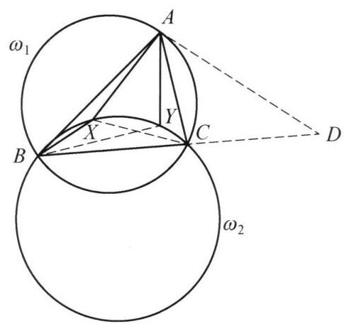

::: {.problem-meta-bar}
第 6 讲 圆幂与根轴
竞赛难度
圆幂与根轴 四点共圆 切线
:::

## 题目

在锐角三角形 ${ABC}$ 中，点 $X, Y$ 是三角形 ${ABC}$ 内部的两个互异的动点，且满足 $B, C, X, Y$ 四点共圆及 $\angle {AXB} - \angle {ACB} = \angle {AYC} - \angle {ABC}$ . 证明: 直线 ${XY}$ 经过一个定点.

图 6-7

## 参考解答

::: {.callout-important title="标准解答" collapse="false"}
如图 6-7，设过点 $A$ 的 $\triangle  {ABC}$ 的外接圆的切线与 ${BC}$ 的延长线交于点 $D$ .

设三角形 ${AXY}$ 的外接圆为 $\omega$ ，三角形 ${ABC}$ 的外接圆为 ${\omega }_1,{BCXY}$ 的外接圆为 ${\omega }_2$ .

由 $\angle {AXB} - \angle {ACB} = \angle {AYC} - \angle {ABC}$ 得

$$
{360}^{ \circ  } - \angle {AXC} - \angle {CXB} - \angle {ACX} - \angle {BCX}
$$

$$
= {360}^{ \circ  } - \angle {AYB} - \angle {CYB} - \angle {ABY} - \angle {CBY}\text{ , }
$$

即

$$
{360}^{ \circ  } - \left( {{180}^{ \circ  } - \angle {XAC}}\right)  - \left( {{180}^{ \circ  } - \angle {XBC}}\right)
$$

$$
= {360}^{ \circ  } - \left( {{180}^{ \circ  } - \angle {BAY}}\right)  - \left( {{180}^{ \circ  } - \angle {BCY}}\right) .
$$

所以

$$
\angle {CAX} + \angle {CBX} = \angle {BAY} + \angle {BCY}.
$$

$$
\angle {YAD} = \angle {BAD} - \angle {BAY}
$$

$$
= \angle {ACD} - \left( {\angle {CAX} + \angle {CBX} - \angle {BCY}}\right)
$$

$$
= \angle {ABC} + \angle {BAC} - \angle {CAX} - \angle {CBX} + \angle {BCY}
$$

$$
= \angle {ABX} + \angle {BAX} + \left( {{180}^{ \circ  } - \angle {BXY}}\right)
$$

$$
= \angle {AXY}\text{ . }
$$

所以 ${AD}$ 是三角形 ${AXY}$ 的外接圆 $\omega$ 的切线. 于是直线 ${AD}$ 是 ${\omega }_1$ 与 $\omega$ 的根轴. 又因为直线 ${XY}$ 是 $\omega ,{\omega }_2$ 的根轴,直线 ${BC}$ 是 ${\omega }_1,{\omega }_2$ 的根轴,则由根心定理,知 ${AD}$ , ${XY},{BC}$ 三线共点,即直线 ${XY}$ 过点 $D$ . 原问题得证.

注: 取 $X = C, Y = B$ 可猜出 $D$ 在 ${BC}$ 上,导角得圆 ${ABC}$ 与圆 ${AXY}$ 相切,再利用根心定理知结论成立.
:::

## 解题思路与分析

::: {.callout-note title="思路还原与分析" collapse="false"}
这个证明之所以让人觉得“费解”，是因为教材采用了**“综合法（从已知直接推向结论）”**的书写方式，把探路的过程、极具直观意义的几何模型（如凹四边形性质）以及关键的代换桥梁全部隐藏或改写成了纯粹的代数角运算。

如果我们将这个证明按**“解题者的真实思维过程（逆向分析法）”**拆解开来，你会发现每一步都是顺理成章、甚至可以说是唯一自然的。我们可以分四个阶段来还原它是怎么被想出来的：

---

### 第一阶段：如何未卜先知地“猜”出定点 $D$？（极限/退化探路法）

题目要求证明直线 $XY$ 过一个定点，但既没给出定点的位置，也没给出任何与定点相关的线段。在竞赛几何中，面对“求证动直线过定点”的问题，第一步永远是**通过极端情况（退化位置）把定点找出来**。

我们考察已知条件：$B, C, X, Y$ 四点共圆，且 $\angle AXB - \angle ACB = \angle AYC - \angle ABC$。
1. **第一次退化（如书中“注”所言）**：
既然 $X, Y$ 是满足条件的动点，不妨让 $X$ 无限趋近于 $C$，同时让 $Y$ 无限趋近于 $B$。此时：
$$\angle AXB \to \angle ACB, \quad \angle AYC \to \angle ABC$$
原等式变成 $0 = 0$，完全成立！而此时直线 $XY$ 退化成了直线 $BC$。这说明：**如果直线 $XY$ 恒过某一定点，该定点必然在直线 $BC$ 上！**
2. **第二次退化（锁定 $BC$ 上的具体位置）**：
如果我们让过 $B, C, X, Y$ 的圆 $\omega_2$ 逐渐扩大，无限逼近 $\triangle ABC$ 的外接圆 $\omega_1$，同时让点 $X$ 和点 $Y$ 在 $\triangle ABC$ 内部同时无限趋近于顶点 $A$。
* 此时，$\angle AXB$ 和 $\angle AYC$ 的极限行为是对称的，等式在极限意义下依然能够维持平衡；
* 当圆上的两个动点 $X, Y$ 同时趋近于顶点 $A$ 时，割线 $XY$ 的极限位置就是**圆 $\omega_1 = (ABC)$ 在点 $A$ 处的切线**！

结合这两次退化，动直线 $XY$ 的极限位置既是直线 $BC$，又是点 $A$ 处的外接圆切线。因此，这个定点**只能是过点 $A$ 的 $\triangle ABC$ 外接圆切线与直线 $BC$ 的交点 $D$**！这就是证明第一句话“设过点 $A$ 的切线与 $BC$ 延长线交于点 $D$”的由来。

---

### 第二阶段：为什么凭空引入 $\triangle AXY$ 的外接圆 $\omega$？（根心定理的召唤）

一旦锁定了定点 $D$，我们的目标就变成了证明：**直线 $XY$、直线 $BC$、以及圆 $\omega_1=(ABC)$ 在点 $A$ 处的切线 $AD$ 三线共点**。

观察现有的几何结构：
* 我们已经有两个圆：$\omega_1 = (ABC)$ 和 $\omega_2 = (BCXY)$；
* 直线 $BC$ 恰好是 $\omega_1$ 和 $\omega_2$ 的公共弦，即**根轴**；
* 直线 $XY$ 是圆 $\omega_2$ 的一条弦；
* 直线 $AD$ 是圆 $\omega_1$ 在点 $A$ 处的切线。

在平面几何中，证明“两圆的公共弦（根轴）”与其他直线共点，最核心的工具就是**根心定理（三个圆两两的根轴交于一点）**。为了凑齐三个圆：
1. 我们需要第三个圆 $\omega$，使得直线 $XY$ 成为 $\omega$ 与 $\omega_2$ 的根轴——这意味着**圆 $\omega$ 必须经过点 $X, Y$**；
2. 同时，我们需要切线 $AD$ 成为 $\omega$ 与 $\omega_1$ 的根轴——既然 $AD$ 已经与 $\omega_1$ 相切于点 $A$，那么只需**圆 $\omega$ 也经过点 $A$，且在点 $A$ 处与直线 $AD$ 相切**（此时两圆在 $A$ 点相切，公切线 $AD$ 就是它们的根轴）！

过 $A, X, Y$ 三点的圆是唯一确定的，即 $\triangle AXY$ 的外接圆 $\omega$。于是，整道题的证明被完美地转化为一个纯粹的导角目标：
> **证明直线 $AD$ 是 $\triangle AXY$ 外接圆 $\omega$ 的切线**。由弦切角定理的逆定理，这等价于证明：**$\angle YAD = \angle AXY$**。

---

### 第三阶段：破译“天书般”的 $360^\circ$ 导角（被隐藏的“飞镖模型”）

证明中最让人摸不着头脑的，莫过于把 $\angle AXB - \angle ACB$ 突然写成：
$$360^\circ - \angle AXC - \angle CXB - \angle ACX - \angle BCX$$
为什么要这么做？其实这里隐藏着一个极其简单的初等几何基本图形——**凹四边形（俗称“飞镖模型”）**。

1. **直观的几何模型**：
因为点 $X$ 在 $\triangle ABC$ 内部，连接 $CA, CB, XA, XB$，这四条线段构成了一个凹四边形 $ACBX$（凹顶点为 $X$）。
在初中几何中，凹四边形有一个非常著名的性质（可由连接 $CX$ 并延长，利用两次三角形外角定理直接得出）：
$$\angle AXB = \angle ACB + \angle CAX + \angle CBX$$
移项即得：
$$\angle AXB - \angle ACB = \angle CAX + \angle CBX$$
同理，对于凹四边形 $ABYC$（凹顶点为 $Y$），立刻有：
$$\angle AYC - \angle ABC = \angle BAY + \angle BCY$$
将这两式代入题目条件 $\angle AXB - \angle ACB = \angle AYC - \angle ABC$，一秒钟就能得出核心中间结论：
$$\angle CAX + \angle CBX = \angle BAY + \angle BCY$$

2. **为什么教材要写 $360^\circ$？**
教材为了不添加“延长 $CX$ 交 $AB$ 于某点”这样的辅助线描述，直接用代数方式重证了一遍凹四边形性质：
* 绕内点 $X$ 一周的周角为 $360^\circ$，所以 $\angle AXB = 360^\circ - \angle AXC - \angle CXB$；
* 顶点 $C$ 的角拆分为 $\angle ACB = \angle ACX + \angle BCX$；
* 两式相减，把 $360^\circ$ 拆成两个 $180^\circ$，分别放进 $\triangle AXC$ 和 $\triangle BXC$ 中使用内角和定理：
$$\angle AXB - \angle ACB = (180^\circ - \angle AXC - \angle ACX) + (180^\circ - \angle CXB - \angle BCX) = \angle CAX + \angle CBX$$
这种写法在逻辑上极其紧凑，但掩盖了“把张角 $\angle AXB$ 与顶角 $\angle ACB$ 之差转化为另外两个侧角之和”的几何直觉。

---

### 第四阶段：最后一步的“神仙凑角”是如何打通的？

有了核心等式 $\angle CAX + \angle CBX = \angle BAY + \angle BCY$，现在的任务是计算 $\angle YAD$，并把它变成 $\angle AXY$。我们来看看这里的消元逻辑（以及书中一处跳步的细节）：

1. **消去点 $Y$ 附近的角，向点 $X$ 集中**：
我们要算 $\angle YAD = \angle BAD - \angle BAY$，而目标 $\angle AXY$ 主要是关于点 $X$ 的角。因此，自然想到利用刚才的等式，把与 $Y$ 有关的 $\angle BAY$ 替换掉：
$$\angle BAY = \angle CAX + \angle CBX - \angle BCY$$

2. **书中隐蔽的跳步：为什么 $\angle BAD$ 突然变成了 $\angle ACD$？**
注意书中写道：
$$\angle YAD = \angle BAD - \angle BAY = \angle ACD - (\angle CAX + \angle CBX - \angle BCY)$$
很多读者卡在这里：为什么 $\angle BAD = \angle ACD$？
* 因为 $AD$ 是圆 $\omega_1=(ABC)$ 的切线，由弦切角定理知 $\angle CAD = \angle ABC$；
* 于是 $\angle BAD = \angle BAC + \angle CAD = \angle BAC + \angle ABC$；
* 而在 $\triangle ABC$ 中，点 $D$ 在 $BC$ 的延长线上，所以外角 $\angle ACD$ 恰好也等于 $\angle BAC + \angle ABC$！
其实，$\angle ACD$ 只是一个过渡记号，它的真正目的是把 $\angle BAD$ 拆成 $\triangle ABC$ 的两个内角 **$\angle ABC + \angle BAC$**。

3. **顺理成章的合并与收尾**：
把 $\angle BAD = \angle ABC + \angle BAC$ 代入后，式子变成了：
$$\angle YAD = (\angle BAC - \angle CAX) + (\angle ABC - \angle CBX) + \angle BCY$$
看前两项，在图形中就是两个角的直接相减：
* $\angle BAC - \angle CAX = \angle BAX$
* $\angle ABC - \angle CBX = \angle ABX$

看第三项 $\angle BCY$：此时我们还有一个关键条件**“$B, C, X, Y$ 四点共圆”**没有用！在圆内接四边形 $BCYX$ 中，对角互补，所以：
* $\angle BCY = 180^\circ - \angle BXY$

将这三部分合起来，最后再用一次 $\triangle ABX$ 的内角和与绕点 $X$ 的周角 $360^\circ$：
$$\begin{aligned}
\angle YAD &= (\angle BAX + \angle ABX) + (180^\circ - \angle BXY) \\
&= (180^\circ - \angle AXB) + (180^\circ - \angle BXY) \\
&= 360^\circ - (\angle AXB + \angle BXY) \\
&= \angle AXY
\end{aligned}$$

---

### 总结：整道题的思维链条图

把上面的分析串联起来，这道题的完整思考路径其实是这样的：

$$\text{极限探路猜出定点 } D \xrightarrow{\text{三线共点联想}} \text{构造辅助圆 }\omega=(AXY)\text{ 用根心定理} \xrightarrow{\text{等价转化}} \text{需证弦切角 }\angle YAD = \angle AXY$$
$$\xrightarrow{\text{飞镖模型化简条件}} \text{得出 }\angle CAX + \angle CBX = \angle BAY + \angle BCY \xrightarrow{\text{消去 }\angle BAY\text{ 并结合四点共圆}} \text{导角得证}$$

只要看穿了**“逆向用根心定理定目标”**和**“正向用飞镖模型化简条件”**这两头，中间的导角就完全是顺水推舟的恒等变形了。
:::

## 分步证明

::: {.callout-tip title="分步推理与几何步骤" collapse="false"}
### 步骤 0：已知条件与几何命题

在锐角 $\triangle ABC$ 中，点 $X, Y$ 是内部的两个互异动点，满足：
1. $B, C, X, Y$ 四点共圆（记此圆为 $\omega_2$）；
2. $\angle AXB - \angle ACB = \angle AYC - \angle ABC$。
求证：无论动点 $X, Y$ 如何运动，直线 $XY$ 必恒经过一个只与 $\triangle ABC$ 相关的定点。

### 步骤 1：① 构造定点 D 与外接圆 ω₁

设 $\triangle ABC$ 的外接圆为 $\omega_1$。过顶点 $A$ 作 $\omega_1$ 的切线，与边 $BC$ 的延长线交于点 $D$。
定点确定：由于锐角 $\triangle ABC$ 是固定的，外接圆 $\omega_1$、切线 $AD$ 以及与直线 $BC$ 的交点 $D$ 均唯一确定，与动点 $X, Y$ 无关。
由切割线定理，切线长满足：$DA^2 = DB \cdot DC$。

### 步骤 2：② 周角拆解转化角差条件

围绕内部动点 $X$，利用平面周角 $360^\circ$ 与三角形内角和性质：
$\angle AXB = 360^\circ - \angle AXC - \angle CXB$
$\angle ACB = \angle ACX + \angle BCX$
在 $\triangle ACX$ 与 $\triangle BCX$ 中利用内角和 $180^\circ$ 相消得：
$\angle AXB - \angle ACB = \angle CAX + \angle CBX$。
同理可得：$\angle AYC - \angle ABC = \angle BAY + \angle BCY$。
代入已知角差相等条件，即得关键对称等式：
$\angle CAX + \angle CBX = \angle BAY + \angle BCY$。

### 步骤 3：③ 弦切角与圆内接四边形导角

由 $AD$ 切 $\omega_1$ 于 $A$，弦切角 $\angle CAD = \angle ABC$，故外角 $\angle BAD = \angle ABC + \angle BAC$。
计算角 $\angle YAD$：
$\angle YAD = \angle BAD - \angle BAY = \angle ABC + \angle BAC - (\angle CAX + \angle CBX - \angle BCY)$
$= (\angle ABC - \angle CBX) + (\angle BAC - \angle CAX) + \angle BCY = \angle ABX + \angle BAX + \angle BCY$。
因 $B,C,X,Y$ 共圆，圆内接四边形对角互补：$\angle BCY = 180^\circ - \angle BXY$。
代入 $\triangle ABX$ 内角和：$\angle YAD = (180^\circ - \angle AXB) + (180^\circ - \angle BXY) = \mathbf{\angle AXY}$！

### 步骤 4：④ 判定 AD 是 ω(AXY) 的切线

在 $\triangle AXY$ 中，射线 $AD$ 与弦 $AY$ 所夹的角满足：
$\angle YAD = \angle AXY$。
由弦切角定理的逆定理：直线 $AD$ 必为 $\triangle AXY$ 外接圆 $\omega$ 在点 $A$ 处的切线！
因此，圆 $\omega$ 与圆 $\omega_1$ 在点 $A$ 处内切，直线 $AD$ 为圆 $\omega$ 与圆 $\omega_1$ 的公共切线（即两圆的根轴）。

### 步骤 5：⑤ 应用三圆根心定理得出结论

考察三个圆及其两两之间的根轴：
1. $\omega$ 与 $\omega_1$ 在 $A$ 处内切 $\implies$ 公共切线 $AD$ 为其根轴；
2. $\omega_1$ 与 $\omega_2$ 相交于 $B, C$ $\implies$ 直线 $BC$ 为其根轴；
3. $\omega$ 与 $\omega_2$ 相交于 $X, Y$ $\implies$ 直线 $XY$ 为其根轴。
由根心定理（三圆根轴定理）：三圆的两两根轴若不平行，必汇交于同一点（根心）。
已知根轴 $AD$ 与根轴 $BC$ 显然相交于定点 $D$，故第三条根轴 直线 $XY$ 必经过定点 $D$！命题得证。
:::

## 动态演示

::: {.demo-link-container}
[在新窗口打开交互式分步演示](../demos/06.html){.demo-link target="_blank" rel="noopener"}
:::

  <iframe src="../demos/06.html" title="例 6：动点切线与定点定直线根轴 分步演示" loading="lazy"></iframe>

