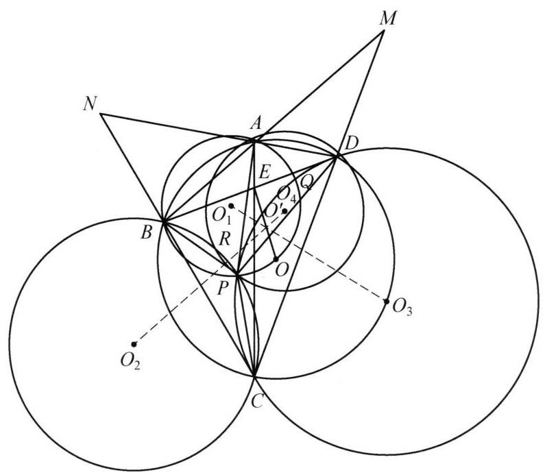

::: {.problem-meta-bar}
第 6 讲 圆幂与根轴
竞赛难度
圆幂与根轴 根轴
:::

## 题目

已知四边形 ${ABCD}$ 内接于圆 $O$ ,对角线 ${AC},{BD}$ 交于点 $E.P$ 为四边形 ${ABCD}$ 内一点. ${O}_1,{O}_2,{O}_3,{O}_4$ 分别为 $\triangle {ABP},\triangle {BCP},\triangle {CDP},\triangle {DAP}$ 的外接圆圆心. 证明: 直线 ${O}_1{O}_3,{O}_2{O}_4,{OE}$ 共点.

图 6-8

## 参考解答

::: {.callout-important title="标准解答" collapse="false"}
如图 6-8,设 ${DA}$ 与 ${CB}$ 的延长线交于点 $N,{BA}$ 与 ${CD}$ 的延长线交于点 $M,{O}_1{O}_3$ 与 ${O}_2{O}_4$ 交于点 ${O}^{\prime }$ ,圆 ${O}_1$ 与圆 ${O}_3$ 交于异于点 $P$ 的一点 $Q$ ,圆 ${O}_2$ 与圆 ${O}_4$ 交于异于点 $P$ 的一点 $R$ ，则 ${O}_1{O}_3$ 垂直平分 ${PQ}$ ， ${O}_2{O}_4$ 垂直平分 ${PR}$ ，故 ${O}^{\prime }$ 是 $\triangle {PQR}$ 的外心.

因为 ${NB} \cdot  {NC} = {NA} \cdot  {ND}$ ,所以点 $N$ 在圆 ${O}_2$ 与圆 ${O}_4$ 的根轴上，则 $N, R, P$ 三点共线. 同理有 $M, Q, P$ 三点共线. 于是 ${NR} \cdot  {NP} = {NB} \cdot  {NC},{MQ} \cdot  {MP} = {MA}$ . ${MB}$ ,所以, $M, N$ 均在圆 $O$ 与圆 ${O}^{\prime }$ 的根轴上,从而直线 ${MN}$ 为圆 $O$ 与圆 ${O}^{\prime }$ 的根轴, 又因为 ${MN} \perp  {OE}$ ,所以 $O,{O}^{\prime }, E$ 共线,即直线 ${O}_1{O}_3,{O}_2{O}_4,{OE}$ 共点.

注: 由 ${MN}$ 为 $E$ 关于圆 $O$ 的极线知 ${OE} \perp  {MN}$ ,因而只需证明 $O{O}^{\prime } \perp  {MN}$ 即可, 这利用根轴实现.
:::

## 解题思路与分析

::: {.callout-note title="思路还原与分析" collapse="false"}
这份证明之所以让人觉得“费解”，是因为教材采用的是**“由因导果”的正向书写方式**——一上来就凭空扔出 $M, N, Q, R$ 四个辅助点，像变魔术一样把结论拼了出来。

实际上，命题人和解题者在草稿纸上是**“执果索因”（逆向倒推）**想出这个证法的。只要拆解出背后隐藏的**三个平面几何经典套路**，你就会发现每一个辅助点的引入都是顺理成章、甚至是被“逼”出来的。

---

### 逆向破题四步曲：这个证明是怎么一步步想出来的？

#### 第一步：改造目标——为什么要引入点 $M, N$？
题目要求证明 $O_1O_3, O_2O_4, OE$ 三线共点。
常规思路是先设前两条直线的交点为 $O'$（即 $O' = O_1O_3 \cap O_2O_4$），然后去证 **$O, E, O'$ 三点共线**。

但难点在于：点 $E$ 是对角线交点，而 $O_1, O_2, O_3, O_4$ 都与内部动点 $P$ 有关，直接算角度或比例来证 $O, E, O'$ 共线几乎无从下手。
这时就要用到圆内接四边形的一个**条件反射级套路——极点极线（布洛卡定理 Brocard's Theorem）**：
> 在圆 $O$ 的内接四边形 $ABCD$ 中，只要出现“圆心 $O$”与“对角线交点 $E$”的连线 $OE$，立刻延长两组对边交于 $M, N$。此时直线 $MN$ 就是点 $E$ 关于圆 $O$ 的极线，必然有 **$OE \perp MN$**。

这样一来，难以捉摸的“直线 $OE$”就被转化为了一个极其明确的几何方向——**过点 $O$ 且垂直于 $MN$ 的直线**。
于是，证明“$O, E, O'$ 三点共线”，就完全等价于证明 **“$OO' \perp MN$”**（这正是题目最后一行“注”所透露的真实思考起点）。

---

#### 第二步：寻找桥梁——如何证明 $OO' \perp MN$？
现在目标变成了证 $OO' \perp MN$。
注意：**点 $O$ 是一个圆的圆心**。在平面几何中，要证明“经过圆心的某条直线 $OO'$ 垂直于另一条直线 $MN$”，最强大的武器是什么？
答案是：**把 $O'$ 也看作某个圆的圆心，然后证明 $MN$ 是圆 $O$ 与圆 $O'$ 的根轴（等幂轴）！**（因为两圆连心线必然垂直于它们的根轴）。

这就引出了下一个核心问题：**点 $O'$ 能作为哪个圆的圆心？**

---

#### 第三步：赋予 $O'$“圆心”的身份——为什么要引入点 $Q, R$？
回到 $O'$ 的定义：$O'$ 是 $O_1O_3$ 与 $O_2O_4$ 的交点。
观察 $O_1O_3$ 是什么线？它是 $\odot O_1$（即 $\odot ABP$）与 $\odot O_3$（即 $\odot CDP$）的**连心线**。
这两个圆已经有一个现成的公共点 $P$ 了！这里触发第二个经典套路——**相交两圆的连心线性质**：
> 两圆相交，连心线垂直平分公共弦。

既然两圆已经交于点 $P$，如果不画出它们的**第二个交点 $Q$**，连心线 $O_1O_3$ 的几何性质就无法转化为线段关系。一旦设出第二个交点 $Q$：
1. $O_1O_3$ 就是公共弦 $PQ$ 的垂直平分线；
2. 同理，设 $\odot O_2$ 与 $\odot O_4$ 的第二个交点为 $R$，则 $O_2O_4$ 就是公共弦 $PR$ 的垂直平分线。

此时再看交点 $O'$：
* $O'$ 在 $PQ$ 的中垂线上 $\implies O'P = O'Q$；
* $O'$ 在 $PR$ 的中垂线上 $\implies O'P = O'R$。

所以 $O'P = O'Q = O'R$，**点 $O'$ 天然就是 $\triangle PQR$ 的外接圆圆心！**
第二步里我们苦苦寻找的“以 $O'$ 为圆心的圆”，就这样严丝合缝地浮出水面了——它就是 $\odot(PQR)$。

---

#### 第四步：打通逻辑闭环——为什么 $MN$ 恰好是圆 $O$ 与圆 $O'$ 的根轴？
现在只差最后一步：证明点 $M$ 和点 $N$ 对圆 $O$（即 $\odot ABCD$）和圆 $O'$（即 $\odot PQR$）的幂相等。

以点 $M$ 为例，它在圆 $O$ 的两条割线 $MAB$ 和 $MDC$ 上，因此点 $M$ 对圆 $O$ 的幂为：
$$\text{Pow}(M, \odot O) = MA \cdot MB = MC \cdot MD$$

怎么把这个乘积跟圆 $O'$（$\odot PQR$）扯上关系呢？这里用到了第三个经典套路——**三圆根心定理（Radical Center）**：
观察三个圆：**$\odot O$（过 $A,B,C,D$）**、**$\odot O_1$（过 $A,B,P,Q$）**、**$\odot O_3$（过 $C,D,P,Q$）**：
* $\odot O$ 与 $\odot O_1$ 的根轴是公共弦 $AB$；
* $\odot O$ 与 $\odot O_3$ 的根轴是公共弦 $CD$；
* $\odot O_1$ 与 $\odot O_3$ 的根轴是公共弦 $PQ$。

根据根心定理，三个圆两两的根轴必然三线共点！既然 $AB$ 与 $CD$ 交于点 $M$，那么第三条根轴 **$PQ$ 也必然经过点 $M$**（即 $M, Q, P$ 三点共线）。

既然 $M, Q, P$ 共线，且 $A, B, P, Q$ 四点共圆（都在 $\odot O_1$ 上），由割线定理立刻得到：
$$MA \cdot MB = MQ \cdot MP$$
你看这个等式的两边：
* 左边 $MA \cdot MB$ 是点 $M$ 对 **$\odot O$（过 $A,B,C,D$）** 的幂；
* 右边 $MQ \cdot MP$ 恰好是点 $M$ 对 **$\odot O'$（过 $P,Q,R$）** 的幂！

这说明点 $M$ 对 $\odot O$ 和 $\odot O'$ 的幂相等，即点 $M$ 在两圆的根轴上。完全同理，利用 $\odot O, \odot O_2, \odot O_4$ 的根心为 $N$，可知 $N, R, P$ 共线，从而点 $N$ 也在 $\odot O$ 和 $\odot O'$ 的根轴上。

---

### 思维对比：为什么看书觉得难，自己推却很顺？

把**解题者的思考方向**和**书本的书写方向**放在一起对比，就能彻底看清全貌：

| 思考阶段 | 解题者的真实逆向思考（执果索因） | 书本上的正向呈现（由因导果） |
| :--- | :--- | :--- |
| **1. 核心转化** | 要证 $O_1O_3, O_2O_4, OE$ 共点 $\implies$ 设交点为 $O'$，证 $O,E,O'$ 共线 $\implies$ 借极线性质 $OE \perp MN$，转化为证 **$OO' \perp MN$**。 | 直接设出 $M, N, O', Q, R$ 一大堆点，不解释为什么设它们。 |
| **2. 锁定工具** | 要证圆心连线 $OO' \perp MN$ $\implies$ 只需证 **$MN$ 是 $\odot O$ 与 $\odot O'$ 的根轴**。 | 证明 $O'$ 是 $\triangle PQR$ 的外心。 |
| **3. 寻找圆 $O'$** | $O'$ 是两对共点圆连心线的交点 $\implies$ 连心线垂直平分公共弦 $PQ, PR$ $\implies$ **$\odot O'$ 就是 $\odot(PQR)$**。 | 用割线定理证 $N,R,P$ 共线及 $M,Q,P$ 共线。 |
| **4. 验证等幂** | 利用三圆根心证 $M,P,Q$ 共线、$N,P,R$ 共线 $\implies$ $MA \cdot MB = MQ \cdot MP$，得证等幂！ | 得出 $MN$ 是根轴，结合 $MN \perp OE$ 突然宣布证毕。 |

书本为了追求排版的简洁，把“从结论倒推辅助线”的脚手架全部拆掉了。今后遇到涉及**“圆内接四边形对角线交点 $E$ 与外心 $O$”**的题目，不妨先在草稿纸上画出对边交点 $M, N$，利用 $OE \perp MN$ 把共线问题转化为垂直（根轴）问题。对于中间“三圆根心”或“布洛卡定理（$OE \perp MN$）”这两个背景定理，需要我为你展开推导一下吗？
:::

## 分步证明

::: {.callout-tip title="分步推理与几何步骤" collapse="false"}
### 步骤 0：已知条件与图形结构

已知凸四边形 ABCD 内接于圆 O，对角线 AC, BD 交于点 E。
点 P 为四边形内部一点。O₁, O₂, O₃, O₄ 分别为 △ABP, △BCP, △CDP, △DAP 的外接圆圆心。
求证：直线 O₁O₃、O₂O₄、OE 三线共点。

### 步骤 1：构造对边交点 M, N 与圆心交点 O'

延长 DA 与 CB 交于点 N；延长 BA 与 CD 交于点 M。
连结对边三角形外接圆的圆心连线 O₁O₃ 与 O₂O₄，设它们相交于点 O'。

### 步骤 2：公共弦垂直平分性与 △PQR 外心

圆 O₁ 与圆 O₃ 均过点 P，设另一交点为 Q；圆 O₂ 与圆 O₄ 均过点 P，设另一交点为 R。
由连心线垂直平分公共弦定理：
O₁O₃ ⊥ PQ 且平分 PQ ⟹ O'P = O'Q；
O₂O₄ ⊥ PR 且平分 PR ⟹ O'P = O'R。
因此 O'P = O'Q = O'R，即 O' 是 △PQR 的外接圆圆心！

### 步骤 3：圆幂定理与根轴共线 N-R-P

因为四边形 ABCD 内接于圆 O，由割线定理有：
NB · NC = NA · ND。
注意到 NB · NC 即点 N 对圆 O₂ (⊙BCP) 的幂，NA · ND 即点 N 对圆 O₄ (⊙DAP) 的幂。
两幂相等，说明点 N 在两圆的根轴（即公共弦所在直线 PR）上，故 N, R, P 三点共线！
同时得到割线圆幂：NR · NP = NB · NC。

### 步骤 4：同理推出 M-Q-P 三点共线

同理，点 M 为割线 MAB 与 MDC 的交点，由圆幂定理有：
MA · MB = MC · MD。
因此点 M 对圆 O₁ (⊙ABP) 与圆 O₃ (⊙CDP) 的幂相等，点 M 必在两圆根轴（公共弦直线 PQ）上，故 M, Q, P 三点共线！
同样得到割线圆幂：MQ · MP = MA · MB。

### 步骤 5：直线 MN 为两圆根轴 ⟹ OO' ⊥ MN

综合前两步结论，由于 P, Q, R 均在圆 O' 上：
点 N 对圆 O' 的幂为 NR · NP = NB · NC（即点 N 对圆 O 的幂）；
点 M 对圆 O' 的幂为 MQ · MP = MA · MB（即点 M 对圆 O 的幂）。
这表明点 M, N 均在圆 O 与圆 O' 的根轴上，因此直线 MN 为圆 O 与圆 O' 的根轴！
由“两圆根轴垂直于连心线”定理，必有：
OO' ⊥ MN

### 步骤 6：极线性质得出三线共点于 O'

在圆内接四边形 ABCD 中，E 为对角线交点，M, N 为对边交点。
由极点极线性质可知，直线 MN 是点 E 关于圆 O 的极线，因而必有：
OE ⊥ MN
由第 5 步已证 OO' ⊥ MN，由于过圆心 O 垂直于直线 MN 的垂线是唯一的，因此：
O, O', E 三点共线
因为 O' 本身是直线 O₁O₃ 与 O₂O₄ 的交点，现又有点 E 位于直线 OO' 上，
故直线 O₁O₃、O₂O₄、OE 汇交于同一点 O'。证毕！✦
:::

## 动态演示

::: {.demo-link-container}
[在新窗口打开交互式分步演示](../demos/07.html){.demo-link target="_blank" rel="noopener"}
:::

  <iframe src="../demos/07.html" title="例 7：共轴圆系三线共点证明 分步演示" loading="lazy"></iframe>

