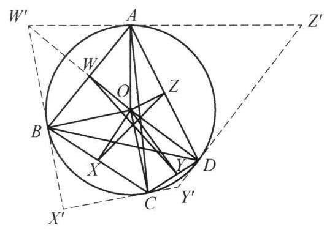

::: {.problem-meta-bar}
第 7 讲 反演与位似
竞赛难度
反演与位似 中点 反演
:::

## 题目

设四边形 ${ABCD}$ 内接于圆 $O, W, X, Y, Z$ 分别为 ${AB},{BC},{CD},{DA}$ 的中点. 证明: $\triangle {AOC},\triangle {BOD},\triangle {WOY},\triangle {XOZ}$ 的外接圆除了点 $O$ 之外还有一个公共点.

图 7-3

## 参考解答

::: {.callout-important title="标准解答" collapse="false"}
如图 7-3,以 $O$ 为反演中心,圆 $O$ 的半径为反演半径作反演变换. 在此变换下,点 $W, X, Y, Z$ 的反演像分别为 ${W}^{\prime },{X}^{\prime },{Y}^{\prime },{Z}^{\prime }$ . 注意到 ${W}^{\prime }$ 在射线 ${OW}$ 上且 ${OW} \cdot  O{W}^{\prime } = O{A}^2$ . 因为 $W$ 是 ${AB}$ 的中点,所以 $\angle {OWA} = {90}^{ \circ  }$ ,结合 ${OW} \cdot  O{W}^{\prime } = \; O{A}^2$ 知 $\angle {W}^{\prime }{AO} = {90}^{ \circ  }$ ,即 ${W}^{\prime }A$ 与圆 $O$ 相切.

同理可得 ${X}^{\prime }B,{Y}^{\prime }C,{Z}^{\prime }D$ 均与圆 $O$ 相切,于是四边形 ${W}^{\prime }{X}^{\prime }{Y}^{\prime }{Z}^{\prime }$ 为圆 $O$ 的外切四边形,切点分别为 $B, C, D, A$ . 由牛顿定理,得 ${AC},{BD},{W}^{\prime }{Y}^{\prime },{X}^{\prime }{Z}^{\prime }$ 共点于 ${M}^{\prime }$ ,于是圆 ${AOC}$ ,圆 ${BOD}$ ,圆 ${WOY}$ ,圆 ${XOZ}$ 也交于 ${M}^{\prime }$ 的反演点 $M$ .
:::

## 解题思路与分析

::: {.callout-note title="思路还原与分析" collapse="false"}
教材和题解书在写证明时，习惯采用**“从因到果”的综合法（正向书写）**：一上来先抛出“作反演变换”，就像变魔术一样凭空拉出四条切线，最后再用一个“牛顿定理”一锤定音。这种写法掩盖了思考的痕迹，自然会让人觉得莫名其妙。

如果把思维过程倒过来，用**“从果索因”的分析法（逆向破题）**以及**命题人构造题目的视角**来看，这个证明其实是由三个非常自然的“条件反射”串联起来的：

---

### 第一步：看到“多圆过同一点 $O$”，条件反射想到“以 $O$ 为中心反演”

我们先看结论：要证 $\odot AOC, \odot BOD, \odot WOY, \odot XOZ$ 四个圆除点 $O$ 外还共点于 $M$。

在平面几何中，证明“多个圆共点”通常很难直接下手，但有一个极其强烈的结构信号——**这四个圆全都经过同一个已知点 $O$**！
* **反演的基本性质**：以点 $O$ 为反演中心作反演变换，任何**过点 $O$ 的圆**，都会被直接拉直，变成一条**不过点 $O$ 的直线**。
* 因此，“四个过点 $O$ 的圆交于另一点 $M$”在反演下**完全等价于**“四条直线交于一点 $M'$”。把“多圆共点”转化为“多线共点”，是几何中的标准降维操作。

**紧接着的灵魂一问：反演半径选多少最划算？**
既然点 $A, B, C, D$ 都在已知的圆 $O$ 上，如果我们直接把**圆 $O$ 的半径 $R$ 选作反演半径**（即以圆 $O$ 为反演基圆），那么圆 $O$ 上的所有点在反演下都是**不动点**（$A'=A, B'=B, C'=C, D'=D$）！
这样一来，前两个圆的像甚至都不用算：
* $\odot AOC$ 反演后直接变成直线 $AC$；
* $\odot BOD$ 反演后直接变成直线 $BD$。

此时，那个神秘的公共交点 $M'$ 已经暴露了——它**必然就是对角线 $AC$ 与 $BD$ 的交点**！剩下的任务仅仅是证明：$\odot WOY$ 和 $\odot XOZ$ 反演后的两条直线 $W'Y'$ 和 $X'Z'$，也经过 $AC$ 与 $BD$ 的交点 $M'$。

---

### 第二步：翻译条件——“弦的中点”在反演下的真实身份是“极点”

确定了以圆 $O$ 为基圆作反演后，我们需要看看已知条件中的“弦中点 $W, X, Y, Z$”会变成什么。

这里藏着圆几何中一对最经典的对偶转换（**极点与极线**）：
* 已知 $W$ 是弦 $AB$ 的中点，由垂径定理知 $OW \perp AB$。
* 设 $W$ 的反演点为 $W'$，则 $W'$ 在射线 $OW$ 上，且满足 $OW \cdot OW' = R^2 = OA^2$。
* 在 $\triangle OAW'$ 中，$OA$ 是斜边 $OW'$ 上的比例中项（射影定理的逆定理），这直接迫使 $\angle OAW' = 90^\circ$，同理 $\angle OBW' = 90^\circ$。

也就是说，**“弦 $AB$ 的中点 $W$”关于圆 $O$ 的反演点 $W'$，天然就是“过 $A, B$ 两点的切线交点”（即弦 $AB$ 关于圆 $O$ 的极点）**！
这绝不是凑出来的巧合，而是圆的极点与极线的基本定义：极点 $W'$ 到圆心的距离与极线 $AB$ 到圆心的距离之积等于半径的平方。

---

### 第三步：为什么四线共点？（不背“牛顿定理”也能一眼看穿）

经过前两步的机械翻译，原题已经完全等价于这样一个命题：
> 设圆 $O$ 的内接四边形为 $ABCD$，过 $A, B, C, D$ 作圆 $O$ 的切线围成外切四边形 $W'X'Y'Z'$，证明：$AC, BD, W'Y', X'Z'$ 四线共点。

书上的证明直接引用了外切四边形的“牛顿定理”（布里安松定理的退化情形）。但如果你从**射影几何（配极原则）**的角度看，这个结论其实是完全透明的，根本不需要死记定理：

1. 设内接完全四边形 $ABCD$ 的对角线交点为 $M' = AC \cap BD$，两组对边延长线的交点分别为 $E = AB \cap CD$ 和 $F = AD \cap BC$。
2. 由圆内接完全四边形的调和性质（自配极三角形定理），对角线交点 $M'$ 关于圆 $O$ 的**极线**恰好是直线 $EF$。
3. 另一方面，$W'$ 是弦 $AB$ 的极点，$Y'$ 是弦 $CD$ 的极点，因此直线 $W'Y'$ 的**极点**就是 $AB$ 与 $CD$ 的交点 $E$。
4. 根据**配极原则（La Hire 定理）**：因为点 $E$ 在点 $M'$ 的极线（即直线 $EF$）上，所以点 $E$ 的极线（即直线 $W'Y'$）必然经过点 $M'$！
5. 同理，直线 $X'Z'$ 的极点是 $F$，由于 $F$ 也在直线 $EF$ 上，所以 $X'Z'$ 也必然经过点 $M'$。

---

### 还原命题人的“障眼法”

如果站在**命题人如何编造这道题**的视角，一切就更加真相大白了：

1. **原始素材**：命题人手头有一个极其经典、众人皆知的射影几何模型——圆内接四边形 $ABCD$ 与切线构成的外切四边形 $W'X'Y'Z'$ 中，四条直线 $AC, BD, W'Y', X'Z'$ 共点于 $M'$。
2. **施加伪装**：如果直接考这个结论，懂极点极线或牛顿定理的学生一秒钟就能做出来。于是命题人以圆心 $O$ 为中心作了一次反演变换：
* 擦掉所有的切线和交点 $W', X', Y', Z'$，把它们变成圆内部的**弦中点** $W, X, Y, Z$；
* 把原本共点的四条直线 $AC, BD, W'Y', X'Z'$，变成四个过圆心 $O$ 的**外接圆** $\odot AOC, \odot BOD, \odot WOY, \odot XOZ$。
3. **呈现题目**：最终呈现在你面前的，就是这道表面上看不到任何切线、只有弦中点和四个圆的“例 3”。而书上的解答，不过是把命题人藏起来的“反演拉链”重新拉开了而已。
:::

## 分步证明

::: {.callout-tip title="分步推理与几何步骤" collapse="false"}
### 步骤 0：已知条件与构型

设凸四边形 ABCD 内接于圆 O。
取各边中点分别记为 W (AB 中点)、X (BC 中点)、Y (CD 中点)、Z (DA 中点)。
目标是证明：△AOC、△BOD、△WOY、△XOZ 的四个外接圆除了点 O 之外，还有一个公共点 M。

### 步骤 1：以 O 为中心建立反演变换

以圆心 O 为反演中心、圆 O 的半径 R 为反演半径作反演变换。
对于任意点 P (P ≠ O)，其反演点 P' 位于射线 OP 上，满足：
OP · OP' = R2
在此变换下，四边形顶点 A, B, C, D 均在反演圆上，故其反演像为自身（A'=A, B'=B, C'=C, D'=D）；
中点 W, X, Y, Z 的反演像分别记为 W', X', Y', Z'。

### 步骤 2：证明 W'X'Y'Z' 为圆 O 的外切四边形

以弦 AB 及其反演点 W' 为例：
因为 W 是 AB 的中点，由垂径定理知 OW ⊥ AB，即 ∠OWA = 90°。
由反演定义，OW · OW' = R2 = OA2，得到 OW / OA = OA / OW'。
结合公共角 ∠AOW = ∠W'OA，可得 ΔOWA ∼ ΔOAW'。
因此 ∠W'AO = ∠OWA = 90°，即 W'A 与圆 O 相切于点 A！
同理，W'B, X'B, X'C, Y'C, Y'D, Z'D, Z'A 均与圆 O 相切。
于是四边形 W'X'Y'Z' 为圆 O 的外切四边形，切点顺次为 B, C, D, A。

### 步骤 3：牛顿定理：四线共点于 M'

在圆外切四边形 W'X'Y'Z' 中：
• 两组对边切点的连线分别为弦 AC 与弦 BD；
• 两条对角线分别为 W'Y' 与 X'Z'。
根据牛顿定理（Newton's Theorem）：圆外切四边形的两条对角线与两对边切点连线这四条线共点！
因此，直线 AC, BD, W'Y', X'Z' 严格共点于 M'。

### 步骤 4：直线反演为圆与反演像点 M

由反演几何基本定理：不过反演中心 O 的直线，其反演像为经过反演中心 O 的圆。
考察 Step 3 中的四条直线：
1. 直线 AC 经过反演圆上点 A, C，其反演像为过 O, A, C 的圆，即 △AOC 的外接圆；
2. 直线 BD 的反演像为过 O, B, D 的圆，即 △BOD 的外接圆；
3. 直线 W'Y' 的反演像为过 O, W, Y 的圆，即 △WOY 的外接圆；
4. 直线 X'Z' 的反演像为过 O, X, Z 的圆，即 △XOZ 的外接圆。
四线交点 M' 在反演下的像点为 M（满足 OM · OM' = R2）。

### 步骤 5：四圆交于公共点 M，命题得证

因为点 M' 是四条直线 AC, BD, W'Y', X'Z' 的公共交点，
所以根据反演变换的点线对应性质，点 M 必定同时落在上述四条直线的反演像上！
即：
• M ∈ ⊙(AOC)
• M ∈ ⊙(BOD)
• M ∈ ⊙(WOY)
• M ∈ ⊙(XOZ)
又因 M' ≠ O，反演点 M 亦为一个异于 O 的唯一点。
从而 △AOC, △BOD, △WOY, △XOZ 的外接圆除了点 O 之外，还有一个公共点 M！命题得证。
:::

## 动态演示

::: {.demo-link-container}
[在新窗口打开交互式分步演示](../demos/04.html){.demo-link target="_blank" rel="noopener"}
:::

  <iframe src="../demos/04.html" title="例 4：四圆共点与位似变换相似 分步演示" loading="lazy"></iframe>

