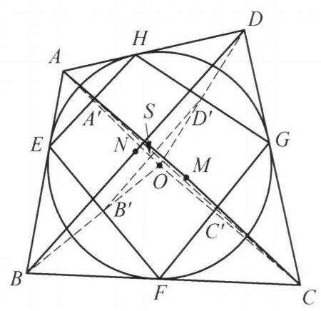

::: {.problem-meta-bar}
第 7 讲 反演与位似
竞赛难度
反演与位似 中点 相似
:::

## 题目

设凸四边形 ${ABCD}$ 外切于一个圆 $O$ ，且已知 ${OA} = 5,{OB} = 6,{OC} = 7$ ， ${OD} = 8$ . 记线段 ${AC}$ ， ${BD}$ 的中点分别为 $M$ ， $N$ . 求 $\frac{OM}{ON}$ 的值.

图 7-7

## 参考解答

::: {.callout-important title="标准解答" collapse="false"}
如图 7-7，设四边形 ${ABCD}$ 与圆 $O$ 的切点分别为 $E, F, G, H.$ 以 $O$ 为反演中心，圆 $O$ 为反演基圆作反演变换. 设 $A, B, C, D$ 的反演点分别为 ${A}^{\prime },{B}^{\prime },{C}^{\prime },{D}^{\prime }$ ,则 ${A}^{\prime },{B}^{\prime },{C}^{\prime },{D}^{\prime }$ 分别为 ${HE},{EF},{FG},{GH}$ 的中点,故

$$
{A}^{\prime }{B}^{\prime }\not{= }\frac{1}{2}{FH}\not{= }{C}^{\prime }{D}^{\prime },
$$

$$
{A}^{\prime }{D}^{\prime } \text{ ⫫ } \frac{1}{2}{EG} \text{ ⫫ } {B}^{\prime }{C}^{\prime }.
$$

所以 ${A}^{\prime }{C}^{\prime }$ 与 ${B}^{\prime }{D}^{\prime }$ 互相平分,设其交点为 $S$ .

设圆 $O$ 的半径为 $r$ ,由 $B,{B}^{\prime }$ 互为反演点,知

$$
{OB} \cdot  O{B}^{\prime } = {r}^{2}.
$$

同理可得 ${OD} \cdot  O{D}^{\prime } = {r}^2$ ,于是 ${OB} \cdot  O{B}^{\prime } = {OD} \cdot  O{D}^{\prime }$ ,即 $\frac{O{B}^{\prime }}{O{D}^{\prime }} = \frac{OD}{OB}$ . 所以 $\triangle {B}^{\prime }O{D}^{\prime } \backsim  \triangle {DOB}$ . 又因为 $S$ 为 ${B}^{\prime }{D}^{\prime }$ 的中点, $N$ 为 ${BD}$ 的中点,所以

$$
\frac{ON}{OS} = \frac{OB}{O{D}^{\prime }} = \frac{OB}{\frac{{r}^2}{OD}} = \frac{{OB} \cdot  {OD}}{{r}^2}.
$$

同理有 $\frac{OM}{OS} = \frac{{OA} \cdot  {OC}}{{r}^2}$ .

故

$$
\frac{OM}{ON} = \frac{{OA} \cdot  {OC}}{{OB} \cdot  {OD}} = \frac{35}{48}.
$$

注: 利用反演前后的相似比的表达式表示出 ${OM},{ON}$ 的长度,进而得到答案.
:::

## 解题思路与分析

::: {.callout-note title="思路还原与分析" collapse="false"}
这个证明之所以让人觉得“费解”甚至有些“像变魔术”，是因为教材采用的是**从结果倒推回去的“综合法”书写顺序**——它一上来就抛出反演变换，直到最后一步才揭晓底牌。如果按照解题者真实的**逆向探索过程（分析法）**来拆解，它的诞生其实依托于三个非常经典的几何思维模块：

---

### 一、 破题痛点：条件与结论是“割裂”的

我们先看题目已知什么、求什么：
1. **已知条件**：$OA, OB, OC, OD$ 的长度（顶点到圆心的距离），以及四边形 $ABCD$ 外切于圆 $O$。注意：**题目甚至没有给出圆 $O$ 的半径 $r$**！这说明最终的比值 $\frac{OM}{ON}$ 与半径 $r$ 无关，一定在某个比例式中把 $r$ 约掉了。
2. **所求目标**：对角线 $AC$ 的中点 $M$ 与 $BD$ 的中点 $N$ 到圆心 $O$ 的距离之比 $\frac{OM}{ON}$。

**思维卡点在哪里？**
* 在 $\triangle OAC$ 中，$OM$ 是中线；在 $\triangle OBD$ 中，$ON$ 是中线。虽然已知两边 $OA, OC$ 和 $OB, OD$，但不知道夹角 $\angle AOC$ 和 $\angle BOD$（或者对角线 $AC, BD$ 的长），无法直接用中线长公式算出 $OM$ 和 $ON$。
* 更麻烦的是，在原图中，$M$ 和 $N$ 是**两个彼此孤立的点**。要想在算不出具体长度的情况下求出 $\frac{OM}{ON}$，必须找到一个**公共的“桥梁”（中介量）**，把 $OM$ 和 $ON$ 同时与这个桥梁挂钩。

---

### 二、 思维破局的三个核心步骤

#### 第一步：看到“圆外切多边形 + 到圆心的距离”，条件反射想到【极线与反演】
在圆的几何中，“外切四边形 $ABCD$”是一个很难直接利用的条件，因为顶点 $A, B, C, D$ 都在圆外且不共圆。但它的切点 $E, F, G, H$ 都在圆 $O$ 上，构成了一个**圆内接四边形 $EFGH$**。

如何把圆外的顶点 $A, B, C, D$ 转化为切点四边形 $EFGH$ 上的点？这是平面几何中最标准的**基本构型（母题）**：
* 从圆外一点 $A$ 向圆 $O$ 作两条切线 $AE, AH$，连结切点弦 $EH$，设 $OA$ 交 $EH$ 于 $A'$。
* 由垂径定理和射影定理，立刻有 $A'$ 是弦 $EH$ 的中点，且满足：
  $$OA \cdot OA' = OE^2 = r^2$$
* 这意味着：**以圆 $O$ 为基圆作反演变换，外切四边形的四个顶点 $A, B, C, D$ 的反演点 $A', B', C', D'$，恰好就是切点四边形 $EFGH$ 四条边的中点**！

同时，题目给出的条件恰恰是 $OA, OB, OC, OD$ 的长度，经过反演关系 $OA' = \frac{r^2}{OA}$ 后，所有的长度条件都能无损地转移到 $A', B', C', D'$ 上。

---

#### 第二步：神来之笔——用【瓦里尼翁定理】将“双中点”合二为一
把问题转化到 $A', B', C', D'$ 之后，奇迹发生了：
既然 $A', B', C', D'$ 分别是四边形 $EFGH$ 四条边 $HE, EF, FG, GH$ 的中点，根据初中几何著名的**瓦里尼翁定理（Varignon's Theorem，任意四边形四边中点顺次连结必构成平行四边形）**，利用三角形中位线定理：
$$A'B' \parallel \frac{1}{2}FH \parallel C'D', \quad A'D' \parallel \frac{1}{2}EG \parallel B'C'$$
且长度相等，因此**四边形 $A'B'C'D'$ 必然是一个平行四边形**！

平行四边形最大的性质是什么？**对角线互相平分**！
* 在原四边形 $ABCD$ 中，对角线 $AC$ 的中点 $M$ 和 $BD$ 的中点 $N$ 是**分开的两个点**；
* 而在反演后的平行四边形 $A'B'C'D'$ 中，对角线 $A'C'$ 的中点与 $B'D'$ 的中点**重合为了同一个点 $S$**！

**这就是解题者梦寐以求的“公共桥梁”！** 只要能找出原对角线中点（$M$ 或 $N$）与反演后对角线中点 $S$ 之间的长度关系，就能用同一个 $OS$ 把 $OM$ 和 $ON$ 串联起来。

---

#### 第三步：利用【反演逆相似三角形】建立中线之比
现在的任务只剩最后一个：已知 $A, C$ 的反演点是 $A', C'$，且 $M$ 是 $AC$ 中点，$S$ 是 $A'C'$ 中点，如何求 $\frac{OM}{OS}$？

注意：**中点的反演点并不是反演点的中点**（即 $M$ 和 $S$ 互不为反演点）。但反演变换有一条最基础的保相似性质——**逆相似（反相似）**：
* 因为 $OA \cdot OA' = OC \cdot OC' = r^2$，所以 $\frac{OA'}{OC} = \frac{OC'}{OA}$。
* 加上公共角 $\angle A'OC' = \angle COA$，直接得到 **$\triangle A'OC' \sim \triangle COA$**（注意顶点对应顺序是反过来的）。

既然两个三角形相似，那么它们**对应边上的中线之比，就等于相似比**！
* $\triangle COA$ 中，$CA$ 边上的中线是 $OM$；
* $\triangle A'OC'$ 中，$A'C'$ 边上的中线是 $OS$；
* 因此，中线之比等于对应边之比：
  $$\frac{OM}{OS} = \frac{OA}{OC'} = \frac{OA}{\frac{r^2}{OC}} = \frac{OA \cdot OC}{r^2}$$
同理，在 $\triangle BOD$ 与 $\triangle D'OB'$ 中：
$$\frac{ON}{OS} = \frac{OB \cdot OD}{r^2}$$
两式相除，未知的中介长度 $OS$ 和未知的半径 $r^2$ 同时被完美约去，直接得出：
$$\frac{OM}{ON} = \frac{OA \cdot OC}{OB \cdot OD}$$

---

### 三、 降维视角：从“向量与复数”看穿这个证明的代数本质

如果你觉得上面的纯几何构造依然有些“巧合”，我们可以用**向量与复数**把它的底层代数逻辑彻底扒开。你会发现，书上的几何证明其实只是把下面两行极其自然的代数恒等式“翻译”成了几何语言：

1. **为什么会出现公共中点 $S$？（向量对称性）**
以圆心 $O$ 为原点。因为 $A'$ 是切点弦 $HE$ 的中点，所以向量 $\overrightarrow{OA'} = \frac{1}{2}(\overrightarrow{OH} + \overrightarrow{OE})$。同理 $\overrightarrow{OC'} = \frac{1}{2}(\overrightarrow{OF} + \overrightarrow{OG})$。
那么 $A'C'$ 的中点 $S$ 满足：
$$\overrightarrow{OS} = \frac{\overrightarrow{OA'} + \overrightarrow{OC'}}{2} = \frac{\overrightarrow{OE} + \overrightarrow{OF} + \overrightarrow{OG} + \overrightarrow{OH}}{4}$$
你看，右边关于四个切点 $E, F, G, H$ 是**完全对称**的！所以 $B'D'$ 的中点算出来也必然是 $\frac{1}{4}(\overrightarrow{OE} + \overrightarrow{OF} + \overrightarrow{OG} + \overrightarrow{OH})$。这就是瓦里尼翁平行四边形在代数组合上的本质。

2. **为什么 $\frac{OM}{OS} = \frac{OA \cdot OC}{r^2}$？（复数求倒数通分）**
在复平面上，以原点 $O$ 为中心、半径为 $r$ 的反演变换，对应的复数关系是 $z' = \frac{r^2}{\bar{z}}$（其中 $\bar{z}$ 为共轭复数）。
设点 $A, C, M, S$ 对应的复数分别为 $a, c, m, s$。因为 $M$ 是 $AC$ 中点，所以 $m = \frac{a+c}{2}$；因为 $S$ 是 $A'C'$ 中点，所以：
$$s = \frac{a' + c'}{2} = \frac{1}{2}\left(\frac{r^2}{\bar{a}} + \frac{r^2}{\bar{c}}\right) = \frac{r^2(\bar{a} + \bar{c})}{2\bar{a}\bar{c}} = \frac{r^2 \cdot \bar{m}}{\bar{a}\bar{c}}$$
对两边直接取模长（即到原点 $O$ 的距离），利用 $|\bar{m}| = |m| = OM$，瞬间得到：
$$OS = \frac{r^2 \cdot OM}{OA \cdot OC} \implies \frac{OM}{OS} = \frac{OA \cdot OC}{r^2}$$

你看，在复数运算里，**“利用逆相似三角形转换中线”本质上就只是一个简单的分式通分 $\frac{1}{a} + \frac{1}{c} = \frac{a+c}{ac}$**！命题人正是抓住了 $\frac{1}{a} + \frac{1}{c}$ 通分后分子恰好会出现 $a+c$（对应中点 $M$），而分母恰好是 $ac$（对应已知条件 $OA \cdot OC$），才将其包装成了这道经典的纯几何反演题。
:::

## 分步证明

::: {.callout-tip title="分步推理与几何步骤" collapse="false"}
### 步骤 0：已知构型与核心待求线段

设凸四边形 $ABCD$ 外切于圆 $O$，$OA=5, OB=6, OC=7, OD=8$。对角线 $AC, BD$ 的中点分别为 $M, N$。求 $\frac{OM}{ON}$ 的值。

### 步骤 1：① 建立以 $O$ 为中心、半径 $r$ 的反演变换

以 $O$ 为反演中心、圆 $O$ 为基圆（反演幂 $r^2$）作反演变换。各顶点反演像 $A', B', C', D'$ 落在射线 $OA, OB, OC, OD$ 上，满足 $OA \cdot OA' = OB \cdot OB' = OC \cdot OC' = OD \cdot OD' = r^2$。

### 步骤 2：② 证明 $A'B'C'D'$ 为切点中位线平行四边形

由切线直角射影性质，$A', B', C', D'$ 分别为切点弦的中点。由三角形中位线定理，$A'B' \parallel C'D'$ 且 $A'B' = C'D' = \frac{1}{2}HF$。因此 $A'B'C'D'$ 严格为一个平行四边形！其对角线互相平分于公共中点 $S$。

### 步骤 3：③ 相似三角形中线比：表达 $OM$

由反演性质知 $\triangle A'OC' \sim \triangle COA$（反向相似）。线段 $OS$ 与 $OM$ 分别是两相似三角形对应的中线，故对应中线比等于对应边长比：$\frac{OS}{OM} = \frac{OA'}{OC} = \frac{r^2}{OA \cdot OC}$，解得 $OM = \frac{OS \cdot OA \cdot OC}{r^2}$。

### 步骤 4：④ 相似三角形中线比：表达 $ON$

同理，在另一对对角线构成的三角形中，$\triangle B'OD' \sim \triangle DOB$。$OS$ 与 $ON$ 为对应中线，满足：$\frac{OS}{ON} = \frac{OB'}{OD} = \frac{r^2}{OB \cdot OD}$，解得 $ON = \frac{OS \cdot OB \cdot OD}{r^2}$。

### 步骤 5：⑤ 比值消元，得出最终精确值 $\frac{35}{48}$

将两式相除，公共未知量 $OS$ 与反演基圆幂 $r^2$ 完全对消：
$$\frac{OM}{ON} = \frac{\frac{OS \cdot OA \cdot OC}{r^2}}{\frac{OS \cdot OB \cdot OD}{r^2}} = \frac{OA \cdot OC}{OB \cdot OD} = \frac{5 \times 7}{6 \times 8} = \frac{35}{48}$$
最终得解：$\frac{OM}{ON} = \frac{35}{48}$！
:::

## 动态演示

::: {.demo-link-container}
[在新窗口打开交互式分步演示](../demos/08.html){.demo-link target="_blank" rel="noopener"}
:::

  <iframe src="../demos/08.html" title="例 8：外切四边形反演与调和四边形 分步演示" loading="lazy"></iframe>

